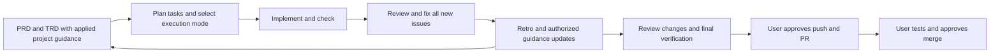

# Brief

Brief provides a file-based project CLI and shared lifecycle skills for Claude, Codex, and Gemini.
This checkout is the source for the workflow. Project-specific decisions and conventions stay in
project repositories; shared improvements reach linked installations from this source.

## Workflow



Use `/brief <phase>`. The [router](skills/brief/SKILL.md) owns ordering; the
[implement phase](skills/brief/implement/SKILL.md) defines story-scoped modes:

| Mode | Commit behavior | Human checkpoints |
|------|-----------------|-------------------|
| strict | Ask before every commit | Every commit and publication |
| selective | Verified routine commits proceed | Critical changes, human/browser verification, publication |
| auto | Finish authorized local story work | End-of-story publication gate |

All modes ask when ambiguity remains, preserve protected-action controls, and require explicit
publication approval. Recommend selective for critical/manual work and auto for clear code-only
work with adequate automated checks. The user chooses; resume preserves that choice.

[Review](skills/brief/pr-review/SKILL.md) fixes every confirmed introduced/worsened issue regardless
of severity. Existing debt is the user's fix/defer choice. [Retro](skills/brief/retro/SKILL.md)
finishes before publication by default; explicit urgency can defer with a durable follow-up. Later
changes require affected review/checks and new learnings; a clean user test needs no repeat retro.

[Planning context](skills/brief/references/planning-context.md) makes learned rules and decisions
explicit in PRD/TRD/tasks so implementation can follow settled choices. [Memory](skills/brief/memory/SKILL.md)
records user choices immediately at their stated scope. [Self-improving](agents/self-improving.md)
reconciles captures and applies authorized rule, skill, and agent improvements.

## Install the Shared Workflow

From this checkout, inspect the proposed registrations first:

```bash
./build.sh --dry-run
./build.sh
./check.sh
```

For an existing legacy installation, review conflicts and explicitly adopt only the named workflow
artifacts. Existing files/links are backed up; conflicting directories are never deleted:

```bash
./build.sh --dry-run --adopt-existing
./build.sh --adopt-existing
./check.sh
```

[Installer](scripts/install-workflow.py) manages:

- One brief skill link in each supported discovery directory (universal, Claude, Codex).
- The named brief, brief-lifecycle, git-workflow, and db-safety rules, plus the four shared agents.
- Generated Codex agent definitions and a delimited workflow block in each provider's instruction file.
- A source/target manifest and backups for replaced named artifacts.

Unrelated skills, user configuration, and custom project instructions are preserved. Whole provider
files are not regenerated from the examples in [providers](providers/). Managed files changed outside
this workflow are conflicts until explicitly adopted. `setup.sh` is an alias for this installation.

Links read this checkout live. Keep it at a stable location, validate edits before installing, and
reload/start a new agent session after changes. A source edit is not a remote Git push or a release.
Existing project links to this checkout continue working. Copied skills need explicit refresh;
custom project restrictions may need reconciliation and are never silently overwritten.

Backups are reported by the installer. To roll back, stop workflow edits, inspect its manifest and
backup paths, restore only the affected named artifacts, and re-run verification. Source task commits
can be reverted independently. No bulk migration of existing project repositories is performed.

## Set Up a Project

Install the CLI from this checkout using your normal npm global-link workflow, then in a project:

```bash
brief init
brief status
brief doctor
```

[Initialization](lib/init.mjs) creates project documentation and direct skill links and records their
actual source in its manifest. Existing installations have their own custom rules and harness
content; inspect their state before refreshing them. Global installation above does not run init
across projects.

## CLI Examples

```bash
brief query "handleSubmit"
brief query --full "handleSubmit"
brief search "database design"
brief story list
brief story tasks S-017
brief story task update S-017-T1 status=done
brief story update S-017 status=completed
brief memory list
brief memory show scoped-choice
brief memory create "Scoped choice" --memtype=feedback --body="Source, scope, rationale, application"
brief memory retire scoped-choice
brief help
```

Use the CLI for tracked mutations. Memory files live in documentation/memory, with a concise
MEMORY.md index; no provider-global project memory. Completed tasks use done, completed stories
use completed. See [CLI guidance](rules/brief.md) for additional commands.

## Source Map

| Source | Responsibility |
|--------|----------------|
| [skills/brief](skills/brief/SKILL.md) | Router, phases, and planning context |
| [agents](agents/) | Reviewer, QA, researcher, and self-improving definitions |
| [rules](rules/) | Shared policy; only named workflow rules installed by build |
| [templates](templates/) | Project harness/rule templates and shared provider adapter |
| [lib](lib/) | Project CLI implementation |
| [scripts](scripts/) | Installation, source validation, and agent generation |
| [test](test/) | Node test suite and isolated installer/reference fixtures |

## Verification

```bash
npm test
npm run check:skills
./check.sh
```

Tests cover CLI behavior and isolated installation safety. Active reference validation covers
maintained skills, agents, rules, templates, providers, README, and AGENTS; historical story prose is
not treated as executable policy. Metadata validation uses the existing YAML dependency and preserves
supported multi-provider fields. Static checks do not prove model behavior; independent scenario
results and limits are recorded with the [autonomous lifecycle work](documentation/stories/autonomous-lifecycle/PRD.md).

To test installation without touching the real host configuration, pass `--home-dir` with an empty
temporary directory to build/check. No environment variable override is required.
