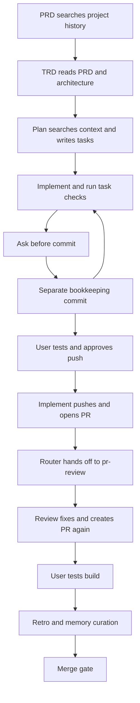
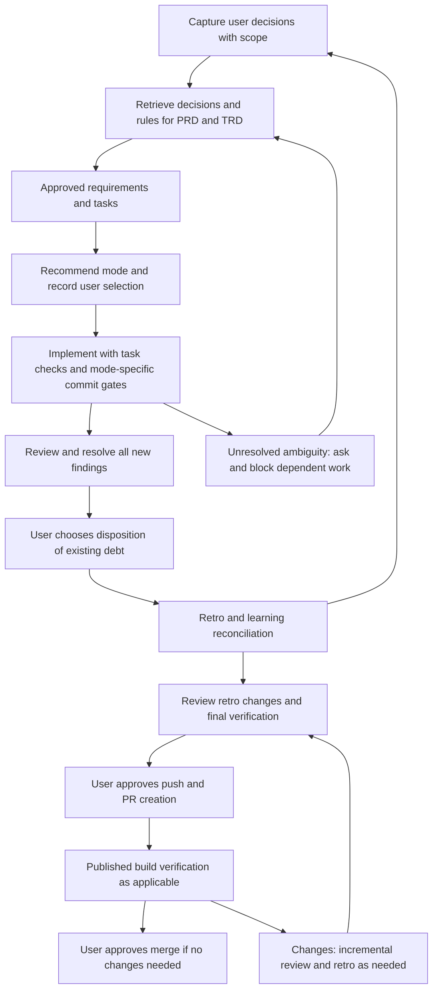

# Audit: Autonomous Execution, Review, and Learning

**Date**: 2026-10-10
**Status**: Complete — findings and proposed behavior; source policies not changed
**Source revision**: `5ea7a12` on `fix/harness-agents-md-help-flags`
**Working branch**: `feature/autonomous-lifecycle`, created from that revision
**Requirements**: [PRD](PRD.md) · **Acceptance scenarios**: [SCENARIOS](SCENARIOS.md)
**Timing refinement**: [Proposed retro policy](RETRO-POLICY.md), following the user's publication question

## Outcome

Preserve the existing retro-driven improvements to rules, skills, and agent instructions. Make
planning explicitly apply that knowledge so execution can follow settled decisions with fewer
interruptions. Approval, publication, and capture/recall inconsistencies still need correction;
adding execution modes only to implement would leave those gaps in place.

This is a source and workflow audit. It does not claim that a model obeys every instruction,
that provider hooks fire in live sessions, or that the complete CLI test suite was run.

## Confirmed User Requirements

- Offer strict, selective, and auto execution for each story; the user selects the mode.
- Recommend selective for migrations, critical changes, or human browser verification; recommend
  auto for clear code-only work with adequate automated verification and no such checkpoints.
- Ask for clarity whenever requirements or intended behavior remain ambiguous; no mode permits
  replacing missing user decisions with assumptions.
- Review and resolve issues before push or PR creation, then verify the resulting changes.
- Fix every confirmed issue introduced or worsened by the story, regardless of severity.
- Existing debt is the user's fix-now/defer choice, confirmed in this audit conversation.
- Capture explicit design, naming, and functional choices and use them in future planning,
  especially TRDs, as well as implementation and review.
- Preserve retro/curation updates to rules, skills, and agents; apply their guidance earlier in
  planning while implementation continues to check and follow applicable rules.
- Keep each choice's stated scope. Ask before broader promotion, confirmed in this conversation.

## Current Flow

The diagram shows the conflicting instructions when composed; it is not a claim that every
session follows this exact sequence.

## Findings

### A01 — High: Approval authority is duplicated and has no story mode

**Evidence:** [implement](../../../skills/brief/implement/SKILL.md), lines 18–23 and 178–186;
[router](../../../skills/brief/SKILL.md), lines 81–92;
[git-workflow](../../../rules/git-workflow.md), lines 7–13.

All three require approval for every commit and push. There is no selection, recommendation,
scope, persistence, resume, or mode-change procedure. An implement-only edit would conflict with
the router and standing rule.

**Required change:** Make the standing rule recognize an explicit, story-scoped selection;
implement owns operational mode behavior and the router owns transitions. Persist the selection,
reason for recommendation, open gates, and remaining verification. Reuse an existing selection
on resume; never silently extend it to another story or switch it because risk changed.

### A02 — High: Ambiguity has no complete resolution protocol

**Evidence:** [critical-thinking](../../../templates/rules/critical-thinking.md) says to ask when
requirements are ambiguous; [implement](../../../skills/brief/implement/SKILL.md), lines 164–186,
stops for wrong specs and failed checks. [Plan](../../../skills/brief/plan/SKILL.md), Phase 2,
requires questions even when prior answers may already settle them.

There is no shared procedure for determining whether context already answers a question,
recording unresolved choices, preventing dependent work, or resuming after clarification.
Ambiguity and routine failures would interrupt autonomy inconsistently.

**Required change:** Inspect authoritative context first. If an answer remains unclear, explain
the concrete choice and ask; block dependent actions in every mode. Record the answer and update
affected requirements, design, tasks, and tests before resuming. Independent work can continue.
Repair clear failures inside approved scope; never reinterpret a requirement to make a test pass.

### A03 — High: Review happens after push and PR ownership conflicts

**Evidence:** [implement](../../../skills/brief/implement/SKILL.md), lines 126–139, pushes and opens
the PR. [Router](../../../skills/brief/SKILL.md), lines 121–124, routes to review after push.
[pr-review](../../../skills/brief/pr-review/SKILL.md), lines 16–24 and 109–114, runs before creating
a PR, creates it, and asks about merge.

**Required change:** Complete local implementation, review and fixes, then final verification,
then request push/PR approval. Give the publishing step one owner. A push request alone must not
be interpreted as a merge approval. Run review automatically as part of authorized story work;
the current router's one-phase-per-invocation rule needs an explicit execution handoff.

### A04 — High: Review permits newly introduced debt to be deferred

**Evidence:** [pr-review](../../../skills/brief/pr-review/SKILL.md), lines 103–120, defers minor
findings; important findings must be fixed before PR creation, although the report wording is
inconsistent. [Reviewer](../../../agents/reviewer.md), Output Format, says important findings
should be fixed soon and minor findings noted for the future.

Neither format records whether a finding is introduced, worsened, or pre-existing. Review of a
full file can therefore trigger unrelated cleanup or allow new low-severity problems to ship.

**Required change:** Every confirmed finding needs evidence, severity, origin, disposition, and
verification. Fix all introduced/worsened issues before publication. Present pre-existing issues
together for user choice, with severity visible. Unknown origin requires investigation, not
automatic deferral. Taste-only suggestions without a requirement or rule violation are advisory.
Do not mark waived existing debt as fixed or call a review with unresolved blockers clean.

### A05 — High: Verification can become stale after review or retro changes

**Evidence:** [implement](../../../skills/brief/implement/SKILL.md), Gate 2, puts human testing
before push; [pr-review](../../../skills/brief/pr-review/SKILL.md), Phase 4, then changes code.
[Retro](../../../skills/brief/retro/SKILL.md), Phase 7, says no further steps remain before merge
after a curation commit, although retro may change skills, rules, and docs.

**Required change:** Review/fix cycles precede final story verification. Record the revision and
verification evidence being approved. Subsequent changes invalidate the affected evidence and
return to review/checks before another push or merge. Repeat affected human flows when behavior
changes; avoid repeating unrelated checks for a proven documentation-only change.

### A06 — Medium: Commit, completion, and resume bookkeeping is incomplete

**Evidence:** [implement](../../../skills/brief/implement/SKILL.md), lines 54–62, asks before the
task commit then directs a separate bookkeeping commit without another explicit gate. The
completion report equates N tasks with N commits despite extra bookkeeping. Branch handling is
hardcoded to main in implement and review. Legacy task formats are supported elsewhere but the
loop diagram only names individual task files.

**Required change:** Specify how every mode applies to task, bookkeeping, review-fix, and retro
commits. Strict means approval for each commit. Report actual counts. Preserve legacy formats;
distinguish implemented, committed, reviewed, verified, and published states. Resolve the actual
base branch. On resume, compare recorded state with Git and outstanding human answers.

### A07 — High: Self-improving curates existing records; it does not ensure capture

**Evidence:** [self-improving](../../../agents/self-improving.md), lines 21–33, labels the flow
auto-capture but starts by reading memories already linked from the index.
[Memory](../../../skills/brief/memory/SKILL.md), lines 156–162, requires lifecycle checkpoints.
[Decision](../../../skills/brief/decision/SKILL.md) makes recording an already-made decision
possible but still suggests asking whether to record it.

A choice made during an unfinished design conversation can disappear before any checkpoint.
An agent receiving only MEMORY.md cannot reconstruct missing conversation evidence.

**Required change:** The active agent captures explicit user choices at the moment of decision,
with source, rationale if given, scope, status, and application guidance. Hand those records to
curation. Checkpoints reconcile omissions. Do not invent reasons or alternatives to fill a
template; record unspecified information honestly. Recording an explicit choice needs no repeat
permission; proposing a wider rule does.

### A08 — High: TRD does not require retrieval or application of preferences and rules

**Evidence:** [TRD](../../../skills/brief/trd/SKILL.md), lines 37–49, requires PRD and architecture
research but no explicit memory/decision search or applicable-rules inventory. Its Design
Patterns section is generic. [PRD](../../../skills/brief/prd/SKILL.md), Phase 1, and
[plan](../../../skills/brief/plan/SKILL.md), Phase 1, have stronger history retrieval, but neither
requires a record of which preferences apply and how they affect the proposal.

**Required change:** Before design, retrieve relevant decisions, user choices, rules, skills, and
agent guidance. Show their source, scope, effect on this design, and unresolved questions; settle
known choices before execution and carry actionable constraints into tasks and review. Implementation
still checks current applicable rules. Explicitly read rules for anticipated code paths even while
editing a Markdown TRD; do not rely on a host loading them by path automatically.

### A09 — High: Learning can expand scope or erase a valid preference

**Evidence:** [self-improving](../../../agents/self-improving.md), lines 39–58, promotes to global
provider instructions and extracts skills into a provider-specific location. Lines 64–72 permit
pruning as stale when code changes. Existing user approval for rule edits is useful, but the
format lacks source, scope, supersession, and a record that the destination was verified.

Code that violates a preference is not evidence that the preference became invalid. A successful
feature-specific decision is not automatically a project-wide or cross-project preference.

**Required change:** Retain stated scope. Ask before broader promotion. Explicit user preferences
persist until superseded or withdrawn; preserve rationale and replacement links. Treat conflicts
as reconciliation work, not silent pruning. Remove duplicate active records only after the
authoritative destination and retrieval path are verified. Record decisions already made as
decided; observations remain observations until the user adopts them as policy.

### A10 — Medium: Curation inventory and write contracts disagree

**Evidence:** [self-improving](../../../agents/self-improving.md) reads index-linked memories,
while [memory](../../../skills/brief/memory/SKILL.md) calls the index minimal orientation. The
current index omits memories returned by `brief memory list`. [Init's memory harness](../../../lib/init.mjs)
requires CLI reads/updates; the memory skill requires direct file writes, and the curator has no
CLI tool. [Memory-review](../../../skills/brief/memory-review/SKILL.md) still names project-memory.

[CLI memory template](../../../lib/commands/item.mjs) uses `metadata.type` and defaults validity
to permanent; the memory skill shows top-level `type` and type-dependent validity. Provider
overrides and the checkpoint script name a different memory directory from the current CLI.

**Required change:** Define a single logical inventory and compatible read/write contract, with
an explicit fallback for agents without CLI access. Reconcile existing formats without deleting
or migrating historical memories blindly. Keep the active index short without making omitted
entries invisible to curation and retrieval. Resolve canonical names and destinations consistently.

### A11 — Medium: Provider behavior and claimed enforcement differ

**Evidence:** [Codex](../../../providers/codex.md) and [Gemini](../../../providers/gemini.md)
reduce self-improving to updating MEMORY.md after retro and QA to fixed npm commands. This repo
only configures npm test; [QA](../../../agents/qa.md) already specifies N/A for missing checks.
QA references quality-check, for which no repo-owned skill exists. The curator uses `globs`
frontmatter while current rule templates use `paths`.

**Required change:** Give each host the same capture, recall, review, and gate obligations, with
capability-specific execution. Verify rule format and loading for supported hosts. Unknown or
unavailable checks must not be reported as passing. Preserve the protocol even where a named
subagent is unavailable. No model-version upgrade is required to repair these contracts.

### A12 — High: Distribution and reference checks cannot validate the proposed upgrade

**Evidence:** `bash check.sh` exits 1 because it expects a root harness file that does not exist;
the current template is [templates/HARNESS.md](../../../templates/HARNESS.md).
[build.sh](../../../build.sh) uses the same absent source.
[Reference checker](../../../scripts/check-references.py) discovers custom-skills, excludes
skills and templates, and is absent from the npm test script.

Running the checker returned 146 diagnostics. This is not 146 confirmed live defects: it mixes
historical references, stale path interpretation, and real issues. It misses the current skill
tree and flags the valid memory skill as unknown.

**Required change:** Restore checks against the actual source layout and supported distribution
path. Validate current skills, templates, agents, and provider adapters; treat historical prose
separately. Add negative fixtures demonstrating a broken reference fails. Add behavioral scenario
evaluation: a string match in a skill is not evidence that a model follows the policy.

### A13 — High: Retro depends on the user keeping the PR open

**Evidence:** [Retro](../../../skills/brief/retro/SKILL.md) starts only after a PR exists and user
testing succeeds. Its required work can be skipped if the user merges immediately; no durable
deferral or post-merge recovery procedure is defined. **Proposed correction:** Complete retro
before publication by default. Explicit urgency can defer it with a tracked obligation. Later
changes receive incremental review and learning updates; a clean test requires no new commit.
See [retro policy](RETRO-POLICY.md) for the proposed controls and branch handling.

## Proposed Target Flow

Task checks continue during implementation; the final integrated verification follows review.
If a preview environment only exists after push, disclose that remaining verification before
publishing approval and finish it before merge. Never claim a pre-push verification that was
technically unavailable. Migration execution retains its separate explicit approval requirement
under [db-safety](../../../rules/db-safety.md), including in auto mode.

## Recommended Ownership and Scope

| Area | Primary owner | Consumers that must agree |
|------|---------------|---------------------------|
| Lifecycle order and handoffs | Brief router | Harness template, provider guidance |
| Execution modes and resume | Implement | Git rule, plan metadata, review/retro commits |
| Finding origin and closure | PR review | Reviewer, QA, bug workflow |
| Capture and recall contract | Memory | PRD, TRD, plan, implement, decision |
| Promotion, authorized guidance updates, and reconciliation | Self-improving | Memory-review, retro, rules/skills/agents, provider adapters |
| Integrity and distribution | Existing scripts | Active source files and generated/linked consumers |

Use the current file-based knowledge system. This proposal does not add a vector store, host
transcript crawler, or background service. Wider historical cleanup remains the user's choice.

## Validation and Limits

- Read the router, lifecycle skills, four agent definitions, relevant rules/templates, provider
  overrides, memory implementation, and distribution/reference scripts.
- Queried project history and memory through brief, including prior audits of memory and rule loading.
- Confirmed local agent skill directories link to the audited source directory.
- Ran the two read-only integrity checks described in A12; both failed before any audit edits.
- Did not run provider distribution, modify installed global configuration, or execute a DB command.
- A past memory reports the checkpoint hook did not fire in July. Current live hook behavior was
  not verified; that historical observation is not treated as a present runtime finding.
- Existing source commits precede this audit branch. Implementation must preserve their provenance
  and choose the eventual PR base deliberately, without folding unrelated changes into the upgrade.
