# PRD: Autonomous Execution with User Control and Reusable Decisions

**Author**: User requirements, drafted by Codex
**Date**: 2026-10-10
**Status**: 🔒 Approved — user authorized applying these skills across projects on 2026-10-10
**Discovery**: N/A — requirements supplied directly; [full audit](AUDIT.md) establishes current behavior

## Executive Summary

Preserve the existing retro/curation loop that improves rules, skills, and agent instructions, and make
PRD/TRD/task planning explicitly apply its output so implementation needs fewer questions. Add
user-selected execution modes, review before publication, resolution of all new issues, and reliable
capture of user choices within their stated scope.

## Problem

Brief users repeatedly approve routine commits, yet still encounter assumptions, late review fixes,
new debt deferred as minor, and forgotten design preferences. Current skills and agent instructions
disagree on approval, publication, memory capture, and recall, making autonomous execution unreliable.

## Users

| Segment | Pain | Current workaround |
|---------|------|--------------------|
| Developer directing story implementation | High | Review each commit and repeat prior decisions |
| Same developer resuming across sessions/providers | High | Re-explain preferences and reconcile conflicting instructions |

## Goals & Success Metrics

| Goal | Target | Measurement |
|------|--------|-------------|
| Preserve user authority | 0 unselected mode changes or unauthorized pushes | Scenario evaluation |
| Prevent assumption-driven work | 100% of unresolved-ambiguity scenarios block dependent work | Scenario evaluation |
| Prevent new debt reaching publication | 0 unresolved confirmed introduced/worsened findings | Review disposition records |
| Reuse explicit choices | 100% of relevant scoped-choice scenarios apply or surface a conflict | TRD/task/review evidence |
| Reduce routine interruptions | 0 per-commit approval requests in eligible auto stories | Scenario execution trace |
| Settle decisions during planning | 0 repeated implementation questions already settled by applicable rules or approved plans | Planning-to-execution scenarios |

## What We Are Building

### Requirements

| ID | Requirement | Priority |
|----|-------------|----------|
| R1 | Offer strict, selective, and auto before each story; record the user's choice and preserve it on resume. An explicit choice in the request counts; a recommendation does not. | Must |
| R2 | Recommend selective for migrations, critical behavior, or human browser checks; auto for clear, adequately testable code-only work. Explain the risk evidence; recommend strict when granular oversight or weak verification warrants it. | Must |
| R3 | In every mode, investigate ambiguity, then ask if unresolved; record the answer and update dependent artifacts before continuing. Never use elapsed time, confidence, or silence as the answer. | Must |
| R4 | Strict asks before every commit. Selective auto-commits routine work and pauses at critical/manual checkpoints. Auto completes authorized local story work and reports at the end. Define coverage of bookkeeping, review fixes, and retro commits. | Must |
| R5 | Run review and resolve findings before final integrated verification and before push/PR. Preserve task checks during development and require user approval before publication and merge. | Must |
| R6 | Fix every confirmed introduced/worsened issue regardless of severity; investigate unknown origin. Present existing debt together for the user's fix-now/defer decision with severity and evidence. | Must |
| R7 | Tie review and verification to the changes being approved. Later changes trigger relevant review/reverification, including after retro, before subsequent publication or merge. | Must |
| R8 | Capture explicit user design, naming, and functional choices immediately, with source, stated scope, rationale if supplied, and status. Do not invent missing rationale or treat observations as user policy. | Must |
| R9 | PRD/TRD/plan must explicitly apply relevant choices, decisions, rules, skills, and agent guidance, resolving known questions before execution. Tasks carry actionable constraints; implementation rechecks applicable rules and asks only about genuinely unresolved or changed conditions. Review verifies adherence. | Must |
| R10 | Preserve retro/curation's responsibility to propose and complete authorized improvements to rules, skills, and agent instructions. Reuse existing approval at its stated scope; ask before broader promotion. Reconcile captures, verify destinations, retain supersession history, and never invalidate a preference merely because code differs. | Must |
| R11 | Keep behavior consistent across supported providers, canonical memory formats/paths, and installed source consumers. Restore relevant integrity checks and evaluate behavioral scenarios. | Must |
| R12 | Preserve migration-execution approval and other explicitly scoped controls in every mode. Report unavailable verification honestly; no fabricated pass or completed status. | Must |
| R13 | Complete retro, memory reconciliation, and authorized rule/skill/agent improvements before publication by default, including review of their changes. Offer explicit urgent deferral with a durable follow-up; after publication, review changed content and capture only new learnings. A successful test without changes needs no repeat retro. | Must |

### User Flows

```mermaid
flowchart LR
    A[Apply learned guidance and user choices] --> B[Approve PRD and TRD]
    B --> C[Plan and select mode]
    C --> D[Implement and check tasks]
    D --> E[Review and fix new issues]
    E --> J[Retro, memory, and authorized guidance updates]
    J --> F[Review retro changes and final verification]
    F --> G[Approve push and PR]
    G --> H[User tests published build]
    H --> I[Approve merge when checks pass]
    J --> A
```

Ambiguity can pause dependent work at any point. A question already answered by authoritative context
does not need to be asked again. Routine fixes within the approved requirements may proceed.
The proposed [retro policy](RETRO-POLICY.md) defines urgent deferral, later changes, and post-merge
recovery. The user approved applying this PRD, including the timing refinement.

## What We Are NOT Building

- A new memory database, background learner, or transcript ingestion service; use existing repo artifacts.
- Automatic cross-project promotion or automatic approval to deploy, execute migrations, push, or merge.
- A model-version upgrade or broad historical cleanup unrelated to active workflow correctness.

## Triggers & Edge Cases

| Trigger | Expected behavior |
|---------|-------------------|
| Resume or mode change | Retain explicit story selection; reconcile actual state and outstanding gates |
| New risk in auto | Explain risk and recommend selective; no silent switch or bypass of a protected action |
| Review finds an old issue worsened by this story | Treat as introduced/worsened; fix before publication |
| User choice conflicts with an older rule | Respect the current explicit instruction within its scope; surface unresolved conflicts and reconcile records |
| Preview only available after push | Complete available local checks, disclose the gap at push approval, finish preview verification before merge |
| Checks fail or tools unavailable | Repair in-scope failures; report unresolved blockers; never label unavailable checks passed |
| User explicitly needs publication before retro | Keep review/fix and verification gates; record deferred retro with owner, reason, revision, and completion trigger before publishing |
| PR changes after review | Explain invalidated evidence, review the affected changes, rerun relevant checks, and add only new retro learnings before merge |
| Deferred retro remains after merge | Use a fresh branch from the current base and a linked follow-up PR; do not reuse the merged PR |

## Dependencies

Existing router, lifecycle skills, agent definitions, repo memory/decision files, project rules, provider
adapters, and integrity/distribution scripts. Detailed ownership and validation belong in the TRD.

## Risks

| Risk | Likelihood | Impact | Mitigation |
|------|------------|--------|------------|
| Modes conflict with standing rules | High | High | Update all active consumers and validate transitions |
| Learned choice expands beyond intent | Medium | High | Preserve scope and require promotion approval |
| Review becomes endless subjective cleanup | Medium | Medium | Evidence-based findings; separate unsupported suggestions |
| Passing checks hide instruction failures | High | High | Behavioral scenarios plus reference and distribution checks |

## Deployment & Rollout

Update and validate source policies before installing them. Existing stories retain recorded consent;
stories without a mode require selection. Validate provider loading and generated consumers before
claiming rollout complete. Roll back the affected policy revision if gates or retrieval regress.

## Performance Requirements

N/A — no runtime service change; minimize redundant prompts and unnecessary repeated context reads.

## Stakeholder Impact

One user workflow across supported providers; no additional team rollout assumed.

## Open Questions

User confirmed scoped promotion, ownership of existing-debt decisions, and applying this PRD.
Implementation choices and rollout constraints are recorded in [TRD](TRD.md).

## Timeline

PRD approval → technical design/review → approved task breakdown → implementation and scenario
evaluation → pre-push review/retro/final checks → publishing approval. Dates have not been committed.
