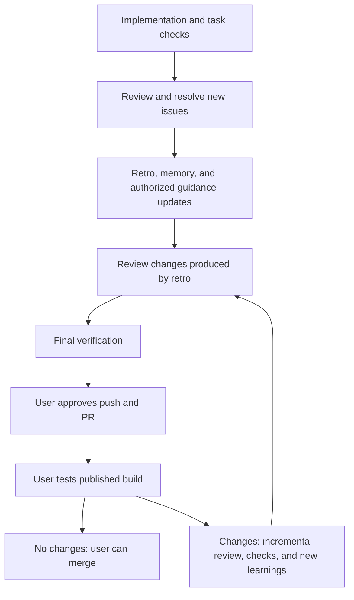

# Proposed Retro Timing and Publication Policy

**Status**: Approved with the PRD — implementation authorized on 2026-10-10
**Source**: User's question about immediate merge, urgent publication, and later PR changes
**Requirements**: [PRD](PRD.md) · **Current gaps**: [Audit](AUDIT.md)

## Recommended Default

Finish the implementation retrospective before publishing the PR. This captures design choices,
implementation surprises, review findings, and process learnings while the work is still active.
Retro and curation continue to propose and complete authorized improvements to rules, skills,
and agent instructions. These improvements and memory updates are part of the PR the user reviews.
Subsequent PRD/TRD/task planning explicitly applies that guidance to settle decisions early;
implementation continues checking and following the applicable rules.

The review after retro covers its changes and their impact; it is not automatically another full
review of unchanged code. Final verification must cover the resulting revision. Pending preview
or production observations remain explicitly pending; pre-publication retro cannot claim them.

Carry authorized improvements through to their destination and verify them; recording a suggestion
alone is not completion. Reuse prior approval within its scope and seek approval for broader
promotion. Explicitly deferred or unapproved optional improvements remain visible proposals;
confirmed defects introduced by the current changes must be fixed.

## Urgent Publication: Explicit User Choice

Offer two timing options when presenting the story's execution policy, with the first recommended:

| Timing | Before publication | After publication |
|--------|--------------------|-------------------|
| Complete retro first | Review/fixes, retro/curation, review retro changes, final checks | User tests and merges if no changes |
| Publish first for urgency | Review/fixes and final checks; durable retro deferral | Complete the deferred retro on the open PR or through a follow-up PR |

Timing is separate from strict/selective/auto. An execution mode does not imply permission to
defer learning, and an urgency choice does not waive review, issue resolution, or verification.
Reuse an explicitly supplied timing choice; do not ask again merely at the publication boundary.

Before deferred publication, record a discoverable follow-up linked to the story with:

- **Status:** retro deferred, not completed.
- **Reason and consent:** the user's explicit urgency choice.
- **Owner:** who will resume it; name the agent workflow if no person is assigned.
- **Scope:** the story and reviewed revision that the retrospective covers.
- **Completion trigger:** during PR review, a user-selected later point, or next story resumption.

Preserve already-captured user decisions immediately in either timing option. The PR summary must
expose pending retro so publication and learning completion cannot be confused. Deferral can allow
merge if the user explicitly chose it; it is a visible obligation, not an invisible merge blocker.
On the next relevant session, surface the obligation. Do not promise background execution when the
host does not provide a running process or a durable scheduler.

## Concurrent Work and Branch Handling

- **PR open:** prepare retro while the user tests the published revision. Read-only analysis may
  proceed concurrently. Isolate edits when separate workers run; do not let both mutate one checkout.
- **Adding retro to that PR:** verify it is still open, integrate only authorized changes, review
  and check them, then obtain the applicable commit/push approval. Report when the tested revision
  changes and whether the user needs to retest any flow.
- **PR merged:** retain unpublished work safely; create a fresh branch from the current base and
  open a linked follow-up PR through the normal review and approval gates. Do not add commits to
  the old PR or replay implementation commits that have already merged.
- **Merge occurs during retro preparation:** detect the state change before publication and use
  the follow-up path. Preparing a retro never authorizes direct commits to the base branch.

## Changes After Publication

Explain what changed since the last reviewed revision and run the required incremental review.
The suggestion to the user is whether broader human retesting is needed; automatic code review
and appropriate verification of changed content are required, not optional suggestions.

| Change | Review and verification | Retro treatment |
|--------|-------------------------|-----------------|
| No changes; user testing succeeds | Existing evidence remains valid; direct user merge is possible | No repeat retro or bookkeeping-only commit required |
| Notes or memory only | Review the diff, factual accuracy, scope, and references | Append new facts only when useful |
| Skills, rules, agent instructions, or configuration | Review behavioral impact and run relevant checks/scenarios | Record the new decision or learning |
| Code, schema, or user-visible behavior | Review changed code and affected integrations; rerun relevant checks and human flows | Record cause, resolution, and prevention for new findings |

Expand to a full story review when the change alters architecture, contracts, shared behavior, or
invalidates the assumptions of the earlier review. The incremental label must not hide wider impact.
Identify any affected approvals that need renewal. Unchanged successful checks need not be rerun
without a reason; new failures or unresolved concerns are reasons to broaden verification.

If a post-merge issue appears, link its correction and learning back to the story while handling
the fix through the normal bug/implementation workflow. Record newly observed outcomes honestly.
