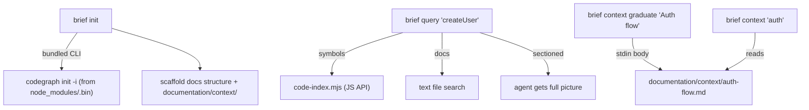
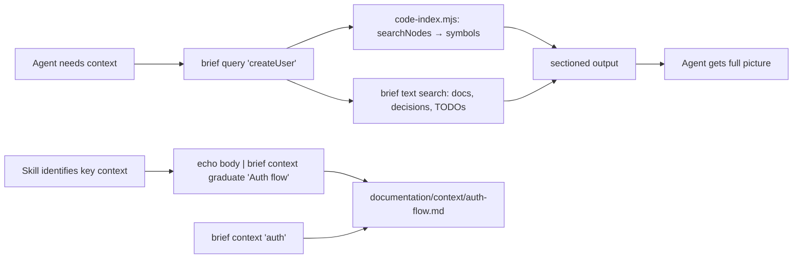

# PRD: Bundle Codegraph + Unified Context Command

**Author**: Deepak / Claude
**Date**: 2026-08-20
**Status**: Draft
**Discovery**: `documentation/research/RES-001-brief-context-codegraph.md`

## Problem

Agents use two separate systems for context — `brief` (text/docs) and `codegraph` (code AST) — with
no shared setup, no unified query, and no way to structure ad-hoc context into tracked items. Agents
frequently call the wrong tool (`brief search` for code symbols) or fall back to slow grep loops.
Codegraph is currently installed via brew — not bundled, so new machines/users don't get it automatically.

## Users

| Segment | Pain Level | Current Workaround |
|---------|-----------|-------------------|
| AI agents (Claude/Codex/Gemini) working in projects | High | Grep/find fallback, wrong tool calls |
| Human (Deepak) setting up new projects | Medium | Manual `codegraph init -i` per project |

## Goals & Success Metrics

| Goal | Metric | Target | Measurement Method |
|------|--------|--------|-------------------|
| One setup installs both systems | Steps to full context | 1 (`brief init`) | Manual verification |
| Agents find code symbols without grep | Codegraph queries per session | >80% of symbol lookups | Usage log |
| Context graduation works | Feature folders created via command | Used in next story | Observe in workflow |
| Eliminate standalone codegraph rule | Rules removed | 2 files deleted | Git diff |

## What We Are Building

Bundle `@colbymchenry/codegraph` as a dependency of brief. Automate index creation in `brief init`.
Promote `brief query` as the unified search (code + docs). Add `brief context` for graduated
context management.

**Command design**:
- `brief query <query>` — unified search across everything (code symbols via codegraph + docs via text search). Replaces/aliases `brief search`. Code results = those from `searchNodes`; doc results = those from brief's file-content search.
- `brief context <query>` — search only graduated context (`documentation/context/` folder)
- `brief context graduate <title>` — skills call this to persist context. Body passed via **stdin** (`echo "markdown body" | brief context graduate "Auth flow"`). Writes `documentation/context/<slug>.md` with frontmatter (title, created, source) + body.
- No MCP registration — brief imports codegraph's JS API directly behind our own interface layer

**Integration strategy**: Import codegraph's JS API (not shell out to CLI). Wrap behind our own
`code-index.mjs` interface so the implementation is swappable. If codegraph ever bloats or shifts
direction, we swap the backend (fork their SQLite schema, build our own AST) — callers don't change.

**Benchmarked (2026-08-20, taiboli-app: 672 files, 68K nodes, 176MB index):**

| Operation | JS API | CLI | Speedup |
|-----------|--------|-----|---------|
| Import + DB open | 130ms (once per session) | N/A (paid every call) | — |
| searchNodes | 19ms | 262ms | 14x |
| getCallers(id) | <1ms | 222ms | 200x+ |
| getImpactRadius(id) | <1ms | 239ms | 200x+ |
| **3 queries total** | **~20ms** | **~723ms** | **36x** |

Pattern: `searchNodes(query)` → get node ID → `getCallers(id)` / `getImpactRadius(id)`.
Sub-millisecond after initial search. CLI pays ~220ms Node bootstrap per invocation.

### Requirements

| # | Requirement | Priority | Notes |
|---|------------|----------|-------|
| R1 | Add `@colbymchenry/codegraph` as npm dependency of brief | Must-have | Ships with brief, no separate install needed |
| R2 | `brief init` creates codegraph index if `.codegraph/` missing | Must-have | Runs bundled CLI resolved via `import.meta.url` (not relative to cwd — brief is global) |
| R3 | `brief query <query>` — unified lookup (code + docs), sectioned output | Must-have | Code results first, then doc results |
| R4 | `brief search` stays unchanged (doc-only); `brief query` is new unified command | Must-have | No breaking change — search keeps existing behavior, query adds code |
| R5 | `brief context graduate <title>` — write to `documentation/context/` | Must-have | Skills call this to persist context |
| R6 | `brief context <query>` — search graduated context only | Should-have | Searches `documentation/context/` folder |
| R7 | Remove standalone `codegraph.md` rules (2 files) | Should-have | Routing absorbed into brief rule |
| R8 | Update brief rule with query/context commands | Should-have | Agents know when to use what |
| R9 | Graceful fallback when no `.codegraph/` exists | Must-have | Returns text-only results, no error |
| R10 | `.codegraph/` added to `.gitignore` in `brief init` | Should-have | Index is local, not committed |
| R11 | `brief query --callers <symbol>` — direct caller chain | Should-have | Collapses search+getCallers to one step |
| R12 | `brief query --impact <symbol>` — blast radius | Should-have | Collapses search+getImpactRadius to one step |
| R13 | `brief context list` — show all graduated context items | Should-have | title, path, created date table |
| R14 | `brief query --json` — structured output | Should-have | Returns `{code: [{name, file, line, kind, callers?}], docs: [{file, type, id?, brief}]}` |
| R15 | `brief init --reindex` — force-rebuild codegraph index | Should-have | Deletes `.codegraph/` then runs bundled CLI `codegraph init -i` (full rebuild) |
| R16 | Route `serve.mjs` codegraph access through `code-index.mjs` | Should-have | Enforces single-interface abstraction; serve.mjs currently opens DB directly |

### User Flows

## What We Are NOT Building

- **NOT**: Custom AST parser — codegraph already handles this well
- **NOT**: Codegraph fork/modifications — we use it as-is, upgrade path stays clean
- **NOT**: MCP server changes — existing `codegraph_explore` MCP tool stays as-is
- **NOT**: Automatic re-indexing on file save — `codegraph sync` is manual or daemon-based (their concern)
- **NOT**: Semantic/vector search — that's a future layer, not this story

## Triggers & Edge Cases

| Trigger / Edge Case | Expected Behavior |
|--------------------|-------------------|
| `brief init` in project with no JS/TS files | Skip codegraph init, log "no indexable files" |
| `brief query` with no `.codegraph/` | Return doc-only results (text search), no error. Log hint: "run `brief init` for code search" |
| `brief query --callers` with no `.codegraph/` | Exit with error: "No codegraph index. Run `brief init` to enable code search." (can't fall back — callers needs AST) |
| `brief query --impact` with no `.codegraph/` | Same as `--callers` — error + suggest `brief init` |
| `brief query --callers createUser` matches multiple symbols | Show all matches with file:line, let agent pick. Format: numbered list, no auto-select |
| `brief context <query>` with no `documentation/context/` dir | "No graduated context yet" (no error — dir doesn't exist until first graduate call) |
| `brief context <query>` matches nothing | "No results" (same as brief search today) |
| `codegraph init` fails (e.g. unsupported lang) | `brief init` continues, logs warning |
| Project already has `.codegraph/` | `brief init` skips codegraph init (idempotent) |
| `brief init --reindex` | Delete `.codegraph/` and re-run bundled CLI `codegraph init -i` (always full rebuild) |
| Title with path separators or special chars (`../../x`) | Slug strips to alphanumeric + dashes only. Path separators rejected. |

## Dependencies

- `@colbymchenry/codegraph` npm package (MIT, v1.5.0 current)
- Node.js (already required by brief)

## Risks

| Risk | Likelihood | Impact | Mitigation |
|------|-----------|--------|------------|
| Codegraph package abandoned upstream | Low | Medium | MIT license — can fork if needed; interface is defined |
| Large DB size (176MB for taiboli) | Medium | Low | `.codegraph/` gitignored, local only |
| Breaking changes in codegraph API | Low | Medium | Pin version, update deliberately |

## Design Decisions (resolved in CEO review)

- [x] JS API vs CLI for queries? → **JS API** (36x faster, typed, swappable via interface layer). Init uses bundled CLI (`codegraph init -i`) — no JS init API exists. Bin resolved via `import.meta.url` relative to brief's install location (brief is global, can't use `node_modules/.bin/` relative to cwd).
- [x] `brief search` unchanged → **NOT an alias**. `brief search` keeps doc-only behavior (no breaking change). `brief query` is the new unified command. Agents/rules updated to point to query.
- [x] `brief context graduate` body mechanism → **stdin pipe**. `echo "body" | brief context graduate "title"`. Source auto-detected from `--source` flag or defaults to "manual".
- [x] `brief context graduate` output format → **Minimal frontmatter**: `title`, `created`, `source`. Body is freeform markdown passed by the skill.
- [x] `brief query` output format → **Sectioned**: code results first (from `searchNodes`), then doc results (from brief file search). Boundary: codegraph results = code; brief text results = docs.
- [x] Context folder location → **`documentation/context/`** (top-level, cross-cutting, not per-feature)
- [x] `brief query` API method → **`searchNodes`** (19ms exact match). `findRelevantContext` is 219ms and NL — overkill for symbol lookups. Can add as `--fuzzy` flag later if needed.
- [x] Multiple symbol matches → **Show all matches** with file:line as a numbered list. Agent picks which to drill into. No auto-selection.
- [x] Empty stdin on `context graduate` → **Error**: "No body provided via stdin" (fail fast — caller bug).
- [x] Slug collision on `context graduate` → **Append suffix**: `auth-flow.md`, `auth-flow-2.md`, `auth-flow-3.md`. Preserves prior graduates.
- [x] Priority note → R11-R15 are "Should-have" in PRD priority column but **all in scope** for this single-PR story. "Should-have" means "cut first if time pressure" not "optional".

## Timeline

| Milestone | Target Date | Notes |
|-----------|------------|-------|
| PRD Approved | 2026-08-20 | |
| TRD Complete | 2026-08-21 | Likely skip — no schema/API change |
| Implementation Start | 2026-08-21 | |
| MVP / First Testable | 2026-08-22 | |
| Launch | 2026-08-23 | Merge to main |
