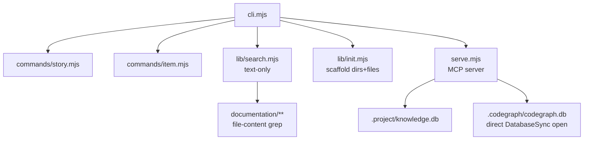
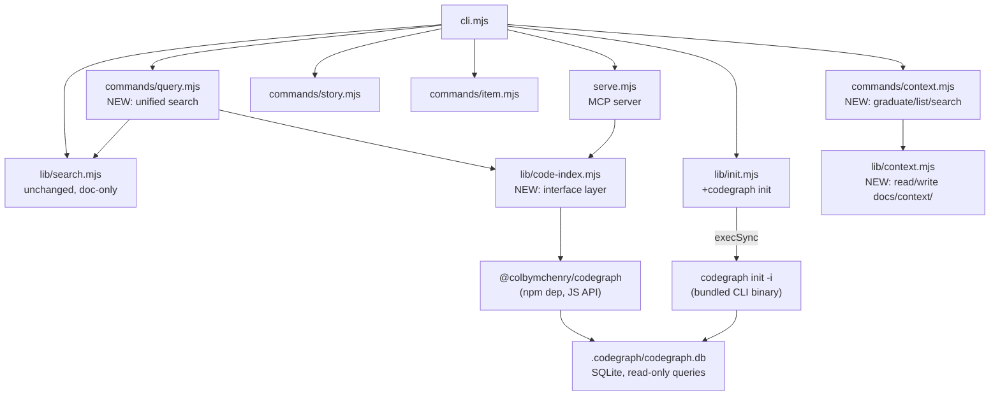
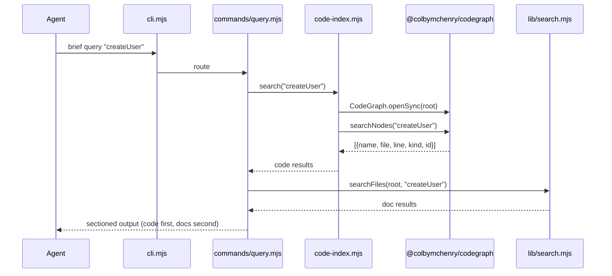
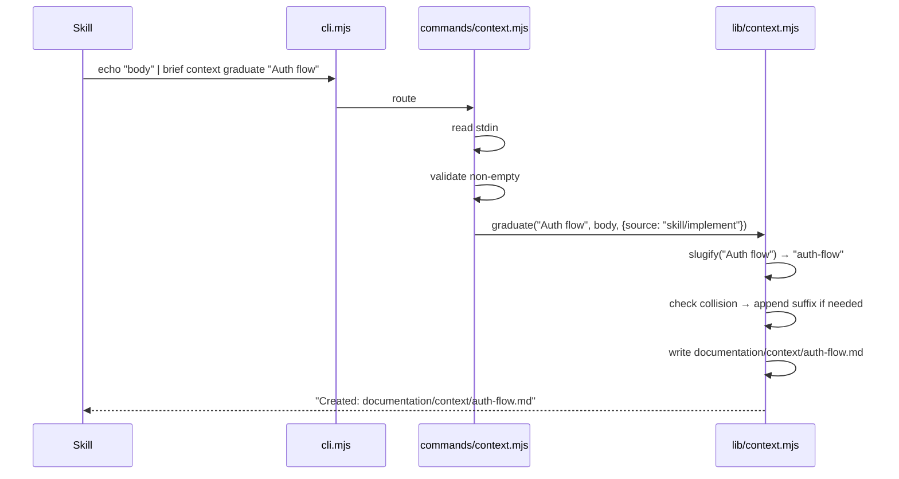

# TRD: Bundle Codegraph + Unified Context Command

**Author**: Deepak / Claude
**Date**: 2026-08-20
**Status**: Draft
**PRD**: [PRD.md](./PRD.md)

## Overview

Add `@colbymchenry/codegraph` as npm dependency, create `code-index.mjs` interface layer for queries,
add `brief query` (unified code+docs) and `brief context` (graduated context) commands, and route
`serve.mjs` DB access through the interface.

## Current Architecture



## Proposed Architecture



### What Changes

| Component | Change Type | Description |
|-----------|------------|-------------|
| `lib/code-index.mjs` | New | Interface layer wrapping codegraph JS API (openSync, searchNodes, getCallers, getImpactRadius) |
| `lib/context.mjs` | New | Read/write `documentation/context/` — graduate, list, search |
| `lib/commands/query.mjs` | New | `brief query` command with --callers, --impact, --json flags |
| `lib/commands/context.mjs` | New | `brief context` command routing (graduate, list, search) |
| `lib/init.mjs` | Modified | Add codegraph init step, add `documentation/context/` to scaffold |
| `cli.mjs` | Modified | Add routing for `query` and `context` commands |
| `serve.mjs` | Modified | Replace direct `DatabaseSync` open with `code-index.mjs` import |
| `package.json` | Modified | Add `@colbymchenry/codegraph` dependency |

## Data Model

No schema changes. Codegraph owns its own SQLite DB (`.codegraph/codegraph.db`). We read it,
never write to it. The `documentation/context/` folder uses markdown files with YAML frontmatter
(same pattern as existing stories/decisions/etc).

### Context File Format

```markdown
---
title: Auth flow
created: 2026-08-20
source: skill/implement
---

<freeform markdown body from stdin>
```

Filenames: `<slug>.md`, `<slug>-2.md`, `<slug>-3.md` on collision.

## API Design

### CLI Commands (not HTTP — brief is a CLI tool)

| Command | Input | Output | Flags |
|---------|-------|--------|-------|
| `brief query <q>` | query string | Sectioned: code results then doc results | `--callers`, `--impact`, `--json` |
| `brief context graduate <title>` | stdin (markdown body) | Created file path | `--source=<origin>` |
| `brief context list` | none | Table: title, path, created | none |
| `brief context <query>` | query string | Matching context files | none |
| `brief init --reindex` | none | Progress output | none |

### JSON Output Schema (--json flag)

```typescript
interface QueryResult {
  code: Array<{
    name: string;       // symbol name
    file: string;       // relative path
    line: number;       // line number
    kind: string;       // function, class, method, etc.
    callers?: Array<{name: string; file: string; line: number}>;
  }>;
  docs: Array<{
    file: string;       // relative path
    type: string;       // story, todo, decision, memory, etc.
    id?: string;        // item ID if tracked
    brief: string;      // first line or description
  }>;
}
```

## System Design

### Component Interaction





### Design Decisions

| Decision | Options Considered | Chosen | Rationale |
|----------|-------------------|--------|-----------|
| codegraph access method | JS API / CLI shell-out | JS API | 36x faster (19ms vs 723ms), typed, swappable via interface |
| Init method | JS API / bundled CLI | Bundled CLI | No JS init API exists; npm package ships `bin` entry |
| Bin resolution (init) | cwd-relative / import.meta.url | import.meta.url | brief is globally installed; cwd has no node_modules |
| brief search behavior | Alias to query / unchanged | Unchanged | Aliasing breaks existing agent rules expecting doc-only |
| Context storage | Per-feature / top-level | Top-level `documentation/context/` | Context is cross-cutting, outlives features |
| Slug collision | Overwrite / append suffix | Append suffix (-2, -3) | Preserves prior graduates |
| Multiple symbol matches | Auto-select first / show all | Show all | Agent picks; auto-select risks wrong context |
| serve.mjs DB access | Leave as-is / route through interface | Route through interface | Single abstraction point; swappable backend |

### Design Patterns

- **Interface layer** (`code-index.mjs`): Exports `open(root)`, `search(query)`, `callers(nodeId)`, `impact(nodeId)`. Internal: lazy-loads codegraph, caches DB handle per root. Same pattern as `lib/search.mjs` but for code.
- **Command file pattern**: `commands/query.mjs` exports `queryCommand(root, args, rawArgs)` — same signature as existing `storyCommand`, `itemCommand`.
- **Graceful fallback**: `code-index.mjs` returns `null` handle if no `.codegraph/` exists. Callers check for null and skip code results.

### Bin Resolution Pattern

```javascript
import { dirname, join } from "node:path";
import { fileURLToPath } from "node:url";

const __dirname = dirname(fileURLToPath(import.meta.url));
const CODEGRAPH_BIN = join(__dirname, "../node_modules/.bin/codegraph");
// Resolves relative to brief's install location (lib/ → brief/ → node_modules/.bin/)
```

## Performance Considerations

- **Expected load**: Single-user CLI, invoked per-query. No concurrency concerns.
- **DB open cost**: 130ms first call (SQLite mmap). Cached for session duration within a single CLI invocation.
- **Query latency**: 19ms `searchNodes` + <1ms callers/impact. Total <25ms for code path.
- **Init cost**: `codegraph init -i` on large projects (672 files) takes ~5-15s. One-time, progress piped through.
- **Memory**: SQLite memory-maps the DB. Only accessed pages loaded. 176MB DB does not mean 176MB RAM.

## Security Considerations

- **Auth/AuthZ changes**: None. Local CLI tool, same-user access only.
- **Data sensitivity**: None. Code index is derived from source (already on disk).
- **Input validation**: Title → slug sanitization strips path separators and special chars. Prevents path traversal.
- **OWASP relevance**: N/A — no network endpoints, no user-facing web surface.

## Dependencies

| Dependency | Type | Risk | Mitigation |
|-----------|------|------|------------|
| `@colbymchenry/codegraph` v1.5.0 | External npm | Low | MIT license, pin version, interface layer enables swap |
| SQLite (via codegraph) | Transitive | None | Already in use by `.project/knowledge.db` |

## Testing Strategy

| Layer | What to Test | Approach |
|-------|-------------|----------|
| Unit | `code-index.mjs` open/search/callers/impact | Mock codegraph module, test null fallback |
| Unit | `lib/context.mjs` graduate/list/search | Temp dir with fixture files |
| Unit | slug sanitization | Edge cases: unicode, path separators, collisions |
| Integration | `brief query` end-to-end | Small fixture `.codegraph/` DB, verify sectioned output |
| Integration | `brief init` with codegraph | Verify `.codegraph/` created, `.gitignore` updated |
| Integration | `serve.mjs` through code-index | Verify MCP tools still return same results |

## Open Technical Questions

- [x] All resolved in CEO review (see PRD Design Decisions section)

## Implementation Order

1. **Foundation**: Add `@colbymchenry/codegraph` to package.json, create `lib/code-index.mjs` interface (with mtime-based handle refresh for serve.mjs mode)
2. **Init**: Modify `lib/init.mjs` — add codegraph init + `documentation/context/` scaffold + `.gitignore`
3. **Query command**: Create `commands/query.mjs` — wire up code-index + search.mjs, sectioned output. Cap --callers/--impact display at 10 symbols, show "N more omitted" if exceeded.
4. **Query flags**: Add `--callers`, `--impact`, `--json` to query command
5. **Context lib**: Create `lib/context.mjs` — graduate (stdin + frontmatter + slug), list, search
6. **Context command**: Create `commands/context.mjs` — route graduate/list/search. Include `process.stdin.isTTY` guard.
7. **CLI routing**: Update `cli.mjs` — add query and context command routing
8. **serve.mjs**: Replace direct DB open with code-index.mjs import
9. **Rules**: Update `rules/brief.md`, remove standalone codegraph rules
10. **Tests**: Set up `node:test` framework + `test/` directory. Full coverage of 32 identified codepaths.

## Eng Review Amendments

Incorporated from /plan-eng-review (2026-08-20):
- **Bin path fix**: Resolution is `join(__dirname, "../node_modules/.bin/codegraph")` (one level up from lib/ to brief/, not two)
- **Mtime refresh**: code-index.mjs checks `fs.statSync()` mtime before each query in serve.mjs mode; reopens handle if changed
- **TTY guard**: `commands/context.mjs` checks `process.stdin.isTTY` — errors immediately if not piped
- **Callers cap**: `--callers`/`--impact` display capped at 10 symbols; `--json` returns all uncapped
- **Test framework**: `node:test` (built-in, zero dep), `test/` directory, `scripts.test: "node --test"`

## GSTACK REVIEW REPORT

| Review | Trigger | Why | Runs | Status | Findings |
|--------|---------|-----|------|--------|----------|
| CEO Review | `/plan-ceo-review` | Scope & strategy | 1 | CLEAR | 4 proposals, 4 accepted, 0 deferred |
| Eng Review | `/plan-eng-review` | Architecture & tests (required) | 1 | CLEAR | 5 issues, 0 critical gaps |
| Design Review | `/plan-design-review` | UI/UX gaps | 0 | -- | -- |
| Outside Voice | `/plan-eng-review` | Independent 2nd opinion | 2 | ISSUES | 18 points raised, 2 tensions resolved |

**VERDICT:** CEO + ENG CLEARED -- ready to implement.

NO UNRESOLVED DECISIONS
