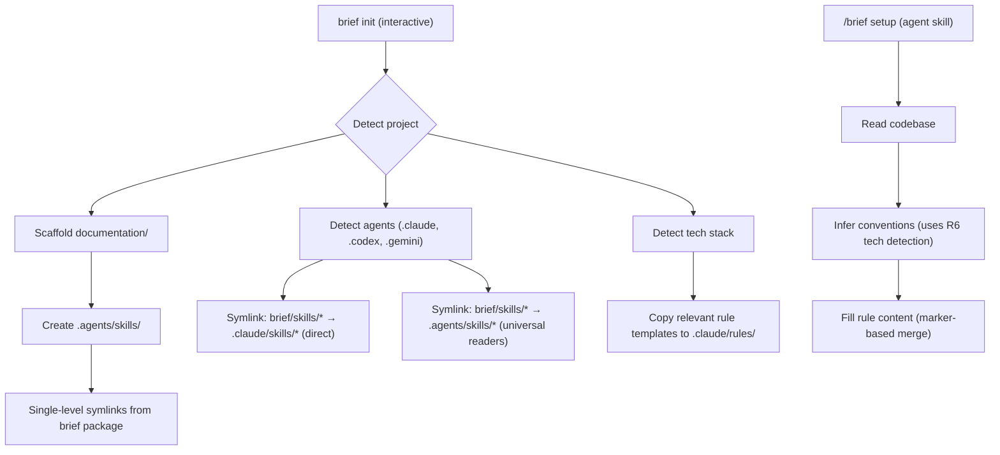
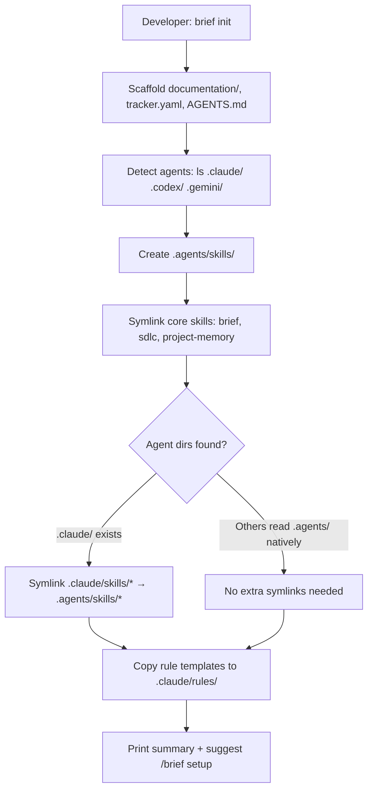
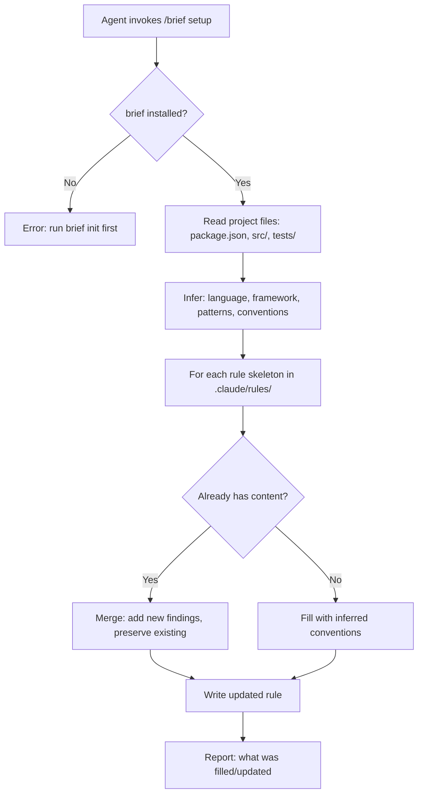

# PRD: Brief Project Setup & Scoped Skills Architecture

**Author**: Deepak / Claude
**Date**: 2026-08-24
**Status**: Approved
**Discovery**: [discovery.md](./discovery.md)

## Executive Summary

Transform `brief init` into an interactive installer that sets up the full agent ecosystem (skills + rules + structure) with multi-agent support, and add `/brief setup` as an agent skill that reads the codebase to fill rule skeletons with real project conventions. Together, these get any developer from zero to productive agent session in under 10 minutes.

## Problem

Developers adopting agentic workflows have no install path for structured project management. They either use Claude Code with zero project rules (agent guesses every session), manually write bloated CLAUDE.md files, or lose institutional knowledge when switching providers. Brief solves this — it preserves knowledge in-repo as text — but today it requires manually replicating a personal dotfiles structure. There's no `npm init` equivalent for agentic project management.

## Users

| Segment | Pain Level | Current Workaround |
|---------|-----------|-------------------|
| Developer adopting brief for the first time | High | Must manually replicate ~/.agents structure, no install path |
| Developer with brief who adds a second agent (Codex/Gemini) | Medium | Manually symlink or duplicate skills into agent-specific dirs |
| Agent sessions needing project context | High | Skills may not exist locally, rules are empty, no onboarding path |

## Goals & Success Metrics

| Goal | Metric | Target | Measurement Method |
|------|--------|--------|-------------------|
| Fast onboarding | Time from `brief init` to productive agent | < 10 minutes | Clock from first command to agent completing a real task |
| Multi-agent coverage | Agents that find skills after init | 100% of detected agents | Test Claude, Codex, Gemini in same project |
| Rule quality | Rules filled with real conventions after setup | ≥ 3 rules with project-specific content | Count non-skeleton rules after `/brief setup` |
| Adoption | Installs | Growing month-over-month | npm downloads (once published) / git clones |

## What We Are Building

### Requirements

| # | Requirement | Priority | Notes |
|---|------------|----------|-------|
| R1 | `brief init` creates `.agents/skills/` as canonical skill location | Must-have | Aligns with skills CLI convention |
| R2 | Core skills (brief, sdlc, project-memory) relocated into `~/.agents/brief/skills/` and symlinked into project | Must-have | Updates propagate without re-running init. Prerequisite: move skills into brief package. |
| R3 | Multi-agent detection: find existing agent dirs, install symlinks where needed | Must-have | Passive — never create agent dirs that don't exist |
| R4 | Interactive shell: present detected config, let user confirm/adjust | Must-have | Like `npm init` — sensible defaults, adjustable |
| R5 | `/brief setup` agent skill: reads code, fills rule skeletons with real content | Must-have | Re-runnable, idempotent, merges without destroying edits (requires marker mechanism) |
| R6 | Tech stack detection from manifest files (package.json, Cargo.toml, go.mod, etc.) | Must-have | Prerequisite for R5 — determines which rules are "relevant" |
| R7 | Platform-aware: symlinks on Unix, copy fallback on Windows/Docker with `--copy` flag | Should-have | Portability |
| R8 | Template reclassification: hono-* → techstack rule + scaffold-module skill | Nice-to-have | From deferred.md — if time permits |

### User Flows

**`brief init` (developer runs in a new project):**

**`/brief setup` (agent runs after init or on demand):**

## What We Are NOT Building

- **NOT**: npm package distribution yet — brief stays git-tracked in ~/.agents until fully stable
- **NOT**: `npx skills add` integration for core skills — we own our symlink logic (skills CLI copies local paths)
- **NOT**: Creating agent directories that don't exist — passive detection only
- **NOT**: Multi-provider rule formats (Gemini/Codex have different rule mechanisms) — we target `.agents/skills/` (universal) and `.claude/rules/` (Claude-specific)
- **NOT**: Automatic rule generation from AI code analysis at init time — that's `/brief setup`'s job, separate from init
- **NOT**: `brief serve` (markdown viewer) — separate epic, lower priority

## Triggers & Edge Cases

| Trigger / Edge Case | Expected Behavior |
|--------------------|-------------------|
| `brief init` in project that already has `.agents/skills/` | Skip creation, verify symlinks are correct, report "already initialized" |
| `brief init` on Windows/Docker where symlinks fail | Detect platform, fall back to copy, warn about manual updates needed |
| `/brief setup` on project with manually-written rules | Merge mode: preserve manual content, append inferred additions with clear markers |
| Agent dir created AFTER init (user installs Codex later) | User re-runs `brief init` — it's idempotent, adds missing symlinks |
| Core skill updated in brief package | Symlinks ensure project immediately sees the update — no action needed |
| Project cloned on another machine without brief installed | `.agents/skills/` has broken symlinks — init detects this and offers to fix |

## Dependencies

- Brief CLI (`~/.agents/brief/`) — owns init.mjs, templates, and the new symlink logic
- Node.js `fs.symlinkSync` / `fs.readlinkSync` — for cross-platform symlink handling
- Existing `manifest.json` detect patterns — for tech stack detection (already defined in S-010)
- Claude Code skill loading — reads `.claude/skills/` and `.agents/skills/`

## Risks

| Risk | Likelihood | Impact | Mitigation |
|------|-----------|--------|------------|
| Broken symlinks after clone (brief not installed on new machine) | High | Medium | Detect broken links in init, offer `--copy` mode, clear error messages |
| `/brief setup` generates low-quality rules | Medium | Low | Rules are starting points — user can edit. Setup is re-runnable to improve. |
| `.agents/skills/` convention changes upstream | Low | Medium | We don't depend on skills CLI at runtime — our own logic, our own convention |
| Windows symlink permissions (requires admin or dev mode) | Medium | Medium | Detect, fallback to copy, document Windows requirement |

## Open Questions

- [x] Symlink vs copy → own symlink logic, copy as fallback (decided in discovery)
- [x] Package distribution → git-tracked for now (decided in discovery)
- [x] Setup re-runnability → idempotent, merge mode (decided in discovery)
- [x] Should `/brief setup` fill ALL rule templates or only detected-relevant ones? → Only relevant ones. Setup should also report which installed rules are non-relevant so user can remove them.
- [x] What's the marker format for "agent-generated" content in rules (for merge safety)? → Behavioral contract defined below; exact format in TRD.
- [x] Git tracking strategy → Symlinks gitignored, rule content (originals) tracked. Init re-runs on clone to recreate local symlinks. brief-manifest.json also gitignored (machine-specific).
- [x] Symlink architecture → Single-level (package → .claude/skills/ for Claude; .agents/skills/ for universal readers). No canonical middle layer.

## Marker Behavior Contract (for R5 merge safety)

`/brief setup` must distinguish agent-generated content from manual edits in rule files. The behavioral contract:

1. **Identify generated sections** — markers clearly delineate what setup wrote vs what a human wrote
2. **Preserve manual edits** — content outside markers is never touched on re-run
3. **Support partial re-generation** — individual sections can be updated without affecting others
4. **Non-invasive** — markers must be valid markdown comments, invisible to rule consumers

Exact marker syntax (e.g., `<!-- brief:auto -->...<!-- /brief:auto -->`) specified in TRD.

## `brief doctor` Acceptance Criteria

Minimal checks for the health command:

1. **Symlink validation** — each expected symlink resolves to an existing file
2. **Broken link detection** — report symlinks that point to missing targets (brief not installed)
3. **Stale copy detection** — if `--copy` mode was used, detect when source is newer than copy
4. **Manifest consistency** — `.agents/brief-manifest.json` matches actual filesystem state
5. **Exit code** — exits 0 if healthy, non-zero if any check fails
6. **Structured output** — `--json` flag for programmatic consumption

## Timeline

| Milestone | Target Date | Notes |
|-----------|------------|-------|
| PRD Approved | 2026-08-24 | This document |
| TRD Complete | 2026-08-24 | Architecture for init rewrite + setup skill |
| Implementation Start | 2026-08-25 | |
| MVP / First Testable | 2026-08-26 | Init + setup working end-to-end |
