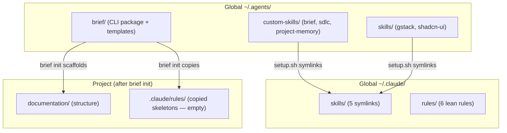

# Discovery: Brief Project Setup & Scoped Architecture

**Date**: 2026-08-24
**Mode**: Greenfield + Refactor
**Trigger**: Deferred Epic 1 from skills-cleanup-consolidation, now ready to plan

## Current Reality

**Pain points:**
1. Core skills (brief, sdlc, project-memory) are global-only — projects assume they exist but have no local guarantee
2. `brief init` copies rule skeletons but doesn't install skills at project level
3. No multi-agent support — only `.claude/` gets anything; Codex/Gemini get nothing
4. Rule skeletons are empty after init — require manual filling or separate agent pass
5. `skills` CLI copies local paths (no symlink) — can't use for own core skills without publishing
6. No distribution story — works on one machine only
7. New developer/agent has no fast path to productive session

**Existing workarounds:**
- `setup.sh` manages global symlinks manually (single machine)
- Custom-skills are git-tracked in `~/.agents/` so edits propagate locally
- Rule templates exist but are empty — agents ignore them until filled

## Who Is Affected

| Persona | Workflow | Pain |
|---------|----------|------|
| **Deepak** (primary) | Multi-project development with Claude/Codex/Gemini | Manual setup per project, global coupling, no distribution |
| **New developer** adopting brief | Wants agentic project management in their repo | No install path exists — must manually replicate ~/.agents structure |
| **Agent sessions** (Claude/Codex/Gemini) | Need skills + rules + context to be productive | Skills are global (may not exist), rules are empty, no onboarding path |

## What They Do Today Without This

- Developers using Claude Code either have zero project rules (agent guesses every session) or manually write a bloated `.claude/CLAUDE.md` with everything inline
- No agentic project management exists as a package — there's no `npm init` equivalent for structured agent workflows
- Knowledge from past sessions lives in conversation history (provider-owned, non-portable) — leaving a provider means losing institutional knowledge

## Success Metrics

| Metric | Target | How to Measure |
|--------|--------|----------------|
| Time-to-productive-agent | < 10 minutes from `brief init` to agent making meaningful progress | Clock from install to first useful agent output |
| Installs | Growing (no specific target yet) | npm download count once published |
| Skill descriptions loaded per session | ≤ 6 (from 28 pre-cleanup) | Count in `.claude/skills/` or `.agents/skills/` |
| Multi-agent coverage | Same project works with Claude + Codex + Gemini | Test each agent finds skills after init |

## Top Opportunities

### O1: Interactive Init + Skill Installation (Score: High)

"Developers who adopt brief need a way to install the full ecosystem (CLI + skills + rules + structure) in one command so they can have a productive agent session in under 10 minutes."

- `brief init` becomes interactive (like `npm init`): detects project, installs skills, scaffolds structure
- Core skills symlinked from brief package → updates propagate automatically
- Multi-agent detection: installs to `.claude/`, `.agents/` (universal), and agent-specific dirs

### O2: Agent-Driven Rule Filling — `/brief setup` (Score: High)

"Developers who have empty rule skeletons need an agent skill that reads their codebase and fills conventions automatically so that rules reflect actual project patterns without manual writing."

- Agent skill (not CLI command) — reads code, infers conventions, writes rule content
- Runs after init or any time rules feel stale
- Fills: coding-style, techstack, backend-standards, frontend-standards, deployment

### O3: Distributable Package (Score: Medium)

"Developers outside this machine need a way to install brief as a package so they can adopt agentic project management without copying a personal dotfiles repo."

- brief becomes its own npm package or git repo
- `npx brief init` works from anywhere
- Core skills ship with the package (symlinked into projects on install)

### O4: Template Reclassification (Score: Low-Medium)

"Project-skill templates (hono-*) need renaming to generic patterns (techstack, scaffold-module) so they're reusable across stacks."

- From `deferred.md`: hono-react-router-prisma → techstack rule + scaffold-module skill
- Depends on the rule vs skill distinction being clear (already decided in prior epic)

## Critical Assumptions to Validate

| # | Assumption | Category | Risk | Experiment |
|---|-----------|----------|------|------------|
| A1 | Symlinks from brief package → project `.agents/skills/` will work across machines and git clones | Feasibility | High | Test: clone a project on a second machine, verify symlinks resolve or fail gracefully |
| A2 | `/brief setup` can reliably infer coding conventions from code analysis | Feasibility | Medium | Test: run against 2-3 existing projects, check if output is useful without manual editing |
| A3 | The `.agents/skills/` canonical pattern (from skills CLI) is stable and won't change | Viability | Medium | Monitor: skills CLI changelog, check if Codex/Gemini docs endorse this path |
| A4 | Other developers want agentic PM enough to install a CLI tool | Value | Medium | Test: ship it, measure adoption. No way to validate without releasing |

## What We Already Know (Low-Risk)

- `.agents/skills/` is the universal canonical dir — Codex, Gemini, Copilot read from it natively (verified via skills CLI research)
- Only Claude Code and Cursor need symlinks from their own dirs → `.agents/skills/`
- `brief init` already scaffolds structure + copies rules — extending it is straightforward
- The skills CLI uses `skills-lock.json` for tracking — we can adopt or ignore this pattern
- Core skills (brief, sdlc, project-memory) are stable and well-tested

## Pre-Mortem: What Could Go Wrong

| Angle | Risk | Category |
|-------|------|----------|
| Technical | Symlinks break on Windows, in Docker containers, or when brief package path changes | Must-mitigate |
| Technical | Multi-agent detection creates dirs that confuse tools (e.g., creating `.codex/` when user doesn't use Codex) | Must-mitigate |
| Product | `/brief setup` generates mediocre rules that developers delete instead of refine | Acceptable |
| Process | Moving brief to its own repo creates a versioning/dependency headache | Acceptable (defer) |
| External | Skills CLI changes `.agents/skills/` convention | Acceptable (we own our install, don't depend on their CLI at runtime) |

**Must-mitigate constraints for PRD:**
1. Symlink fallback: detect platform, use copy on Windows/Docker with a `--copy` flag
2. Agent detection is passive: only install to agent dirs that ALREADY exist (never create `.codex/` etc.)

## Recommended Path

**Ship O1 + O2 together** (Interactive Init + Agent-Driven Setup):
- O1 is the install mechanism (one command, everything working)
- O2 is the intelligence layer (agent fills rules with real project knowledge)
- O3 (distribution as npm package) is a packaging decision — can happen in parallel or after
- O4 (template reclassification) deferred unless time permits

**Architecture decision to lock in:**
- `.agents/skills/` as canonical project location (align with skills CLI convention)
- Core skills symlinked FROM brief package (not copied) — updates propagate
- Agent-specific dirs (`.claude/skills/`) get symlinks to `.agents/skills/` (not directly to brief package)
- Two-level chain: `brief package → .agents/skills/ → .claude/skills/`

**Leverage existing tools:**
- If `npx skills add` does what we need for the symlink mechanics, use it
- If not (e.g., local-path copy limitation), implement our own in `init.mjs` (it's ~50 lines)

## Decisions (from discovery conversation)

1. **Own symlink logic** — don't use `npx skills add` for core skill installation. Build our own in `init.mjs`. The skills CLI copies local paths; we need symlinks for update propagation. Reference skills CLI patterns but implement independently.
2. **Git-tracked for now** — brief stays in `~/.agents/` until fully functional. Once stable, it moves to its own independent repo/package. Don't prematurely extract.
3. **`/brief setup` is re-runnable** — idempotent. Safe to invoke multiple times as project evolves. Merges new findings into existing rules without destroying manual edits.

## Next Step

Ready for `/sdlc prd` — problem is clear, scope is defined (O1 + O2), constraints are identified.
