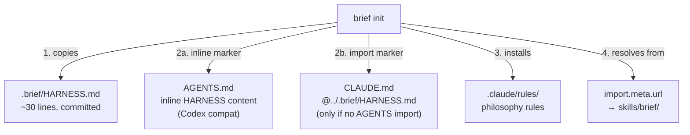
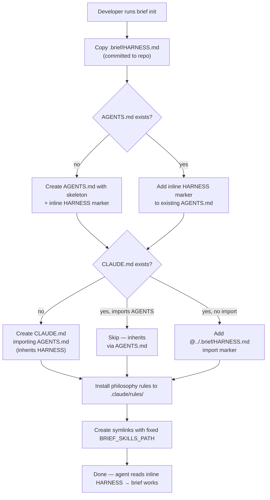

# PRD: Harness Injection & Init Rework

**Author**: Claude + Deepak
**Date**: 2026-08-31
**Status**: Draft
**Discovery**: [discovery.md](discovery.md)

## Executive Summary

Rework `brief init` to inject brief's workflow instructions into projects via marker blocks
in AGENTS.md/CLAUDE.md, fix the broken BRIEF_SKILLS_PATH, and split HARNESS.md into
brief-owned workflow (copied into projects) and engineering philosophy (shipped as optional rules).
After this, agents in any initialized project immediately know how to use `/brief` phases.

## Problem

Developers running `brief init` get a skeleton project structure but agents don't learn about
brief's lifecycle workflow. The developer must manually wire AGENTS.md/CLAUDE.md — defeating
the purpose of an init tool. Additionally, `BRIEF_SKILLS_PATH` is hardcoded to a path that
only exists on the original developer's machine, creating broken symlinks everywhere else.

## Users

| Segment | Pain Level | Current Workaround |
|---------|-----------|-------------------|
| Developer using brief across personal projects | High | Manual edits to AGENTS.md per project |
| New user installing brief for the first time | High | None — init produces broken symlinks |

## Goals & Success Metrics

| Goal | Metric | Target | Measurement Method |
|------|--------|--------|-------------------|
| Agents use brief after init | `brief stats` usage in initialized projects | >0 skill invocations in first session | `brief stats` CLI |
| Zero manual wiring needed | Steps between `brief init` and working `/brief` | 0 manual edits | Test in clean project |
| Init works on any machine | Broken symlinks after init | 0 | `brief doctor` check |

## What We Are Building

`brief init` gains three new capabilities:



### Requirements

| # | Requirement | Priority | Notes |
|---|------------|----------|-------|
| R1 | Copy trimmed HARNESS to `.brief/HARNESS.md` in project | Must | Lifecycle, stories, plan mode, memory only |
| R2 | Inject `<!-- brief:auto -->` marker block into AGENTS.md (inline content) and CLAUDE.md (`@../.brief/HARNESS.md` import) | Must | AGENTS.md gets inline HARNESS for Codex compat; CLAUDE.md gets `@` import. Path relative to `.claude/` dir. |
| R3 | Detect whether CLAUDE.md imports AGENTS.md to avoid doubling | Must | Check for `@../AGENTS.md` or `@AGENTS.md` patterns |
| R4 | Ship philosophy rules (critical-thinking, first-principles, verification-discipline) as defaults during init | Must | Installed to `.claude/rules/`, user can delete |
| R5 | Fix BRIEF_SKILLS_PATH to resolve from `import.meta.url` | Must | `../skills/brief/` relative to `lib/init.mjs` |
| R6 | Move HARNESS.md source to `templates/` in brief repo + self-migrate this repo | Must | Update this repo's own `.claude/CLAUDE.md` reference |
| R7 | `.brief/HARNESS.md` committed to repo (NOT gitignored) | Must | Clones get workflow instructions immediately; `brief init` overwrites to update |
| R8 | Idempotent — re-running init updates markers, doesn't duplicate | Must | Reuse existing `markers.mjs` (`parseMarkers`/`mergeContent`) infrastructure |
| R9 | Remove "Documentation & References" from HARNESS (covered by existing rule) | Should | `documentation-standards.md` rule already covers this |
| R10 | Extract unique "Safe Code Modifications" bits into a rule | Should | "Never repo-wide auto-fix", "propose before broad changes" |
| R11 | Decouple AGENTS.md creation from Codex detection | Must | `detect.mjs:49` uses AGENTS.md presence → creating it flips Codex flag |

### Injection Logic

AGENTS.md always gets **inline** HARNESS content (Codex can't resolve `@` imports).
CLAUDE.md gets an **`@` import** pointing to `.brief/HARNESS.md` (Claude-specific feature).

| AGENTS.md | CLAUDE.md | Action |
|-----------|-----------|--------|
| missing | missing | Create both. AGENTS.md with skeleton + inline marker. CLAUDE.md with `@../AGENTS.md` + no separate marker (inherits via AGENTS.md). |
| exists | missing | Add inline marker to AGENTS.md. Create CLAUDE.md importing AGENTS.md (inherits). |
| exists | exists, imports AGENTS | Add inline marker to AGENTS.md only (CLAUDE.md inherits, no doubling). |
| exists | exists, no import | Add inline marker to AGENTS.md. Add `@` import marker to CLAUDE.md. |
| missing | exists | Add `@` import marker to CLAUDE.md only. |

### Marker Formats

**AGENTS.md (inline):**
```markdown
<!-- brief:auto section="harness" -->
## Brief Workflow
<full trimmed HARNESS content inlined here>
<!-- /brief:auto -->
```

**CLAUDE.md (import, only when no AGENTS.md import):**
```markdown
<!-- brief:auto section="harness" -->
@../.brief/HARNESS.md
<!-- /brief:auto -->
```

Note: `@../.brief/HARNESS.md` — the `../` is required because CLAUDE.md lives in `.claude/`,
so the path resolves relative to that directory.

### Trimmed HARNESS Content (~30 lines)

**Keep** (brief-owned workflow):
- Lifecycle graph (the phase diagram)
- Story-based execution (IDs, one task = one commit, qa per task)
- Memory checkpoints (post-planning, post-implementation, post-ship)
- Plan mode behavior

**Remove** (becomes rules or already covered):
- Critical thinking → `critical-thinking.md` rule
- First-principles process → `first-principles.md` rule
- Verification discipline → `verification-discipline.md` rule
- Documentation & references → already in `documentation-standards.md`
- Safe code modifications → unique bits go to `safe-modifications.md` rule

### User Flow



## What We Are NOT Building

- **NOT**: `brief update` / `brief uninstall` — next story, depends on markers existing (TODO-013)
- **NOT**: Full HARNESS decomposition into rules — future work once markers + update exist
- **NOT**: build.sh changes — personal developer tool, not brief's concern
- **NOT**: Gemini `.agents/rules/` verification — separate TODO-012
- **NOT**: Multi-user / team features — personal tool first

## Triggers & Edge Cases

| Trigger / Edge Case | Expected Behavior |
|--------------------|-------------------|
| AGENTS.md has existing content above/below | Marker appended at end, existing content untouched |
| CLAUDE.md already has `<!-- brief:auto -->` markers | Replace content between markers via `markers.mjs` (idempotent) |
| `.brief/HARNESS.md` already exists | Overwrite with latest version |
| Project has no `.claude/` directory | Create it (already happens for rules) |
| Running on Windows (EPERM on symlinks) | Existing copy fallback in `symlink.mjs` still works |
| User deletes marker block manually | Next `brief init` re-adds it (idempotent) |
| AGENTS.md created by init triggers Codex detection on re-run | R11: detection decoupled from file presence |

## Dependencies

- Existing `brief init` infrastructure (`lib/init.mjs`, `lib/symlink.mjs`, `lib/detect.mjs`)
- Existing marker infrastructure (`lib/markers.mjs` — `parseMarkers`/`mergeContent`)
- Existing rule generation (`lib/rules-gen.mjs` — `generateCodexSection` for AGENTS.md markers)
- Existing rule template system (`templates/rules/manifest.json`)

## Risks

| Risk | Likelihood | Impact | Mitigation |
|------|-----------|--------|------------|
| Marker format conflicts with editor formatting | Low | Medium | Use HTML comments — universally preserved |
| Trimmed HARNESS too terse for agents | Medium | High | Test in real project before shipping |
| Users surprised by brief writing to AGENTS.md | Low | Medium | Print clear summary during init, markers are labeled |
| `@` import syntax changes across providers | Low | High | Marker wraps the import — `brief update` can adapt |
| Partial write corrupts AGENTS.md/CLAUDE.md | Low | High | Use atomic writes (tmp + rename) for user config files |

## Open Questions

- [x] Should `.brief/` directory be at project root or inside `.claude/`? → **Root** (provider-neutral)
- [ ] Should philosophy rules get glob triggers (e.g., `paths: ["**"]`) or always-on?
- [x] Committed or gitignored? → **Committed** (zero-wiring for collaborators)
- [x] AGENTS.md inline or `@` import? → **Inline** (Codex can't resolve `@`)
- [x] Reuse existing markers.mjs? → **Yes** (R8 updated)

## Timeline

| Milestone | Target Date | Notes |
|-----------|------------|-------|
| PRD Approved | 2026-08-31 | |
| TRD Complete | 2026-08-31 | Architecture changes to init.mjs |
| Implementation Start | 2026-08-31 | |
| MVP / First Testable | 2026-09-01 | Test in a clean project |
