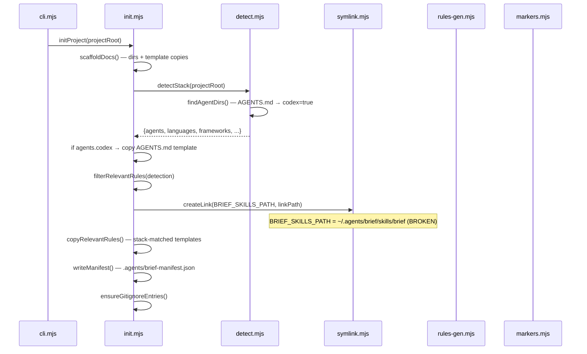
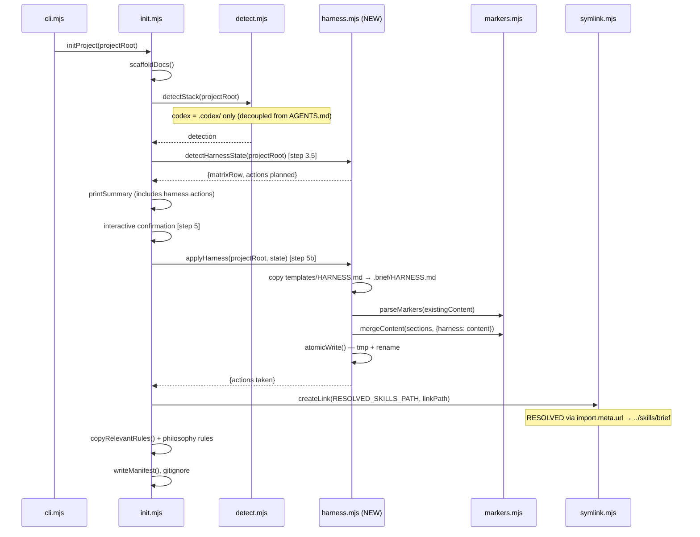
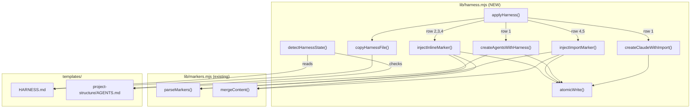

# TRD: Harness Injection & Init Rework

**Author**: Claude + Deepak
**Date**: 2026-09-01
**Status**: Draft
**PRD**: [PRD.md](./PRD.md)

## Overview

Rework `brief init` to copy a trimmed HARNESS into projects, inject it into AGENTS.md/CLAUDE.md
via marker blocks, fix the broken BRIEF_SKILLS_PATH, decouple Codex detection from AGENTS.md
presence, and ship engineering philosophy as optional rules. Six files change; one new module added.

## Current Architecture



**Problems in current architecture:**
- `BRIEF_SKILLS_PATH` (init.mjs:15) hardcoded to `~/.agents/brief/skills/brief` — broken on any other machine
- No HARNESS injection — agents don't learn brief's workflow
- `findAgentDirs()` (detect.mjs:49) uses `AGENTS.md` presence to detect Codex — creating AGENTS.md during init flips this flag
- `markers.mjs` exists but isn't used by init — only by `rules-gen.mjs`

## Proposed Architecture



### What Changes

| Component | Change Type | Description |
|-----------|------------|-------------|
| `lib/harness.mjs` | **New** | Owns HARNESS copy + marker injection into AGENTS.md/CLAUDE.md. Exports `detectHarnessState()` + `applyHarness()`. |
| `lib/init.mjs` | Modified | Fix BRIEF_SKILLS_PATH, call `detectHarnessState()`/`applyHarness()`, remove AGENTS.md gate at line 52-64 |
| `lib/detect.mjs` | Modified | `findAgentDirs()` line 49: Codex detection uses `.codex/` only |
| `templates/HARNESS.md` | **New** | Trimmed HARNESS source (~30 lines) — moved from repo root |
| `HARNESS.md` (root) | Removed | Content moves to `templates/HARNESS.md` |
| `.claude/CLAUDE.md` (this repo) | Modified | Update `@../HARNESS.md` → `@../templates/HARNESS.md` or equivalent |
| `templates/rules/manifest.json` | Modified | Add 3 philosophy rule entries |
| `templates/rules/critical-thinking.md` | **New** | Extracted from HARNESS |
| `templates/rules/first-principles.md` | **New** | Extracted from HARNESS |
| `templates/rules/verification-discipline.md` | **New** | Extracted from HARNESS |

## System Design

### New Module: `lib/harness.mjs`

Single responsibility: copy HARNESS and inject markers. Exports two functions (detect + apply split).

```
detectHarnessState(projectRoot) → { agentsMd: 'exists'|'missing', claudeMd: 'exists-imports'|'exists-no-import'|'missing', matrixRow: 1-5, actions: string[] }
applyHarness(projectRoot, state) → { copied: string[], injected: string[], skipped: string[] }
```

**Detect phase** (runs at step 3.5, before interactive confirmation):

1. Read `templates/HARNESS.md` (resolved via `import.meta.url`) — verify exists
2. Detect state: AGENTS.md exists? CLAUDE.md exists? CLAUDE.md imports AGENTS.md?
3. Determine matrix row (1-5) and describe planned actions
4. Return state object for `printSummary()` to display

**Apply phase** (runs after step 5 confirmation):

1. Create `.brief/` dir, write `.brief/HARNESS.md` via atomic write
2. Apply injection matrix (5 rows from PRD) using state from detect
3. Return summary of actions taken

**Import detection** (R3): regex `/@\.\.\/AGENTS\.md|@AGENTS\.md/` against CLAUDE.md content.
Conservative — only matches the exact `@` import patterns. False negatives are safe (worst case:
CLAUDE.md gets its own marker, no content doubling since AGENTS.md has inline and CLAUDE.md
has `@` import to `.brief/HARNESS.md`).

**Marker injection** uses existing `markers.mjs`:
- `parseMarkers(content)` → sections array
- `mergeContent(sections, { harness: newContent })` → updated string
- Idempotent: existing `harness` section gets replaced, not duplicated

### Design Decisions

| Decision | Options Considered | Chosen | Rationale |
|----------|-------------------|--------|-----------|
| New module vs extend init.mjs | A) Add to init.mjs, B) New harness.mjs | B | init.mjs is 395 lines; harness logic is ~80 lines with distinct concern |
| AGENTS.md inline vs `@` import | A) Inline for both, B) `@` for both, C) Inline AGENTS + `@` CLAUDE | C | Codex can't resolve `@` imports; CLAUDE.md supports them natively |
| Codex detection fix | A) Remove AGENTS.md from detection, B) Add `createdByBrief` flag | A | Simpler — `.codex/` is the canonical Codex indicator |
| Atomic writes | A) writeFileSync direct, B) tmp + rename | B | AGENTS.md/CLAUDE.md are critical user config files |
| HARNESS location in brief repo | A) Keep at root, B) templates/HARNESS.md | B | It's a template — repo root is for this project's own config |
| Philosophy rules glob | A) `paths: ["**"]` (always on), B) No paths (always on, no filter) | B | No `paths` key = always active in `.claude/rules/`. Simpler. |
| AGENTS.md creation | A) Always create, B) Only when both missing, C) Keep Codex gate | B | Per injection matrix: row 1 creates both, row 5 doesn't create AGENTS.md |
| Detect/Apply split | A) Single `injectHarness()`, B) Split detect + apply | B | User sees planned actions before confirming. Matches `filterRelevantRules` pattern (detect at step 4, apply at step 8). Decided during eng review D1. |

### Design Patterns

- **Marker injection**: follows existing `markers.mjs` pattern used by `rules-gen.mjs` — same format, same idempotency
- **Atomic writes**: follows existing `writeManifest()` pattern (init.mjs:268-270) — `tmp + rename`
- **Template resolution**: follows existing `TEMPLATES_DIR` pattern (init.mjs:12) — `join(__dirname, "../templates/...")`

### Component Interaction



### BRIEF_SKILLS_PATH Fix

```
// Before (init.mjs:15)
const BRIEF_SKILLS_PATH = join(homedir(), ".agents", "brief", "skills", "brief");

// After
const BRIEF_SKILLS_PATH = join(__dirname, "../skills/brief");
```

`__dirname` is already resolved from `import.meta.url` at line 11. The `skills/brief/` directory
is always at `../skills/brief/` relative to `lib/`. Works on any machine where brief is installed.

### Codex Detection Decoupling

```
// Before (detect.mjs:49)
codex: existsSync(join(projectRoot, ".codex")) || existsSync(join(projectRoot, "AGENTS.md")),

// After
codex: existsSync(join(projectRoot, ".codex")),
```

**Impact**: projects that had AGENTS.md but no `.codex/` won't be detected as "Codex projects."
This only affects `rules-gen.mjs:16` (`generateCodexSection` — appends convention skeletons to
AGENTS.md). Since harness injection now owns AGENTS.md marker content, the Codex skeleton
section becomes redundant for harness content. `generateCodexSection` still runs for actual Codex
projects that have `.codex/`.

### Trimmed HARNESS Content

Source: current `HARNESS.md` (92 lines) → trimmed to ~30 lines.

**Keep sections** (brief-owned workflow):
- Full Lifecycle Workflow (lines 5-16) — phase graph, gates, router reference
- Story-Based Execution (lines 18-28) — IDs, conventions, qa per task, commit rules
- Memory (lines 40-44) — checkpoint rules
- Plan Mode (lines 38-39) — behavior during planning

**Remove sections** → philosophy rules:
- Critical Thinking (lines 48-54) → `templates/rules/critical-thinking.md`
- First-Principles Process (lines 56-67) → `templates/rules/first-principles.md`
- Verification Discipline (lines 69-80) → `templates/rules/verification-discipline.md`
- Documentation & References (lines 30-32) → already in `documentation-standards.md`
- Safe Code Modifications (lines 34-36) → unique bits into `safe-modifications.md` or drop

### Init Flow Changes

Current `initProject()` step order with changes marked:

| Step | Current | After |
|------|---------|-------|
| 1 | `scaffoldDocs()` | Same |
| 2 | `detectStack()` | Same but Codex detection decoupled |
| 3 | AGENTS.md if Codex | **Removed** — `applyHarness()` owns this |
| 3.5 | *(none)* | **NEW: `detectHarnessState(projectRoot)`** — returns planned actions for summary |
| 4 | `filterRelevantRules()` | Same + philosophy rules added to manifest |
| 5 | Interactive confirmation | Same (updated summary includes harness actions) |
| 5b | *(none)* | **NEW: `applyHarness(projectRoot, state)`** — writes files after consent |
| 6 | `migrateOldSymlinks()` | Same |
| 7 | `createProjectSymlinks()` | Same but uses fixed `BRIEF_SKILLS_PATH` |
| 8 | `copyRelevantRules()` | Same (philosophy rules matched via manifest) |
| 9 | `writeManifest()` | Same |
| 10 | `ensureGitignoreEntries()` | Same (`.brief/` NOT added — committed to repo) |
| 11 | `initCodegraph()` | Same |

`detectHarnessState()` runs BEFORE interactive confirmation (step 3.5) so the summary can
report what harness actions will be taken. `applyHarness()` runs AFTER confirmation (step 5b).
This matches how `filterRelevantRules()` works (detect at step 4, apply at step 8).

### Self-Migration (This Repo)

This repo's `.claude/CLAUDE.md` currently contains `@../HARNESS.md`. After moving HARNESS.md
to `templates/`, update this repo's reference:

Option A: `@../templates/HARNESS.md` — direct reference to new location
Option B: Run `brief init` on this repo — dogfood the new injection

Choose **B**: dogfooding validates the feature. After implementation, run `brief init` in this
repo to get `.brief/HARNESS.md` + markers.

## Error Handling & Failure Modes

### Exception Table

| Error | Handler | User-Visible Result |
|-------|---------|---------------------|
| `templates/HARNESS.md` missing | Check at import time | `Error: HARNESS template not found at <path>` — abort init |
| AGENTS.md write fails (permissions) | Catch in `atomicWrite()` | `Warning: could not update AGENTS.md (<reason>). Add brief markers manually.` — continue init |
| CLAUDE.md write fails | Same as above | Same pattern — warn and continue |
| Marker parsing fails (malformed markers) | Catch `parseMarkers` throw | `Warning: could not parse existing markers in <file>. Skipping injection.` — continue |
| `.brief/` dir creation fails | Catch `mkdirSync` | `Error: could not create .brief/ directory` — abort harness step, continue init |

**Principle**: HARNESS injection failures are warnings, not fatal. Init should complete even if
marker injection fails — the user can always add markers manually.

### Failure Modes

| Failure | Trigger | Impact | Mitigation |
|---------|---------|--------|------------|
| Partial write to AGENTS.md | Crash between tmp write and rename | tmp file left behind, original intact | Atomic write (tmp + rename) |
| Double HARNESS content | Import detection misses a pattern | Agent reads HARNESS twice — verbose but not broken | Conservative regex; test known patterns |
| Broken `@` path in CLAUDE.md | `@../.brief/HARNESS.md` path wrong | Agent doesn't load HARNESS | Integration test: init → read CLAUDE.md → verify path resolves |
| Philosophy rules conflict with user's existing | User has own `critical-thinking.md` | init skips (exists check in `copyRelevantRules`) | Already idempotent — existing files not overwritten |
| `generateCodexSection` conflicts with new harness marker | Both write to AGENTS.md | Two `brief:auto` sections with different IDs | Different section IDs: `harness` vs `conventions` — `mergeContent` handles this |

## Security Considerations

- **No auth/authz changes**: init is a local CLI tool
- **File writes**: only to project directory (no global config pollution)
- **No new dependencies**: reuses existing `markers.mjs`
- **Input validation**: HARNESS template is shipped with brief (trusted input); existing AGENTS.md/CLAUDE.md content is preserved outside markers

## Testing Strategy

| Layer | What to Test | Approach |
|-------|-------------|----------|
| Unit | `detectHarnessState()` — all 5 matrix rows | Temp directory per test, assert state object |
| Unit | `applyHarness()` — all 5 matrix rows | Temp directory per test, assert file contents |
| Unit | Import detection regex | String matching tests: `@../AGENTS.md`, `@AGENTS.md`, no import |
| Unit | `atomicWrite()` | Verify tmp cleanup, permissions preserved |
| Unit | Codex detection change | `findAgentDirs()` with/without `.codex/` and `AGENTS.md` |
| Unit | BRIEF_SKILLS_PATH resolution | Verify resolves to `<brief-install>/skills/brief/` |
| Regression | `detect.test.mjs:37-41` | Flip AGENTS.md-only assertion from `codex: true` to `codex: false` |
| Regression | `init.test.mjs:9,63` | Update BRIEF_SKILLS_PATH constant and symlink target assertion |
| Integration | `brief init` in empty project | Full init → verify `.brief/HARNESS.md` + markers in both files |
| Integration | `brief init` in project with existing AGENTS.md | Verify markers appended, existing content preserved |
| Integration | `brief init` idempotency | Run twice → verify no duplication |
| Integration | `brief init` in this repo (self-migration) | Verify HARNESS reference updated |
| Manual | Agent reads HARNESS after init | `brief stats` shows skill usage in first session |

### Coverage Diagram

```
lib/harness.mjs (NEW)
├── detectHarnessState()     [unit: 5 matrix rows, returns state]
├── applyHarness()           [unit: 5 matrix rows, writes files]
├── injectInlineMarker()     [unit: via markers.mjs]
├── injectImportMarker()     [unit: via markers.mjs]
├── createAgentsWithHarness()[unit: template + marker]
├── createClaudeWithImport() [unit: @../AGENTS.md + no marker]
└── atomicWrite()            [unit: tmp+rename]

lib/detect.mjs
└── findAgentDirs()          [unit: codex detection change]
                             [regression: AGENTS.md-only → codex:false]

lib/init.mjs
├── BRIEF_SKILLS_PATH        [unit: resolution check]
│                            [regression: init.test.mjs:9,63 updated]
├── initProject() step 3     [integration: removed AGENTS.md gate]
├── initProject() step 3.5   [integration: detectHarnessState call]
└── initProject() step 5b    [integration: applyHarness call]

templates/
├── HARNESS.md               [content review: ~30 lines, all sections present]
└── rules/manifest.json      [content review: 3 new entries]
```

## Verification (beyond tests)

- **Integration check**: run `brief init` in a clean temp directory, then start a Claude session and verify `/brief` invocation works
- **Smoke test**: in an existing project with AGENTS.md, run `brief init` and verify existing content preserved
- **Manual verification**: read the injected markers in AGENTS.md — confirm HARNESS content is readable and complete
- **Path resolution**: on a fresh clone, verify `BRIEF_SKILLS_PATH` symlinks resolve correctly

## Rollback Plan

| Scope | Revert Strategy | Data Implications | User Impact |
|-------|----------------|-------------------|-------------|
| Full feature | `git revert` the implementation commits | No data migration — only file creation | Users re-run `brief init` with old behavior |
| Marker injection only | Remove `injectHarness()` call from init.mjs | Existing markers in user projects remain (harmless) | Manual cleanup of markers if unwanted |
| BRIEF_SKILLS_PATH | Revert line 15 of init.mjs | Symlinks revert to old path | Only affects new inits |
| Codex detection | Revert detect.mjs line 49 | AGENTS.md presence resumes triggering Codex | No data impact |

**Reversibility: 5/5** — all changes are file-level, no data migration, no schema changes.

## Dependencies

| Dependency | Type | Risk | Mitigation |
|-----------|------|------|------------|
| `lib/markers.mjs` | Internal | Low | Already tested by `rules-gen.mjs` usage |
| `lib/symlink.mjs` | Internal | Low | Unchanged — only the target path changes |
| `@` import syntax (Claude) | External | Low | Only used in CLAUDE.md; AGENTS.md has inline content as fallback |
| `.brief/` directory convention | New convention | Low | Provider-neutral; no conflict with existing `.claude/`, `.codex/`, `.agents/` |

## Open Technical Questions

- [x] Should `injectHarness()` run before or after interactive confirmation? → **Split: `detectHarnessState()` before, `applyHarness()` after** (eng review D1, matches existing `filterRelevantRules` pattern)
- [x] Should `safe-modifications.md` be a separate rule or folded into `coding-style.md`? → **Separate rule**
- [x] Should existing tests that break be updated as separate tasks or folded into code changes? → **Separate tasks** (eng review D2: T1b for init.test.mjs, T2b for detect.test.mjs)

## Implementation Order

1. **Fix BRIEF_SKILLS_PATH** (init.mjs:15) — one-line change, immediate value, unblocks testing
1b. **Update init.test.mjs** — fix BRIEF_SKILLS_PATH assertion at lines 9, 63 (regression)
2. **Decouple Codex detection** (detect.mjs:49) — one-line change, prerequisite for step 4
2b. **Update detect.test.mjs** — flip AGENTS.md-only codex assertion to `false` at lines 37-41 (regression)
3. **Create trimmed `templates/HARNESS.md`** + 3 philosophy rule templates — content work, no code
4. **Create `lib/harness.mjs`** — new module: `detectHarnessState()` + `applyHarness()` + inject matrix + atomic writes
4b. **Create `test/harness.test.mjs`** — unit tests for all 5 matrix rows + error paths (tests alongside code, not last)
5. **Wire into `init.mjs`** — remove AGENTS.md gate (lines 52-64), add `detectHarnessState()`/`applyHarness()` calls, update summary
6. **Update `templates/rules/manifest.json`** — add 3 philosophy rule entries (detect: `"*"`)
7. **Self-migrate this repo** — run `brief init`, update `.claude/CLAUDE.md`, remove root `HARNESS.md`
8. **Integration tests** — full init flow with harness injection, idempotency test
