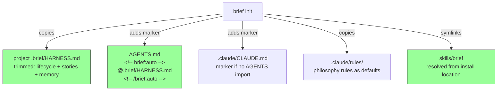

# Discovery: Harness Injection & Init Rework

**Date**: 2026-08-31
**Mode**: Refactor
**Status**: Complete → ready for PRD

---

## Problem Space

`brief init` doesn't wire projects to use brief's workflow. Agents in initialized projects
don't know about `/brief` phases, story conventions, or memory checkpoints unless manually
configured. Three structural issues compound:

1. **HARNESS.md conflates tool behavior with user philosophy** — lifecycle workflow (brief-owned)
   is mixed with engineering philosophy (critical thinking, first principles, verification) that
   should be user-configurable, not tool-imposed.
2. **No injection mechanism** — `brief init` copies a skeleton AGENTS.md but doesn't inject
   workflow instructions. The `build.sh` concatenation approach pollutes global config and isn't
   portable.
3. **BRIEF_SKILLS_PATH is broken** — hardcoded to `~/.agents/brief/skills/brief/` but brief
   now lives at `~/Work/Arcitae/brief/`. Init creates broken symlinks on any other machine.

## Current Reality

```mermaid
flowchart TD
    H["HARNESS.md (92 lines)\nrepo root — mixed content"] -->|build.sh concat| GC["~/.claude/CLAUDE.md\nglobal — pollutes"]
    H -->|@../HARNESS.md| PC["this project only"]

    R["rules/ (6 files)"] -->|build.sh symlinks| GR["~/.claude/rules/\nglobal"]

    INIT["brief init"] -->|copies skeleton| PA["project AGENTS.md\nno workflow instructions"]
    INIT -->|copies template| PCLM["project .claude/CLAUDE.md\n@../AGENTS.md — no brief"]
    INIT -->|symlink to| SK["BRIEF_SKILLS_PATH\n~/.agents/... BROKEN"]

    style H fill:#ff9,stroke:#333
    style SK fill:#f99,stroke:#333
    style GC fill:#f99,stroke:#333
```

## Forcing Questions

### 1. Who is affected?

The developer running `brief init` in their projects. Currently personal use across multiple
projects, but the system must be clean enough to distribute. Build.sh (global pollution) is the
old approach — project-scoped is the new direction.

### 2. What breaks today?

- Agents don't know about brief unless manually configured
- `brief init` doesn't inject workflow instructions into AGENTS.md/CLAUDE.md
- If AGENTS.md or CLAUDE.md already exist, init skips them entirely — no way to add brief's block
- BRIEF_SKILLS_PATH creates broken symlinks on any machine other than the original dev setup

### 3. Success metric

Agents actively use brief skills after init (measurable via `brief stats`). No manual wiring
needed. No fallback to default agent behavior for lifecycle phases.

### 4. MVP scope

Marker injection of trimmed HARNESS content + BRIEF_SKILLS_PATH fix. Everything else follows.

### 5. Prior art

- `@../HARNESS.md` import in this repo's `.claude/CLAUDE.md` — works but not portable
- `build.sh` concatenation to global config — works but pollutes, not project-scoped
- Manual edits per project — works but defeats the purpose of an init tool

## Design Direction (from discovery conversation)

### Architecture: Copied HARNESS + Marker Imports + Rules



### Injection Logic (edge cases resolved)

| AGENTS.md | CLAUDE.md | Action |
|-----------|-----------|--------|
| missing | missing | Create both. AGENTS.md gets marker. CLAUDE.md imports AGENTS.md + marker. |
| exists | missing | Add marker to AGENTS.md. Create CLAUDE.md importing AGENTS.md. |
| exists | exists, imports AGENTS | Add marker to AGENTS.md only (avoids doubling). |
| exists | exists, no import | Add marker to both. |
| missing | exists | Add marker to CLAUDE.md only. |

### HARNESS Trimming

**Keep (brief-owned workflow):**
- Lifecycle graph (discover → prd → trd → plan → implement → pr-review → retro → merge)
- Story-based execution conventions (IDs, one task = one commit, qa agent per task)
- Memory checkpoint rules (post-planning, post-implementation, post-ship)
- Plan mode behavior

**Remove from HARNESS → ship as default rules:**
- Critical thinking (Why → What → How)
- First-principles process (question → delete → simplify → accelerate → automate)
- Verification discipline (absence ≠ proof, unfailable checks, etc.)
- Safe code modifications (already partially in coding-standards rule)
- Documentation references (already in documentation-standards rule)

Users get philosophy rules during init. They can delete/disable them — not opinionated.

### BRIEF_SKILLS_PATH Fix

Replace `join(homedir(), ".agents", "brief", "skills", "brief")` with resolution from
`import.meta.url` — the skills directory is always `../skills/brief/` relative to `lib/init.mjs`.

## Assumptions & Risks

| # | Assumption | Risk | Mitigation |
|---|-----------|------|------------|
| A1 | Marker blocks won't conflict with user content | Low | Unique markers (`<!-- brief:auto -->`), placed at end |
| A2 | Detecting CLAUDE.md → AGENTS.md import is reliable | Medium | Check for `@../AGENTS.md` and `@AGENTS.md` patterns |
| A3 | BRIEF_SKILLS_PATH resolves from import.meta.url | Low | `../skills/brief/` relative to `lib/init.mjs` — standard |
| A4 | Trimmed HARNESS (~30 lines) is enough for agents | Medium | Test in a real project before shipping |
| A5 | Users accept brief writing markers to their files | Medium | Markers are clearly labeled, `brief uninstall` removes them |

### Pre-Mortem Risks

| Risk | Category | Verdict |
|------|----------|---------|
| Marker detection fragile (editors reformat HTML comments) | Technical | Must-mitigate: test roundtrip |
| Trimmed content too terse, agents don't follow workflow | Technical | Must-mitigate: validate in test project |
| Markers rot as brief evolves, no update path | Process | Must-mitigate: ship `brief update` next story |
| Provider changes how AGENTS.md loads | External | Acceptable: rules are the stable fallback |

## Scope Boundary

**In scope (this story):**
- Trim HARNESS → brief-only workflow content
- Marker injection in AGENTS.md / CLAUDE.md
- Philosophy sections → rules (shipped as defaults during init)
- Fix BRIEF_SKILLS_PATH
- Move HARNESS.md to templates/

**Out of scope (separate work):**
- `brief update` / `brief uninstall` (TODO-013, next story — depends on markers existing)
- build.sh deprecation (personal tool, user's concern)
- Gemini `.agents/rules/` verification (TODO-012)
- Full HARNESS decomposition into rules (future — once markers + update exist)
- `brief serve`, SDLC enhancements, and other TODO-010 epics

## Open Questions (resolved)

1. ~~Inline content vs copied file?~~ → **Copied file** (`.brief/HARNESS.md`), markers import it via `@`
2. ~~Where do philosophy rules live?~~ → **Shipped as default rules** during init, user can disable
3. ~~Separate brief-workflow.md rule?~~ → **No**, stays in HARNESS until full decomposition

## Next Step

Ready for `/brief prd` scoped to: marker injection + trimmed HARNESS copy + philosophy rules
as defaults + BRIEF_SKILLS_PATH fix.
