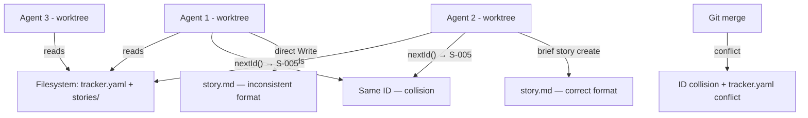

# Discovery: Multi-Agent Coordination for Brief

**Date**: 2026-09-07
**Mode**: infrastructure/architecture
**Status**: complete — ready for PRD

## Current Reality

Brief works well for a single developer with one agent. It breaks under parallelism:

### Pain Points

1. **ID collision** — `nextId()` in `lib/tracker.mjs:54` reads max from tracker.yaml + filesystem, returns max+1. Two parallel agents reading the same state get the same ID. Affects stories, TODOs, decisions — all ID types.
2. **Agent discipline** — agents use `brief story create` to scaffold but then `Write` directly for content, skipping tracker updates and format conventions. The old `~/.agents/backup-rules/brief.md` had the full command list but was too bloated (~125 lines) for agents to follow.
3. **Tracker.yaml merge conflicts** — every story/task CRUD touches this single YAML file, making it a merge bottleneck across branches.
4. **No visibility** — no way to see what IDs are claimed across active branches without checking out each one.

### Current Workaround

Manual cleanup after merge — spot conflicts, renumber stories, fix tracker.yaml by hand. Or: keep an eye on which story IDs are taken and tell agents, or post-work modification. This doesn't scale past one developer.

## Who Is Affected

- Primary: developers running multiple Claude Code sessions (worktrees/forks) on the same repo
- Secondary: teams where each member runs their own agent sessions
- Agents are team members — each team member may run multiple agents. A 5-person team could have 15+ concurrent agents.

## Success Criteria

- Two agents can independently create stories/tasks in parallel and merge cleanly with zero ID conflicts and zero manual fixups
- Scales to a 5-person team with multiple agents per person
- No coordination overhead — agents don't need to know about each other

## Forcing Questions — Answers

| # | Question | Answer |
|---|----------|--------|
| 1 | Who is affected? | Developers running multiple agents; teams adopting brief. Agents = team members. |
| 2 | What's the workaround today? | Manual cleanup — spot conflicts, renumber, fix tracker.yaml by hand. Keep an eye on taken IDs. |
| 3 | How will you know it worked? | Zero ID conflicts across parallel agents; scales to 5-person team, no manual fixups. |
| 4 | Smallest valuable version? | Conflict-free ID allocation + agent CLI discipline rule. Both must-have. |
| 5 | What's been tried? | GitHub Issues as full tracker — failed because two tools (brief + GitHub) and full content duplication was nasty. Shallow copy of just IDs might work. |

## Brainstorm

### User Lens
1. Agents running parallel tasks need conflict-free IDs so merges don't require manual fixup
2. Team members need a single command vocabulary — `brief` — not `brief` + `gh` + direct `Write`
3. Operators need to see what IDs are claimed across all active branches without checking out each one

### Technical Lens
1. ID allocation needs an atomic, centralized counter — filesystem-local `max+1` is inherently racy
2. The brief CLI can wrap the centralized call transparently — agents don't change behavior
3. Content stays local (repo files), only IDs + status go to the central registry

### Business Lens (Team Adoption)
1. If parallel agents collide on IDs, teams won't trust brief — this blocks adoption
2. Cost of inaction: manual cleanup per conflict, or serialized agents (defeating parallelism)
3. A solution that works for 1 dev with 3 agents scales to 5 devs with 15 agents

## Assumptions & Risk

| Assumption | Category | Impact | Risk |
|---|---|---|---|
| GitHub Issues can serve as a fast-enough ID allocator (~500ms) | Feasibility | High | Low |
| Agents will obey a concise rule to use brief CLI exclusively | Usability | High | Medium |
| A shallow copy (ID + title + status label) is enough centrally | Value | High | Low |
| `gh` CLI is available in all agent environments | Feasibility | High | Low |
| Teams will accept GitHub Issues as the ID namespace | Viability | Medium | Medium |

**High-risk assumption**: Agent discipline. Agents have demonstrated they bypass brief CLI even when instructed. A rule alone may not be sufficient.

## Pre-Mortem

> "We shipped this. Six months later, it's considered a failure. What went wrong?"

1. **Technical** — GitHub API rate limits hit when 15 agents create stories/tasks in bursts. Or: `gh` auth breaks in worktree environments, agents fall back to direct Write, IDs drift.
2. **Product** — The rule is too strict and agents get blocked on simple operations. Or: teams on Linear/Jira won't adopt a GitHub-Issues-dependent tool.
3. **Process** — Brief CLI changes are backward-incompatible; existing single-dev users break. Or: the shallow GitHub copy drifts from local state and nobody notices.
4. **External** — GitHub changes issue API, or a team moves to GitLab.

### Must-Mitigate Risks
- **Provider lock-in** → abstract the ID backend behind an interface (`github`, `local`, `cf-worker`)
- **Agent fallback to direct Write** → make the rule enforceable, not just advisory; add hygiene logging
- **Drift between central and local** → brief CLI reconciles on read

## Experiments to Validate

### E1: GitHub Issues as ID allocator
- **Risk**: Latency and reliability under parallel load
- **Experiment**: Add `--github` flag to `brief next`, call `gh issue create` with a label, use issue number as ID. Test 5 rapid parallel calls.
- **Signal**: All 5 get unique IDs, latency < 2s each, no auth issues in worktrees
- **Effort**: Hours

### E2: Agent discipline rule effectiveness
- **Experiment**: Write a concise rule (<30 lines). Run 3 parallel agents on a test story. Count CLI bypasses.
- **Signal**: Zero bypasses across 3 agents
- **Effort**: Hours

## Top Opportunities (Ranked)

1. **O1: Centralized ID allocation via pluggable backend** — brief CLI allocates IDs from a central atomic source (GitHub Issues default, extensible to CF Worker / Linear / SQLite) [Score: H]
2. **O2: Agent discipline rule + CLI hygiene logging** — concise rule for agents + brief CLI logs when it detects files created outside the CLI (non-blocking, informational) [Score: H]
3. **O3: Reconciliation command** — `brief reconcile` detects drift between central registry and local files [Score: M]

## Design Decisions (from discovery)

| # | Decision | Rationale |
|---|----------|-----------|
| D1 | ID backend is configurable via brief manifest | Teams use different tools — GitHub, Linear, CF Worker, local. Config in `brief.yaml` or existing manifest. |
| D2 | Hygiene check is logging, not enforcement | Non-blocking — tells us about agent behavior without interfering. Enforcement can come later based on data. |
| D3 | Must support future expansion to Linear, CF Worker, SQLite | Avoid GitHub lock-in. Abstract behind an ID provider interface. |
| D4 | Shallow copy only — ID + title + status label | Full content duplication to external tools failed (prior attempt). Content stays in repo files. |
| D5 | Existing single-agent local mode must keep working | No breaking change for current users. Centralized backend is opt-in. |

## Recommended Path

Two parallel tracks:

**Track A — Centralized ID allocation**: Add a pluggable ID backend to brief CLI (`lib/id-provider.mjs`) with GitHub Issues as first implementation. `brief story create` → reserves ID centrally → creates local files. Configurable via brief manifest. Local mode remains default.

**Track B — Agent discipline**: Write a concise agent rule (~25 lines) that makes brief CLI mandatory for all `documentation/` mutations. Distribute via `brief init`. Add hygiene logging to brief CLI to detect bypass.

**Spike first**: Validate E1 (GitHub Issues latency under parallel load) before full implementation.

## Open Questions

- Exact config shape in brief manifest for ID backend selection
- Whether `brief reconcile` is a separate command or baked into `brief status`
- Migration path for existing projects: do they get retroactive IDs in the central registry?

## Next Step

Ready for `/brief prd` scoped to Track A (ID allocation) + Track B (agent discipline).
