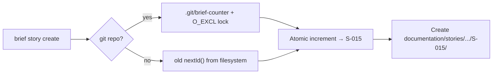
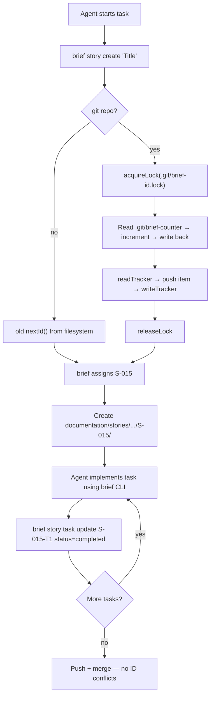

# PRD: Multi-Agent Coordination

**Author**: claude/db
**Date**: 2026-09-07
**Status**: 🔒 Approved
**Discovery**: [DISCOVERY.md](./DISCOVERY.md)

## Executive Summary

Brief's file-based ID allocation breaks under parallel agent execution — two agents creating stories simultaneously get the same ID, requiring manual cleanup. This is the single biggest blocker to team adoption. We're adding a shared atomic counter in `.git/brief-counter` with O_EXCL lockfile to eliminate ID races across worktrees, a concise agent discipline rule to ensure agents use the brief CLI exclusively, and a MEMORY.md harness snippet to keep agents using `brief memory` commands instead of reading raw memory files (which bloats context).

> **CEO Review (2026-09-09)**: Provider abstraction cut. The real problem is multi-agent on one machine (worktrees), solved with a shared counter in `.git/`. Cross-machine coordination deferred until team adoption.

## Problem

When multiple agents run in parallel (worktrees, forks, or separate team members), `nextId()` reads `max(tracker.yaml + filesystem) + 1` — a classic race condition. Both agents get `S-005`, both create files, and the merge explodes. Separately, agents inconsistently use brief CLI — they scaffold via `brief story create` then bypass it with direct `Write`, leaving tracker.yaml stale and file formats inconsistent.

## Users

| Segment | Pain Level | Current Workaround |
|---------|-----------|-------------------|
| Solo dev running 2-3 parallel agents | High | Manual ID deconfliction, post-merge fixup |
| Team (5+ devs, each with agents) | Blocking | Cannot adopt brief at all |

## Goals & Success Metrics

| Goal | Metric | Target | Measurement Method |
|------|--------|--------|-------------------|
| Zero ID collisions | Duplicate IDs across parallel agents | 0 | Run 5 parallel `brief story create`, verify unique IDs |
| Agent CLI compliance | Story/task ops that bypass brief CLI | 0 per session | Hygiene log count in `brief status` |
| No single-agent regression | Existing `brief` commands work without config | 100% | Test suite passes with no ID backend configured |

## What We Are Building

Two tracks that together solve multi-agent coordination:

### Track A — Atomic ID Allocation

A shared counter file at `.git/brief-counter` (JSON, per-type counters) protected by an O_EXCL lockfile at `.git/brief-id.lock`. Since `.git/` is shared across all git worktrees, parallel agents in different worktrees see the same counter. The lock covers the full read-modify-write cycle on both the counter and `tracker.yaml`. Non-git projects fall back to the existing `nextId()` behavior. Stale locks (>10s old) are auto-removed.

### Track B — Agent Discipline Rule + Memory Harness

A concise rule file (`rules/brief-cli-ops.md`, ~25 lines) distributed by `brief init` that:
- Makes brief CLI mandatory for all `documentation/` CRUD (stories, tasks, TODOs, decisions)
- Lists the ~8 commands agents actually need (not the full 40+ reference)
- Fires on `documentation/**` glob — auto-loads when agents touch story files

Plus a MEMORY.md harness snippet (similar to AGENTS.md's harness marker) that tells agents:
- Use `brief memory list` / `brief memory show` instead of reading raw memory files
- Use `brief memory create` instead of direct `Write` to `documentation/memory/`
- Keeps memory interactions concise — agents see summaries, not full file contents, reducing context bloat

### Requirements

| # | Requirement | Priority | Notes |
|---|------------|----------|-------|
| R1 | O_EXCL lockfile in `.git/brief-id.lock` with stale detection (10s) | Must-have | Atomic lock primitive |
| R2 | Shared counter in `.git/brief-counter` (JSON, per-type) | Must-have | Replaces filesystem scan |
| R3 | Lock covers full readTracker → allocateId → writeTracker cycle | Must-have | Prevents tracker.yaml race |
| R4 | Counter seeding from tracker.yaml + filesystem on first use (inside lock) | Must-have | Backward compat |
| R5 | Non-git fallback to old `nextId()` behavior | Must-have | Works outside git repos |
| R6 | `brief next <type>` = reserve (increments counter, no file creation) | Must-have | For planning phases |
| R7 | Per-story task number counter (fixes story.mjs:228 race) | Must-have | Consistent fix |
| R8 | Agent discipline rule in `rules/brief-cli-ops.md` | Must-have | Distributed by `brief init` |
| R9 | Hygiene logging — detect files created outside CLI | Should-have | Non-blocking, informational |
| R10 | MEMORY.md harness snippet — agents use `brief memory` commands | Must-have | Reduces context bloat |
| R11 | Counter state visible in `brief status` | Should-have | Debugging aid |
| R12 | Discover skill Phase 6 — auto-persist DISCOVERY.md | Should-have | Prevents lost work |

### User Flows

## What We Are NOT Building

- **NOT**: Provider interface abstraction — because no second provider exists; premature abstraction (CEO review D7)
- **NOT**: GitHub Issues as ID backend — because deferred until team adoption proves need
- **NOT**: CF Worker / cloud endpoint — because cross-machine coordination deferred
- **NOT**: `brief reconcile` — because no central registry to reconcile against
- **NOT**: Enforcement mode for agent discipline — because we want to observe behavior first via logging, then decide if enforcement is needed
- **NOT**: Linear/Jira/any external integration — because no demand signal yet

## Triggers & Edge Cases

| Trigger / Edge Case | Expected Behavior |
|--------------------|-------------------|
| Not a git repo | Fall back to old `nextId()` behavior — no lock, no counter |
| Stale lockfile from crashed process | Auto-remove if >10s old, retry |
| Counter file missing (first use) | Seed from tracker.yaml + filesystem scan, inside lock |
| Counter file corrupted | Log warning, re-seed from tracker.yaml |
| Lock contention (5 retries × 200ms) | Throw with clear message: "another brief process holds the lock" |
| Agent creates story file via direct `Write` | Hygiene log entry; file works but counter not updated |
| Two agents call `brief story create` within 1ms | O_EXCL guarantees one wins; loser retries |
| `brief next story` in planning phase | Reserves ID (increments counter), does not create files |

## Dependencies

- Git repository — for shared `.git/` directory across worktrees
- `node:fs` `openSync` with `O_EXCL` flag — atomic file creation (POSIX guarantee)

## Risks

| Risk | Likelihood | Impact | Mitigation |
|------|-----------|--------|------------|
| Stale lock blocks all agents | Low | High (temporary) | 10s stale detection auto-recovers |
| Counter drifts from tracker.yaml | Low | Low (cosmetic gaps) | Counter is authoritative; tracker catches up |
| Agents ignore discipline rule | Medium | High | Start with logging; enforce later if needed |
| Non-git project has no lock | Low | Medium | Documented: git required for multi-agent; fallback is old behavior |

## Deployment & Rollout

- **Phasing**: Automatic for git repos. No config needed — counter is created on first `brief` command.
- **Rollback**: Delete `.git/brief-counter` + `.git/brief-id.lock` → falls back to old `nextId()` from filesystem.
- **Migration**: Counter auto-seeds from existing tracker.yaml + filesystem on first use. Zero manual steps.

## Resolved Questions

| # | Question | Decision | Rationale |
|---|----------|----------|-----------|
| Q1 | Counter location: `.brief/` or `.git/`? | `.git/` | `.git/` is shared across worktrees; `.brief/` is per-worktree (D6) |
| Q2 | Provider abstraction needed? | No — ship counter only | First principles: no second provider exists (D7) |
| Q3 | Lock scope: counter only or full CRUD? | Full CRUD cycle | Prevents tracker.yaml overwrite race (D9) |
| Q4 | Stale lock handling? | Auto-remove if >10s old | Standard pattern for crash recovery (D8) |
| Q5 | `brief next` semantics? | Reserve (increments counter) | Stale peeks are confusing; gaps are cosmetic (D10) |
| Q6 | Task number race? | Fix too (per-story counter) | Same pattern, consistent fix (D11) |
| Q7 | MEMORY.md harness snippet injection? | `brief init` injects it | Consistent with AGENTS.md harness marker pattern |

## Timeline

| Milestone | Target Date | Notes |
|-----------|------------|-------|
| PRD Approved | 2026-09-07 | |
| CEO Review Complete | 2026-09-09 | Scope reduced, architecture changed |
| TRD Complete | 2026-09-09 | Architecture for shared counter + lockfile |
| Implementation Start | 2026-09-09 | |
| MVP: atomic counter + discipline rule | 2026-09-10 | |

## CEO Review Appendix

See full CEO review report: `~/.gstack/projects/bansaldeepak-agents-setup/ceo-plans/2026-09-09-multi-agent-coordination.md`

**Decisions**: D6-D11 (shared .git/ counter, cut provider, stale lock, wide lock scope, brief next = reserve, fix task race)
