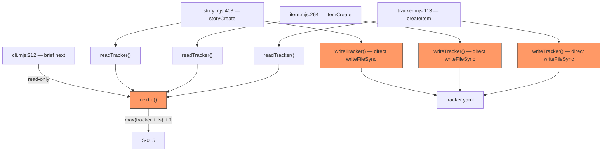
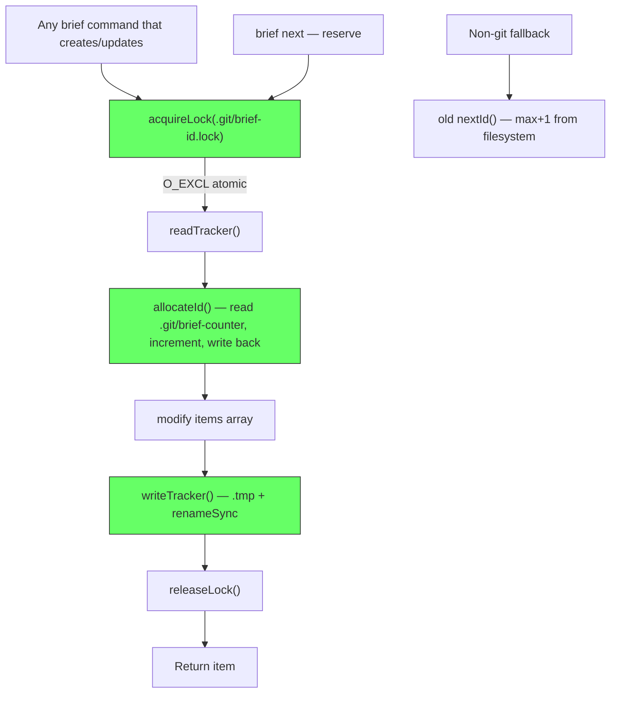
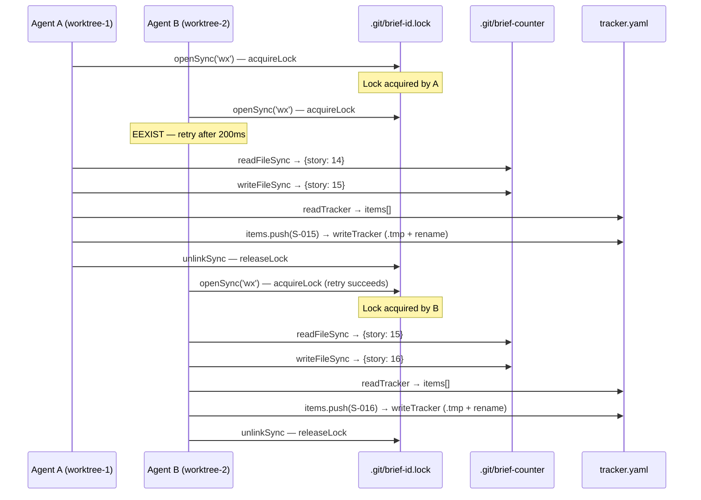

# TRD: Multi-Agent Coordination

**Author**: claude/db
**Date**: 2026-09-09
**Status**: Draft
**PRD**: [PRD.md](./PRD.md)

## Overview

Replace the racy `nextId()` function and non-atomic `writeTracker()` with a shared counter in `.git/brief-counter` protected by an O_EXCL lockfile, covering the full read-modify-write cycle. Add an agent discipline rule and MEMORY.md harness snippet.

## Current Architecture



**Problems**: `nextId()` is unsynchronized (race across worktrees). `writeTracker()` writes directly (no .tmp + rename). 12 `writeTracker()` callsites across story.mjs and item.mjs. Task numbering in story.mjs:228 has the same race.

## Proposed Architecture



### What Changes

| Component | Change Type | Description |
|-----------|------------|-------------|
| `lib/tracker.mjs` — `nextId()` | Modified | Becomes thin wrapper: calls `allocateId()` inside lock if git, else old logic |
| `lib/tracker.mjs` — `writeTracker()` | Modified | Add .tmp + renameSync (atomic write pattern from coding-style.md) |
| `lib/tracker.mjs` — new: `acquireLock()` | New | O_EXCL lockfile at `.git/brief-id.lock` with stale detection |
| `lib/tracker.mjs` — new: `releaseLock()` | New | `unlinkSync()` the lockfile — ENOENT silently ignored |
| `lib/tracker.mjs` — new: `allocateId()` | New | Read/increment `.git/brief-counter` (atomic .tmp+rename write), return next ID |
| `lib/tracker.mjs` — new: `withLock()` | New | Higher-order function: acquire → callback → release (try/finally) |
| `lib/tracker.mjs` — new: `seedCounter()` | New | Bootstrap counter from tracker.yaml + filesystem scan |
| `lib/commands/story.mjs:228` | Modified | Task numbering uses per-story counter in `.git/brief-counter` |
| `lib/commands/story.mjs:285,363,374,403,478,513` | Modified | All 6 writeTracker callsites wrapped in `withLock()` |
| `lib/commands/item.mjs:264,282,335` | Modified | All 3 writeTracker callsites wrapped in `withLock()` |
| `cli.mjs:212` | Modified | `brief next` calls `allocateId()` inside lock (reserve, not peek) |
| `rules/brief-cli-ops.md` | New | Agent discipline rule (~25 lines) |
| `templates/project-structure/MEMORY.md` | Modified | Add harness snippet |
| `.claude/skills/brief/discover/SKILL.md` | Modified | Add Phase 6 auto-persist |

## System Design

### Component Interaction



### Design Decisions

| Decision | Options Considered | Chosen | Rationale |
|----------|-------------------|--------|-----------|
| Lock mechanism | A) O_EXCL `openSync('wx')`, B) `flock` via C binding, C) `mkdirSync` atomicity | A) O_EXCL | Single syscall, POSIX atomic, no native bindings. `mkdir` also works but O_EXCL is the canonical file-lock pattern in Node. |
| Lock location | A) `.git/brief-id.lock`, B) `.brief/brief-id.lock`, C) `/tmp/brief-*.lock` | A) `.git/` | `.git/` is shared across all worktrees (verified: `git rev-parse --git-common-dir`). `.brief/` is per-worktree. `/tmp` doesn't survive reboots. |
| Lock scope | A) Counter increment only, B) Full read-modify-write cycle (all 12 callsites) | B) Full cycle | Just locking the counter still allows tracker.yaml races. All 12 writeTracker callsites get withLock(). Eng review D2. |
| Counter format | A) JSON (`{story: 15, todo: 8}`), B) Plain text per type, C) YAML | A) JSON | Minimal, no dependencies, fast parse. YAML adds yaml dependency to a hot path. |
| Stale lock threshold | A) 10s, B) 30s, C) 60s | A) 10s | Brief commands complete in <2s. A lock older than 10s is from a crashed process. 30s+ is too conservative. |
| Retry delay | A) `Atomics.wait(new Int32Array(new SharedArrayBuffer(4)), 0, 0, 200)`, B) `execFileSync("sleep", ["0.2"])`, C) Busy loop | A) Atomics.wait | In-process synchronous sleep; no forked process per retry. Eng review D3. |
| `brief next` semantics | A) Reserve (increment), B) Peek (read-only) | A) Reserve | Stale peeks confuse planning agents. Gaps in numbering are cosmetic. CEO D10. |
| Task number source | A) Per-story counter in `.git/brief-counter`, B) Directory scan (current) | A) Counter | Same race as story IDs. Counter key: `task:S-015` → next task number for that story. |
| Counter seeding | A) Inside lock on first access, B) During `brief init`, C) Migration command | A) Inside lock | Must be atomic — two processes seeding simultaneously would race. |
| `writeTracker()` atomicity | A) .tmp + renameSync, B) Direct write (current) | A) Atomic write | Crash during write corrupts tracker.yaml. The .tmp + rename pattern is the project standard (coding-style.md). |
| Counter file atomicity | A) .tmp + renameSync, B) Direct write | A) Atomic write | Same crash-safety argument as writeTracker. Outside voice D5. |
| `gitCommonDir()` output | A) `.toString().trim()` applied, B) Raw execFileSync output | A) Trim | execFileSync returns trailing newline; untrimmed produces ENOENT on all lock/counter operations. Outside voice D6. |

### Scope Clarification: What the Lock Protects

**Cross-worktree counter race**: The shared `.git/brief-counter` is protected against races across all worktrees. Two agents in different worktrees get unique IDs.

**Same-worktree tracker.yaml race**: `tracker.yaml` inside a single worktree is protected against races within that worktree (e.g., two processes running in the same working tree).

**Cross-worktree tracker.yaml**: Each worktree has its own `documentation/tracker.yaml`. These are NOT shared. Merging multiple worktrees still produces git merge conflicts on tracker.yaml — that is a git-level problem and out of scope for this PR. The lock does not help here.

### Design Patterns

- Pattern: **O_EXCL lockfile** — Used for: cross-process mutex — Reference: standard POSIX advisory lock, same pattern as `npm` lockfile
- Pattern: **Atomic write** (.tmp + rename) — Used for: crash-safe file updates — Reference: `lib/harness.mjs` uses this already; applied to both `writeTracker()` and counter file
- Pattern: **withLock higher-order function** — Used for: ensure lock release in try/finally — Reference: common Node.js resource management pattern

### Lock API (pseudocode)

```javascript
const LOCK_FILE = "brief-id.lock";
const COUNTER_FILE = "brief-counter";
const STALE_THRESHOLD_MS = 10_000;
const MAX_RETRIES = 5;
const RETRY_DELAY_MS = 200;

function gitCommonDir(projectRoot) {
  // execFileSync('git', ['rev-parse', '--git-common-dir'], { cwd: projectRoot })
  //   .toString().trim()  — trailing newline must be stripped
  // Returns shared .git/ path (works for both normal repos and worktrees)
}

function acquireLock(gitDir) {
  const lockPath = join(gitDir, LOCK_FILE);
  for (let i = 0; i < MAX_RETRIES; i++) {
    try {
      const fd = openSync(lockPath, O_WRONLY | O_CREAT | O_EXCL);
      writeSync(fd, String(process.pid));
      closeSync(fd);
      return lockPath;
    } catch (err) {
      if (err.code !== "EEXIST") throw err;
      // Check stale
      const stat = statSync(lockPath, { throwIfNoEntry: false });
      if (stat && Date.now() - stat.mtimeMs > STALE_THRESHOLD_MS) {
        unlinkSync(lockPath);
        continue; // retry immediately after stale removal
      }
      // Wait and retry — Atomics.wait for in-process synchronous sleep (no fork)
      Atomics.wait(new Int32Array(new SharedArrayBuffer(4)), 0, 0, 200);
    }
  }
  throw new Error("brief: could not acquire lock — another brief process may be running");
}

function releaseLock(lockPath) {
  try { unlinkSync(lockPath); } catch {}
}

function withLock(gitDir, fn) {
  const lockPath = acquireLock(gitDir);
  try { return fn(); }
  finally { releaseLock(lockPath); }
}
```

### Counter File Format

`.git/brief-counter`:
```json
{
  "story": 15,
  "todo": 8,
  "decision": 3,
  "research": 1,
  "audit": 0,
  "bug": 2,
  "memory": 4,
  "task:S-012": 7,
  "task:S-015": 3
}
```

Per-type counters store the **last allocated number** (not next). `allocateId("story")` reads `story: 15`, writes `story: 16`, returns `S-016`. Task counters are keyed `task:<story-id>`.

### Seeding Logic

On first access (counter file doesn't exist), inside the lock:
1. Read tracker.yaml — extract max ID per type
2. Scan filesystem directories — extract max ID per type (same as current `nextId()` safety net)
3. Take `Math.max()` of both per type
4. Write `.git/brief-counter` with all maxes
5. Proceed with allocation

## Error Handling & Failure Modes

### Exception Table

| Error | Handler | User-Visible Result |
|-------|---------|---------------------|
| `EEXIST` on lock acquire | Retry loop (5 × 200ms) | Silent retry; error after 5 attempts: "another brief process may be running" |
| Stale lock (>10s old) | Auto-remove, retry | Silent recovery; no user message |
| Counter file missing | Seed from tracker.yaml + fs | Silent; counter created transparently |
| Counter file corrupt (bad JSON) | Log warning, re-seed | `stderr`: "Warning: brief counter corrupted, re-seeding from tracker" |
| Not a git repo | Fall back to old `nextId()` | No change from current behavior |
| `git rev-parse` fails | Fall back to old `nextId()` | No change from current behavior |
| `writeTracker` crash mid-write | .tmp file left behind | Next `writeTracker` overwrites .tmp; tracker.yaml intact |

### Failure Modes

| Failure | Trigger | Impact | Mitigation |
|---------|---------|--------|------------|
| Lock deadlock | Process killed between acquire and release | All agents blocked until stale threshold | 10s stale detection; PID written to lock for debugging |
| Counter ahead of tracker | Agent reserves ID but crashes before writeTracker | Gap in numbering (cosmetic) | Counter is authoritative; gaps are expected |
| Counter behind tracker | Manual tracker.yaml edit adds higher ID | Next allocation may collide | `allocateId` also checks tracker max, takes higher of counter vs tracker |
| Concurrent stale removal | Two processes both detect stale, both unlink | One succeeds, other gets ENOENT on unlink | ENOENT on unlink is silently ignored |

## Security Considerations

- **No auth/authz changes**: Lock is process-level, not user-level
- **No data sensitivity**: Counter file contains only numeric IDs
- **PID in lockfile**: Used for debugging stale locks, not security
- **No network exposure**: All operations are local filesystem

## Dependencies

| Dependency | Type | Risk | Mitigation |
|-----------|------|------|------------|
| `node:fs` O_EXCL flag | Internal (Node.js) | None | POSIX standard, available on all platforms |
| `git rev-parse --git-common-dir` | External (git CLI) | Low | Git is a hard dependency of brief already; fallback to old behavior if missing |
| `node:child_process` execFileSync | Internal (Node.js) | None | Already used elsewhere in brief |

## Testing Strategy

| Layer | What to Test | Approach |
|-------|-------------|----------|
| Unit | `acquireLock` / `releaseLock` / `withLock` | Temp dir, verify lock file creation/cleanup |
| Unit | `withLock` callback throws | Verify lock released even when fn throws (try/finally) |
| Unit | `releaseLock` on missing lockfile | ENOENT silently ignored, no throw |
| Unit | `acquireLock` max retries | 5 retries expire, throws with clear message |
| Unit | `acquireLock` non-EEXIST error | Rethrows immediately (not retry) |
| Unit | `allocateId` increments correctly | Seed counter, call allocateId, verify returned ID and counter state |
| Unit | `allocateId` counter behind tracker | Manual tracker edit pushes tracker ahead; verify allocateId takes max |
| Unit | `seedCounter` from tracker.yaml + filesystem | Create fixtures with known IDs, verify counter matches max |
| Unit | Stale lock detection | Create lock file, backdate mtime, verify auto-removal |
| Unit | Non-git fallback | Call nextId without git dir, verify old behavior |
| Unit | `writeTracker` atomicity | Verify .tmp intermediate, verify final file content |
| Unit | `brief next` = reserve | Call nextId via cli.mjs next path, verify counter incremented, no files created |
| Integration | Lock contention | Fork child process, both acquire lock, verify sequential execution |
| Integration | 5 parallel `brief story create` | Spawn 5 processes, verify 5 unique IDs |
| Integration | Task numbering under lock | Two processes add tasks to same story, verify unique T-NNN |
| Integration | Stale lock recovery under contention | Create stale lock, have waiting process auto-recover |

### Coverage Diagram

```
┌─────────────────────────────────────────────┐
│ tracker.mjs                                  │
│ ┌─────────────┐ ┌──────────────┐            │
│ │ acquireLock  │ │ releaseLock  │  ← unit    │
│ └─────────────┘ └──────────────┘            │
│ ┌─────────────┐ ┌──────────────┐            │
│ │ allocateId   │ │ seedCounter  │  ← unit    │
│ └─────────────┘ └──────────────┘            │
│ ┌─────────────┐ ┌──────────────┐            │
│ │ withLock     │ │ writeTracker │  ← unit    │
│ └─────────────┘ └──────────────┘            │
│ ┌──────────────────────────────┐            │
│ │ nextId (fallback path)       │  ← unit    │
│ └──────────────────────────────┘            │
├─────────────────────────────────────────────┤
│ Integration                                  │
│ ┌──────────────────────────────┐            │
│ │ lock contention (fork)       │  ← integ   │
│ │ 5 parallel story create      │  ← integ   │
│ │ task numbering under lock    │  ← integ   │
│ └──────────────────────────────┘            │
└─────────────────────────────────────────────┘
```

## Verification (beyond tests)

- **Race condition manual test**: Open two terminals, run `brief story create "Test A"` and `brief story create "Test B"` simultaneously, verify unique IDs
- **Worktree test**: Create git worktree, run `brief story create` from both, verify shared counter incremented correctly
- **Stale lock test**: Create `.git/brief-id.lock` manually, wait 10s, run `brief story create`, verify it recovers
- **Non-git test**: Run `brief story create` in a non-git directory, verify old behavior works

## Rollback Plan

| Scope | Revert Strategy | Data Implications | User Impact |
|-------|----------------|-------------------|-------------|
| Atomic counter | `git revert` the commit | `.git/brief-counter` becomes orphaned (harmless, gitignored) | Falls back to old `nextId()` |
| Atomic writeTracker | `git revert` the commit | .tmp files cleaned up on next write | None — old direct write still works |
| Agent discipline rule | Remove from `rules/` | Agents revert to ad-hoc behavior | No data impact |
| MEMORY.md harness | Revert template change | Agents read raw memory files again | More context bloat, not data loss |

## Long-Term Trajectory

- **Tech debt introduced**: None — this removes tech debt (racy nextId)
- **Reversibility**: 5/5 — delete counter file + revert code = instant fallback
- **Path dependency**: Opens path to cross-machine coordination later. Counter format is extensible (add `provider` key). Lock mechanism is replaceable without changing callers (they use `withLock`).

## Open Technical Questions

- [x] Sleep implementation in retry loop — `execFileSync("sleep", ["0.2"])` vs `Atomics.wait` vs busy loop? Using execFileSync avoids busy-waiting without async. *(Resolved: execFileSync is fine for <1s delays in a CLI tool)*

## Implementation Tasks

Synthesized from this review's findings. Each task derives from a specific finding above. Run with Claude Code; checkbox as you ship.

- [ ] **T1 (P1, human: ~2h / CC: ~15min)** — lib/tracker.mjs — Add `acquireLock`, `releaseLock`, `withLock` primitives with `Atomics.wait` retry
  - Surfaced by: Architecture review — lock primitives needed before all other work
  - Files: `lib/tracker.mjs`
  - Verify: `node --test test/tracker.test.mjs` (lock unit tests)
- [ ] **T2 (P1, human: ~1h / CC: ~10min)** — lib/tracker.mjs — Atomic `writeTracker` (.tmp+rename) and atomic counter file write
  - Surfaced by: Architecture (direct writeFileSync); outside voice D5 (counter not atomic)
  - Files: `lib/tracker.mjs`
  - Verify: Test atomic write, verify .tmp intermediate, verify crash-safety
- [ ] **T3 (P1, human: ~1h / CC: ~10min)** — lib/tracker.mjs — `allocateId`, `seedCounter`, `gitCommonDir` with `.toString().trim()`
  - Surfaced by: Core TRD scope; outside voice D6 (trim required)
  - Files: `lib/tracker.mjs`
  - Verify: Test counter increment, seeding, non-git fallback
- [ ] **T4 (P1, human: ~30min / CC: ~5min)** — lib/tracker.mjs — Refactor `nextId` to delegate to `allocateId` with non-git fallback
  - Surfaced by: Architecture — backward compat wrapper pattern
  - Files: `lib/tracker.mjs`
  - Verify: Existing tests still pass; new fallback path test
- [ ] **T5 (P1, human: ~1h / CC: ~10min)** — lib/commands/ — Wrap all 12 `writeTracker` callsites in `withLock()`
  - Surfaced by: Eng review D2 — only 3 of 12 callsites were planned; all need lock
  - Files: `lib/commands/story.mjs` (lines 285, 363, 374, 403, 478, 513), `lib/commands/item.mjs` (lines 264, 282, 335)
  - Verify: Parallel update test — two agents update same story, no data loss
- [ ] **T6 (P1, human: ~30min / CC: ~5min)** — lib/commands/story.mjs — Fix task numbering race with per-story counter
  - Surfaced by: CEO D11 — story.mjs:228 has identical race to story IDs
  - Files: `lib/commands/story.mjs:228`
  - Verify: Two parallel task-add ops on same story produce unique T-NNN
- [ ] **T7 (P1, human: ~30min / CC: ~5min)** — cli.mjs — `brief next` becomes reserve operation
  - Surfaced by: CEO D10 — reserve not peek
  - Files: `cli.mjs:212`
  - Verify: `brief next story` increments counter, no files created
- [ ] **T8 (P1, human: ~3h / CC: ~20min)** — test/ — Write `test/tracker.test.mjs` (15 unit + 4 integration paths)
  - Surfaced by: Test review D4 — 6 missing paths; no tracker.test.mjs exists
  - Files: `test/tracker.test.mjs` (new file)
  - Verify: `node --test test/tracker.test.mjs` all green
- [ ] **T9 (P1, human: ~1h / CC: ~10min)** — rules/ — Add `rules/brief-cli-ops.md` agent discipline rule; distribute via `brief init`
  - Surfaced by: PRD Track B — agent discipline
  - Files: `rules/brief-cli-ops.md`, `lib/init.mjs`, `templates/rules/manifest.json`
  - Verify: `brief init` in a test project installs the rule
- [ ] **T10 (P2, human: ~30min / CC: ~5min)** — templates/ — MEMORY.md harness snippet + discover skill Phase 6 auto-persist
  - Surfaced by: PRD R10, R12
  - Files: `templates/project-structure/MEMORY.md`, `.claude/skills/brief/discover/SKILL.md`
  - Verify: New project has harness snippet; discover produces DISCOVERY.md
- [ ] **T11 (P2, human: ~30min / CC: ~5min)** — lib/commands/status.mjs — Show counter state in `brief status`
  - Surfaced by: PRD R11 — counter visibility for debugging
  - Files: `lib/commands/status.mjs`
  - Verify: `brief status` shows current counter values

## Implementation Order (High-Level)

1. **First: Lock primitives** — `acquireLock()`, `releaseLock()`, `withLock()` in tracker.mjs
2. **Second: Atomic writeTracker** — .tmp + renameSync pattern
3. **Third: Counter + allocateId** — `.git/brief-counter` read/write/seed inside lock
4. **Fourth: Refactor nextId** — delegates to allocateId when git available, else old logic
5. **Fifth: Callsite updates** — story.mjs, item.mjs, cli.mjs wrap creation in `withLock()`
6. **Sixth: Task number counter** — per-story task counter in `.git/brief-counter`
7. **Seventh: Tests** — unit tests for lock, counter, seed; integration tests for race conditions
8. **Eighth: Agent discipline rule** — `rules/brief-cli-ops.md`, init distribution
9. **Ninth: MEMORY.md harness** — template update, init injection
10. **Tenth: Discover skill Phase 6** — auto-persist DISCOVERY.md
11. **Eleventh: Status counter visibility** — show counter state in `brief status`

## GSTACK REVIEW REPORT

| Review | Trigger | Why | Runs | Status | Findings |
|--------|---------|-----|------|--------|----------|
| CEO Review | `/plan-ceo-review` | Scope & strategy | 1 | CLEAR | 11 decisions, provider abstraction cut |
| Codex Review | `/codex review` | Independent 2nd opinion | 0 | — | — |
| Eng Review | `/plan-eng-review` | Architecture & tests (required) | 1 | CLEAR | 5 issues found, all folded |
| Design Review | `/plan-design-review` | UI/UX gaps | 0 | — | n/a (no UI) |
| DX Review | `/plan-devex-review` | Developer experience gaps | 0 | — | — |

**VERDICT:** CEO + ENG CLEARED — ready to implement.

NO UNRESOLVED DECISIONS
