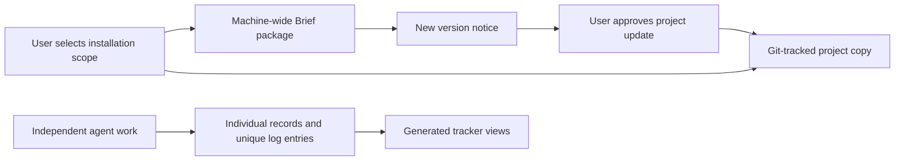

# PRD: Portable Brief Installs and Concurrent Project Records

**Author:** db / Codex · **Date:** 2026-10-10 · **Status:** Approved — user directed implementation and combined local testing
**Discovery:** Direct user reports; findings in [audit](AUDIT.md).
**Branch:** feature/portable-concurrent-workflows, based on the published lifecycle upgrade
at `02a3457`. The prior upgrade remains on feature/autonomous-lifecycle.

## Executive Summary

Let users install Brief globally for one machine or keep a complete, versioned project copy for
teammates and servers. Remove shared documentation write hotspots so independent agent work can
merge without editing the same log or tracker, while preserving meaningful same-item conflicts.

## Problem and Users

Project skill links currently point to one machine and are ignored by Git. Parallel agents also
edit shared project state; the existing checkout lock cannot prevent Git conflicts between branches
or duplicate sequential IDs allocated by separate clones. Users are team members, server-based
agents, and developers running several agent sessions or worktrees.

## Goals and Success Metrics

| Goal | Target / measurement |
|---|---|
| Portable project workflow | Fresh-clone fixture resolves 100% of bundled Brief references with original checkout/home absent |
| Safe installation/update | Zero modified or unowned files silently overwritten in migration/update fixtures |
| Independent concurrent work | Zero lost entries or aggregate-file merge conflicts for distinct features across 2 clones; 100% of duplicate-ID fixtures reported |
| Log collision safety | 100 entries created with the same mocked timestamp remain distinct and readable |
| Lossless migration | 100% of existing records, extra metadata, and legacy log bytes preserved |

## What We Are Building

### Applied Constraints

| Source / scope | Effect | Status |
|---|---|---|
| User approved tracked copies and reviewable updates | Local installs contain real files and complete dependencies; updates preserve edits | Decided |
| User wants global/local choice and gstack-style notifications | Scope is explicit; global package updates do not silently rewrite project copies | Decided |
| User wants legacy logs intact and new separate session records | Preserve old log files; new entries are uniquely named, session-associated files | Decided |
| Existing shared lifecycle policy | Resolve ambiguity; preserve scope; review all new issues; approvals still apply | Decided |
| Existing S-015 coordination limits | Cover separate clones and Git merges, not just local-process locks | Required |
| User chose authoritative item files / generated local trackers | Eliminate central write hotspots without losing tracker-only metadata | Decided |
| User chose human-readable feature-scoped story IDs | Each feature numbers its own stories; preserve old IDs and detect same-feature collisions | Decided; syntax finalized in TRD |

### Requirements and Scope Modes

| ID | Requirement | Priority |
|---|---|---|
| R1 | Offer global and project-local install scopes; recommend tracked local copies for shared repos; persist scope for repeat runs | Must |
| R2 | Local copies include required skills, references, rules, and agent guidance, with portable source/version/hash provenance; fresh clones work without the author's global installation | Must |
| R3 | Global installation uses a machine-owned Brief package; projects with local copies keep their selected version and clearly resolve it instead of silently taking global behavior | Must |
| R4 | Detect available updates, identify installed/available revisions, and offer an explicit update with a reviewable diff; preserve project customizations and support recovery on failure | Must |
| R5 | Re-running init is idempotent and preserves local edits; migrate old ignored links safely and keep machine caches outside tracked provenance | Must |
| R6 | Write new project logs as immutable, uniquely identified entry files associated with a session/agent; preserve legacy monolithic logs byte-for-byte and retain search access | Must |
| R7 | Enforce the new logging contract through CLI defaults, distributed guidance, and an executable repository validation check; existing hooks/custom CI are preserved | Must |
| R8 | Individual tracked records own state; tracker.yaml and PROJECT-TRACKER.md become generated local views outside routine commits; independent item/task changes do not rewrite shared authority | Must |
| R9 | Preserve tracker-only fields and unknown metadata during migration; block ambiguous duplicates or conflicting sources instead of silently selecting one | Must |
| R10 | New stories use human-readable feature-scoped IDs, such as checkout/S-001, and tasks retain that scope; existing IDs/links stay valid; duplicate or ambiguous IDs are reported without overwrite or first-match selection | Must |
| R11 | Keep same-item status changes and task ownership honest: independent-task progress must not clobber a shared current-task pointer; unresolved conflicting intent requires resolution | Must |
| R12 | Migration/update supports dry-run, explicit scope, backup/recovery, and verification; update all affected readers, commands, templates, and guidance together | Must |
| R13 | Cached update notices can be deferred or disabled; offline usage continues with the installed version | Should |
| R14 | Optional explicit live-link development mode, visibly machine-dependent | Should |

## What We Are NOT Building

No hosted coordination service, automatic push/merge, bulk changes to other project repositories,
automatic project upgrades, or historical log rewriting. A server still needs the normal CLI/runtime
dependencies when invoking CLI commands; copying instructions does not install those runtimes.

Different items should merge independently. Two agents changing the same item's meaning can still
conflict: surface that conflict; do not use union/ours/theirs or last-writer-wins to hide it. Legacy
sequential IDs remain valid. Missing update connectivity is distinct from a verified up-to-date result.

## Risks, Rollout, and Dependencies

| Risk | Likelihood / impact | Mitigation |
|---|---|---|
| Metadata lost when retiring combined tracker authority | High / high | Inventory every field, dry-run mapping, preserve legacy source, verify equivalence |
| Local/global instructions resolve differently by host | Medium / high | Explicit source selection and fresh-clone/provider registration fixtures |
| Update erases customized skills | Medium / high | Hash-based ownership/conflict detection, staged update, recoverable prior files |
| Agents bypass logging instructions | High / medium | CLI safe writes plus validation that detects legacy-log edits and invalid new records |
| Identifier change breaks parsers or links | High / high | Resolve policy first; inventory callers and test old/new IDs and branch merges |

Roll out in phases: install/update support, log enforcement, then approved tracker migration and
concurrency verification. Use temporary projects first. Existing project migrations are explicit;
this work does not authorize silently migrating every repository. Roll back if metadata, customized
files, or historical bytes change unexpectedly. Dependencies: existing file-based CLI, Git and
supported host discovery; no new database is proposed. gstack is a design reference, not a dependency.

## Open Decisions and Milestones

Tracker direction and feature-scoped story IDs are selected. User authorized implementing this
scope on top of the published lifecycle branch, testing both locally before any merge, and selected
selective execution. [Technical design](TRD.md) records the implementation decisions. No other
project migration or publication of this follow-up is authorized.

Milestones are approval-driven: PRD → TRD → stories/tasks → implementation/review/retro → publication
approval. No calendar deadline supplied. CLI flows need no browser verification.

## CLI-only npm onboarding — user clarification, 2026-10-10

The user confirmed MCP was removed and is not wanted. `brief install` installs the machine workflow
package in `~/.brief/workflow/`; `brief init` sets up a project using its selected scope. Ordinary
npm or npm-linked use requires no source argument. Explicit local directory/symlink sources are
development overrides, not remote downloads. Keep updates explicit and project copies pinned.
Test both source modes and an actual packed npm installation in isolated homes/projects. No real
home migration or npm publication is authorized by these tests.

## Release naming and pilot documentation — user choice, 2026-10-10

Use Brief for the product and documentation brand, getbrief for the npm package and GitHub repository,
and brief for the command and skill name.
Publish reader-facing setup/update/migration instructions and a one-project real-agent pilot before
push/merge. The selected repository rename does not change its visibility or publish branch contents.

## Pilot compatibility refinement — user approval, 2026-10-11

Read both `**Status**:` and `**Status:**` header forms, including related metadata labels, consistently
when scanning and validating records. Regeneration must preserve tracker-only metadata.
Keep one managed Brief lifecycle block per instruction file, with version and last-content-update
metadata; inner markers are optional only when necessary. Consolidate recognized stock legacy
harnesses without discarding custom instructions; unresolved custom content blocks replacement.
Formatting at marker boundaries must not produce false doctor failures. Unchanged init/update must
not churn timestamps or silently change pinned workflow content. Historical logs are unchanged;
the user will commit their existing Astro logs and recheck. Actual project/home migration is separate.
