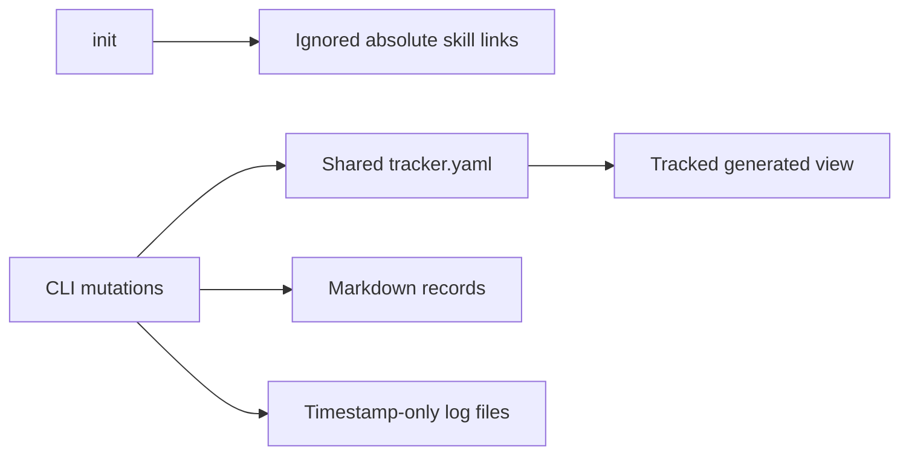
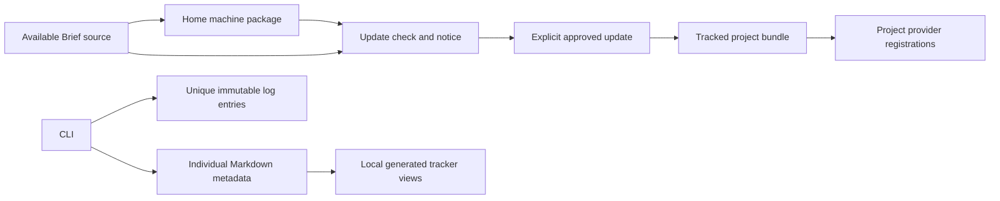
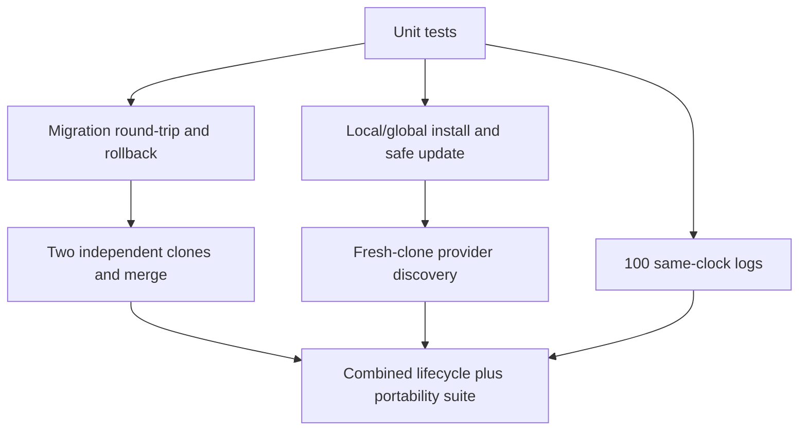

# TRD: Portable Installs and Concurrent Project Records

## Pilot compatibility refinement — 2026-10-11

Share record-header parsing between scanner and validator: recognize colon placement inside/outside
bold, constrain fields to the record header, and preserve tracker-only keys during legacy regeneration.
One `brief:workflow` block carries version and updated attributes, with stable metadata on no-op runs.
Use a shared block implementation for local/global installation, registration repair and doctor.
Accept harmless marker-boundary blank lines, while detecting meaningful edits and malformed markers.
Recognize complete shipped legacy harness bodies (formatting normalized for comparison only); remove
only recognized stock bodies. Custom legacy bodies are conflicts and remain byte-for-byte intact.
Repair registrations from the pinned package without adopting custom bundle hashes or updating content.
No new legacy-log exemption or actual Astro/home mutation is included.

Research regeneration reads the same top-level Markdown status labels as migration validation,
preserving descriptive text exactly; section-local component statuses remain excluded.
Validation compares full status strings; aliases or different qualifiers remain conflicts.
Research identity lookup checks explicit canonical/flat legacy IDs before unique-title fallback.
Explicitly registered feature-level epic records remain in the migration inventory.
The later T9 pilot preflight adds unique-title fallback for legacy research files lacking embedded or
filename IDs. Regeneration receives existing tracker items so adding a file cannot reassign old IDs.
Explicit identity takes precedence; duplicate titles/identities require reconciliation. Only a feature-level
story.md explicitly headed Epic, without record metadata, is treated as an overview; other unexpected
story files still block migration. Status strings remain verbatim (including qualifiers/emoji), rather
than being mapped to inferred lifecycle categories. No Astro status edits or normalizations are authorized.

**Date:** 2026-10-10 · **PRD:** [Approved scope](PRD.md)
**Authority:** User explicitly directed implementation of the selected model and combined local
testing. Selective mode chosen. This records technical decisions within that scope; unplanned
behavioral ambiguity still pauses dependent work.

## Current Architecture

Two read-only researcher passes assessed install/update boundaries and record/ID callers.

The scanner omits tracker-only metadata; task updates mutate a shared current_task pointer.
Global installation already has ownership checks/backups, while legacy project link replacement
can remove a real directory. Existing source and tests are retained as compatibility inputs.

## Applied Constraints

| Source | Design effect | Verification |
|---|---|---|
| User: local/global installation choice | Portable local bundle; separately managed machine package | Fresh clone with original home/source absent |
| User: project updates visible in Git | Pinned manifest and hashes; explicit update, no silent overwrite | Customized-file and update-diff fixtures |
| User: generated local trackers | Individual Markdown owns metadata; views are reconstructible | Two-clone merge and metadata round-trip |
| User: feature-scoped IDs | feature/S-NNN canonical new IDs; old IDs remain unchanged | Scoped resolution and duplicate refusal |
| User: legacy logs unchanged | New immutable session-associated files; legacy read-only search | Byte hashes and same-clock creation |
| Coding style / existing storage | ESM named functions, node: imports, existing YAML parser, atomic writes | Node tests and integrity checks |
| User: test both branches before merge | Parent branch remains published/unmerged; follow-up is stacked | Full suite, source checks, isolated combined install |

## Target Architecture and Decisions

### Record authority

- Existing projects retain legacy operation until explicit `brief tracker migrate-authority`.
  Fresh init enables record authority. A small tracked `.brief/records.json` marker identifies
  the schema; it does not change per record or per session.
- Use one codec for all record shapes. Add/preserve YAML frontmatter even on legacy bold-header
  story files. `_brief` contains `{version: 1, record_id: <immutable UUID>, item: <metadata>, legacy:
  <old progress pointers>}`. Reject existing reserved mappings and mismatched visible identity/status.
  Embed complete tracker metadata under this reserved `_brief` YAML mapping in each existing
  canonical Markdown file. Preserve existing frontmatter and body; mirror existing visible status
  fields on CLI updates. The mapping avoids clobbering historical memory `type` fields or project
  frontmatter. Unknown keys, nulls, arrays and nested values survive migration.
- The read path inventories records and validates identity. Missing/damaged metadata, duplicate IDs,
  or conflicting source mappings are errors rather than first-seen deduplication. Record commands
  update only changed canonical records; routine commands never rewrite generated tracker views.
  Omitting an item from a stale collection never deletes its file. Missing/malformed canonical
  files block migration; do not manufacture placeholder records.
- Each task remains one file. Derived active-task lists/counts replace mutation of a story's
  current_task/last_task pointer in record mode; retain old values in `_brief.legacy`, never as active state.
- Generate tracker.yaml / PROJECT-TRACKER.md explicitly from records. They are ignored local views;
  migration preserves prior bytes and reports any tracked paths that must be untracked to remove
  merge noise. No ours/theirs/union merge driver.

Alternatives: per-item JSON sidecars would preserve metadata but create two state files per item;
pure regex reconstruction loses unknown fields. Embedded namespaced metadata keeps each item atomic.

### IDs and content mutation

- New canonical story ID: `checkout/S-001`; physical path remains
  `documentation/stories/checkout/S-001/story.md`. Task: `checkout/S-001-T1`.
- Validate feature as one safe slug component. Allocate within that feature, using local locking
  and exclusive creation to prevent same-checkout overwrites. Keep old global IDs untouched.
- Centralize resolution: exact canonical ID first, legacy ID where present, otherwise a bare short
  ID only when unambiguous. Show qualified alternatives on ambiguity.
- Independent clones creating the same feature/story number produce a real conflict. New records
  retain an immutable internal identity so identical display titles cannot hide independent creation.
  Report unresolved Git markers, duplicate IDs and inconsistent identities. Human-visible IDs stay readable.

Alternative: random visible suffixes were rejected by the user in favor of feature scope. A hosted
allocator would undermine offline portability and is outside scope.

### Logging and enforcement

- New entries use a session token plus timestamp and random entry identity, with exclusive creation;
  no mutable session index. Keep files directly under documentation/logs for existing readers.
- Explicit `--session` and `--agent` metadata; defaults are local process/session identifiers, not a
  shared counter. YAML serialization handles arbitrary note text safely.
- `brief verify-records` validates record mode and new log schemas. With `--base=<ref>` it detects
  edits/deletions to historical monolithic logs, mutation of existing immutable entries, and tracked
  aggregate-view edits in record mode. CLI returns nonzero for violations.
- Distribute the command and rules in provider guidance and run it during review/verification.
  Do not replace custom hooks/CI or claim instructions prevent every direct filesystem edit.

### Portable installation and updates

- Canonical local bundle: `.brief/workflow/` with skills/brief, required shared rules/agents, adapter
  and generator assets. Track a manifest containing version/revision/content hashes and relative
  registration ownership. No absolute source path or machine timestamp in portable provenance.
  Its tracked manifest is `.brief/workflow/manifest.json`, separate from the old ignored machine manifest.
- Provider registrations use project-relative links or managed copies; project guidance explicitly
  selects the local bundle over any global Brief installation. Preserve outside-block instructions.
  Hosts: `.agents` universal and `.claude`/`.codex` skill registrations, Claude Markdown agents,
  Codex generated agents, plus a Gemini project instruction block reading the canonical bundle.
- Machine package: a managed workflow directory below the existing home `.brief` directory. Scope
  is selected with `brief init --scope=local|global` and remembered; local is the fresh-repo default.
  Global registrations reuse the safe installer with an explicit source package.
- `brief update --check|--dry-run|--apply`, optionally `--global` and `--source=<checkout/package>`.
  Candidate sources are the machine package or installed CLI source. Refreshing that source from
  upstream is separate; checks do not silently fetch/execute a remote checkout.
- Compare available content/revision with installed provenance. Report file additions/changes/removals.
  A locally changed managed file is a conflict when an update would replace it; preserve it and
  show resolution requirements. Stage/backup before replacement; validate destination ownership
  and containment before writes. Repeated init must not perform an upgrade implicitly.
  Run preflight before scaffold/harness writes. Unrelated worktree edits are allowed; dirty managed
  files are preserved. Stage the complete candidate, record recovery state/backups, and publish
  the manifest last. Doctor detects unfinished installation; explicit recovery restores only
  transaction-owned files. Remove only managed ignored-link entries after a successful migration.
- Update notices compare against an available local package and can be snoozed/disabled in ignored
  machine state. A missing candidate is unknown, not up-to-date. CLI runtime remains separately installed.

Alternative: global live links remain explicit development use, not tracked project content.
gstack's scope detection and notifications inform the flow; automatic project upgrades are excluded.

## Migration and Rollback

1. Inventory old tracker and exact Markdown destinations; reject duplicate IDs, missing files,
   contradictory metadata, malformed YAML, and foreign install destinations before changing state.
2. Dry-run lists writes. Explicit apply records backups and fingerprints, enriches files, verifies
   round-trip metadata, then activates the marker and generated-view ignore policy.
3. Migration recovery restores only recorded touched files, refuses to overwrite post-migration
   user edits, and verifies restored bytes. Historical logs never participate in rewriting.
4. Installation uses recorded ownership and backups; customized/unowned content is never removed
   by legacy createLink. Global and local updates affect only the explicitly selected scope.

## Errors and Failure Modes

| Trigger | Handler / user result |
|---|---|
| Invalid or ambiguous ID | Fail with candidates and no mutation |
| Conflicting/unknown migration metadata | List exact records/fields; leave legacy authority intact |
| Lock contention or existing new file | Retry bounded local operation or fail clearly; no overwrite |
| Interrupted write/update | Atomic file replacement, recoverable staged backups; never report success prematurely |
| Modified/unowned install artifact | Preserve it; show conflict and explicit resolution path |
| Missing update source | Report unknown/unavailable; installed workflow stays usable |
| Legacy log or aggregate-view violation | Nonzero validation result with offending paths |

## Testing and Verification

Required: existing Node suite, old/new ID/task/search tests, unknown-field preservation, dry-run
zero writes, rollback byte equality, conflicting records preserved, generated views reconstructible,
same-feature collisions surfaced, independent task progress retained, local/global isolation, update
conflicts and offline notice behavior, source references/metadata, and installed-bundle closure.
Run end-to-end tests in isolated projects/homes; do not migrate unrelated repositories or merge branches.

## Security, Performance, and Dependencies

Validate paths, scope and ownership; reject symlink traversal into unrelated data. No credentials,
remote services or DB migrations are introduced. Read/update checks operate on small local file
trees; cache optional notices, and never cache authoritative task state. Use existing YAML/Node/Python
dependencies. No new DB, package manager, network service or merge driver is required.

## Implementation Order

1. Canonical record metadata, lossless migration/recovery, read/write integration and tests.
2. Feature-scoped IDs, independent task progress, immutable logs and executable validation.
3. Portable bundle/global package, scoped init/update/doctor, safe legacy link handling and tests.
4. Update distributed guidance and complete combined fresh-clone/concurrency verification; review,
   fix all introduced findings, retro/curation, and final local report before publication.

## Open Questions

No product-choice blocker remains. Any concrete metadata conflict found during real migration is
reported before that migration. Local fixture testing does not authorize migrating unrelated projects.

## T5: CLI-only distribution contract

- Remove stale MCP help, configuration writer, server route and knowledge.db lookup; preserve historical records.
- `brief install [--dry-run] [--source=<local-path>]` creates the home workflow package using the
  existing ownership/preflight/transaction machinery. Repeated install preserves a pinned package;
  upgrades use `brief update --global`. No npm postinstall mutates a user's home.
- Project source precedence: explicit local override, available home package, installed CLI assets.
  Global install/update defaults to installed CLI assets. Repeated init preserves its existing package.
- Accept directory symlinks as explicit source roots, but keep internal path safety checks. Reject
  URL sources with an actionable local-path message; do not fetch remote code implicitly.
- Test handler/library home injection using temporary roots, without modifying HOME. Validate the
  npm tarball contains runtime assets, and exercise its installed modules independently of the checkout.
