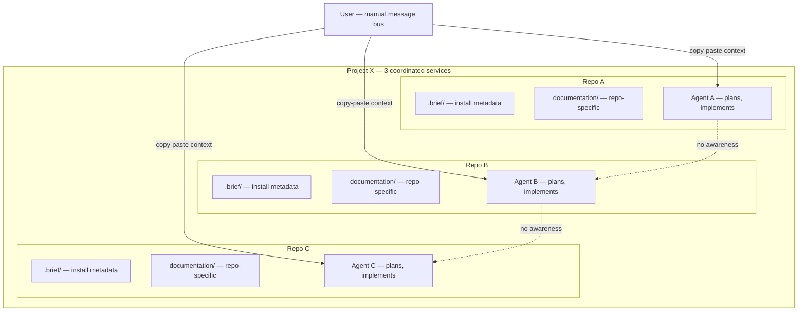
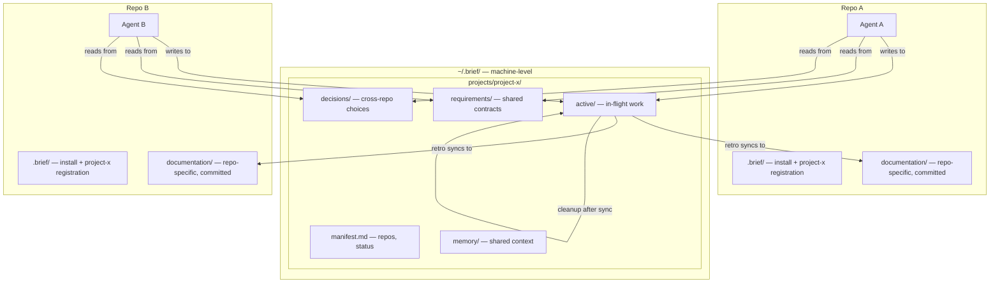

# Discovery: Shared Agent Workspace & Portable Install

## Current Reality

**How it works today:**
- Each repo has its own `.brief/` (install metadata, workflow bundle) and `documentation/` (stories, memory, decisions)
- Agents on different repos have zero shared context
- The user manually relays plans, decisions, and requirements between agents
- Feature-scoped IDs prevent merge collisions but don't enable coordination
- Retro writes to feature-specific files but doesn't sync back to other repos

**Pain points:**
- User becomes a manual message bus across agents — copy-pasting summaries, preparing notes
- Missed relays → conflicts, duplicate planning, half-baked implementations
- Cross-service coordination (3+ repos) is worst — each agent doesn't know what the others need
- On cloud/CI environments, Brief can't be installed easily (no npm package, no one-liner)

**Existing workarounds:**
- User writes notes/docs and points agents to them
- User asks agents to prepare summaries for other agents
- Feature-scoped IDs prevent file collisions (but not planning collisions)

## Mode

**Greenfield** — existing infrastructure (`.brief/`, `documentation/`, portable installs) to build on, but the coordination layer and shared workspace are new architectural scope.

## Forcing Questions — Answers

| # | Question | Answer |
|---|----------|--------|
| 1 | Who is affected? | Developer running multiple AI agents across multiple service repos simultaneously |
| 2 | What do they do today? | Copy-paste context between agents, write notes for agents to reference. Missed relays → conflicts, delays, half-baked work. Cross-project (3 services) is worst. |
| 3 | How will you know it worked? | Agents across repos can read each other's plans/decisions/context without user relaying. Each agent checks shared space and acts on what it finds. |
| 4 | Smallest valuable version? | Multi-repo shared space at project level. Agents check at natural checkpoints (planning, task start). No pub/sub or auto-trigger needed day 1. |
| 5 | Already tried/ruled out? | Manual note-sharing only. Nothing else tried. |

## Competitive Research

### gstack (garrytan/gstack)
- Claude Code skill suite with 23 specialized roles
- `~/.gstack/` holds machine-local runtime state; per-project `.gstack/` is gitignored
- Almost nothing committed to repos (just CLAUDE.md stubs)
- No cross-project coordination mechanism

### gbrain (garrytan/gbrain)
- Heavyweight knowledge DB (PGLite/Postgres + pgvector, 156K pages, OAuth per agent)
- MCP for cross-agent coordination
- 6-tier precedence chain (project → org → global)
- Database-backed, not file-based — much heavier than Brief needs

### Brief's position
- File-based, no DB — lighter than gbrain, more persistent than gstack
- Planning artifacts committed to repo — unique approach
- Shared workspace as working surface (not permanent store) — neither gstack nor gbrain do this

## Brainstorm

### User lens
1. Agents who work across 3 coordinated services need a way to see each other's plans and decisions so they can build compatible implementations without the user relaying
2. Agents who start a planning phase need a way to know what's already been discovered/decided in related projects so they can avoid duplicate work
3. Agents who finish implementation need a way to announce what changed and what contracts were affected so they can unblock dependent agents

### Technical lens
1. A central `~/.brief/projects/<name>/` that groups repos into a logical project, with shared requirements/decisions/memory
2. Brief lifecycle phases (discover, plan, implement) read the shared space at entry by default
3. Completion triggers sync-to-repo-memory + cleanup — shared space is temporary working surface

### Business lens
1. Portable install (curl|bash or npx) removes biggest adoption friction for cloud/CI
2. Multi-repo coordination is a unique differentiator — no other file-based tool does this
3. Retro-syncs-to-repo means project repos stay self-documenting even without Brief installed

## Top Opportunities (ranked)

| # | Opportunity | Score |
|---|------------|-------|
| O1 | **Project-scoped shared workspace** — `~/.brief/projects/<name>/` as coordination layer for multi-repo agents | High |
| O2 | **Lifecycle-integrated reading/writing** — brief phases automatically check and contribute to shared space | High |
| O3 | **Completion-driven cleanup** — work done → sync relevant knowledge back to each repo → clean shared space | Medium |
| O4 | **Portable install** — one-liner install for cloud/CI environments | High |

## Assumptions & Risk Table

| # | Assumption | Category | Impact × Risk | Status |
|---|-----------|----------|---------------|--------|
| A1 | Agents on different repos can usefully coordinate through shared files without real-time signaling | Feasibility | High × Medium | Must validate |
| A2 | A project-scoped folder scales to 3-10 repos without becoming noisy | Usability | High × Medium | Must validate |
| A3 | Agents will check shared space at brief lifecycle checkpoints without explicit user prompting | Usability | High × High | Must validate |
| A4 | File-based coordination on a single machine covers the primary workflow | Value | High × Low | Confident |
| A5 | Markdown format is sufficient for agent consumption (no structured parser needed) | Feasibility | Medium × Low | Confident |
| A6 | Cleanup-on-completion keeps the shared space from going stale | Usability | High × Medium | Must validate |
| A7 | A curl|bash installer can handle Node.js dependency resolution | Feasibility | Medium × Low | Confident |

## Pre-Mortem

### Technical — shared space becomes a dumping ground
Agents write verbose context, other agents can't find what's relevant. Signal-to-noise collapses.
**Must-mitigate**: Structured folder layout with clear sections. Compact summaries, not full PRDs.

### Product — agents don't know what to look for
Without clear conventions, agents read everything (wasting context window) or nothing.
**Must-mitigate**: Convention for what gets written and when agents read. Brief phases handle this.

### Process — shared context goes stale
Project A finishes but its context remains. Agents on Project B act on outdated information.
**Must-mitigate**: Completion-driven cleanup. Timestamps + status markers for freshness.

### External — native multi-agent coordination arrives
Claude Code or other frameworks build shared memory natively, making file-based approach redundant.
**Acceptable**: File-based is a bridge. If native coordination arrives, Brief's format can become an export target.

## Experiments

### E1: Manual shared folder test
- **Assumption**: A1 (file-based cross-project coordination works)
- **Experiment**: Create `~/.brief/projects/test-project/` manually. On next 3-service task, write structured summaries there before switching agents. See if agents consume them usefully.
- **Signal**: Agents act on shared context without user copy-pasting.
- **Effort**: Hours
- **Before building?**: Yes

### E2: Lifecycle checkpoint integration
- **Assumption**: A3 (agents check shared space without prompting)
- **Experiment**: Add "read shared space" step to Brief's planning and implement phase skills. Run 2-3 stories across repos.
- **Signal**: Agents reference cross-project context in their plans unprompted.
- **Effort**: Days
- **Before building?**: Partially (small skill modification)

## Proposed Architecture

**Hierarchy** (start with project, scale later):
- `~/.brief/projects/<name>/` — groups N repos into a logical project
- `~/.brief/orgs/<name>/` — future: org-level shared context
- `~/.brief/global/` — future: cross-project context

**Lifecycle**:
1. Agent starts planning → reads `~/.brief/projects/<registered-project>/`
2. Agent produces decisions/requirements → writes to shared space
3. Agent on another repo starts → finds shared context, acts on it
4. Work completes → retro syncs relevant knowledge to each repo's `documentation/memory/`
5. Shared space cleaned up — no stale accumulation

## Design Decisions (from discovery)

| Decision | Choice | Rationale |
|----------|--------|-----------|
| Coordination unit | Project (groups N repos) | Matches real-world: "Project X" has 3 services |
| Shared space location | `~/.brief/projects/<name>/` | Machine-level, all repos can read/write |
| Format | Markdown | Human-readable, agents parse naturally, no extra tooling |
| Trigger mechanism | Lifecycle checkpoints, not pub/sub | Simpler, no file watchers needed day 1 |
| Shared space lifecycle | Temporary working surface | Completion → sync to repo memory → cleanup |
| Install portability | curl\|bash first, NPM follow-up | Solves cloud/CI without overengineering |

## Recommended Path

**Two-track approach:**

1. **Shared workspace** (architecture) — Build `~/.brief/projects/` structure. Integrate into brief lifecycle phases. Retro drives sync-back and cleanup. Start at project level; org/global later.

2. **Portable install** (plumbing) — `curl | bash` installer that puts `brief` on PATH. NPM publish as follow-up.

## Open Questions

- What exactly gets written to shared space? Compact summaries? Contract definitions?
- How does a repo register itself to a project? (`brief init --project=X`? `.brief/project.json`?)
- Should shared space support multiple active stories per project, or one at a time?
- How does cleanup handle partially-completed multi-repo work?

## Next Step

Ready for `/brief prd` scoped to the shared workspace architecture, with portable install as a companion story.
