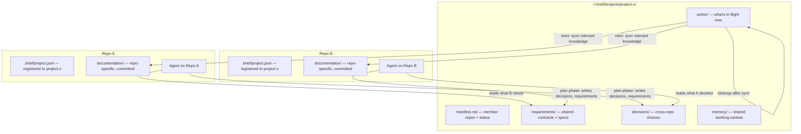
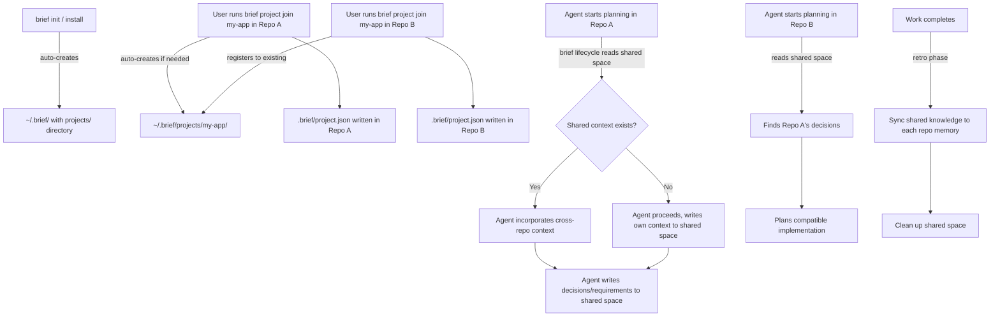

# PRD: Shared Agent Workspace & Portable Install

**Author**: User + Claude
**Date**: 2026-10-26
**Status**: 🔒 Approved
**Discovery**: [DISCOVERY.md](./DISCOVERY.md)

## Executive Summary

When multiple AI agents work across coordinated service repos, the user becomes a manual message bus — relaying plans, decisions, and context between agents. Brief needs a project-scoped shared workspace (`~/.brief/projects/`) where agents across repos read and write coordination context at natural lifecycle checkpoints, plus a portable installer so Brief works on any machine without manual setup.

## Problem

Developers running concurrent AI agents across 3+ coordinated service repos must manually copy-paste plans, decisions, and requirements between agents. Missed relays cause duplicate planning, conflicting implementations, and half-baked cross-service work. The problem scales badly: more services and more agents means more relays to manage. Separately, Brief currently requires `npm link` or manual cloning — it can't be installed on cloud/CI environments with a one-liner.

## Users

| Segment | Pain Level | Current Workaround |
|---------|-----------|-------------------|
| Developer running multi-agent across repos | High | Copy-paste summaries, prepare notes for agents, manually point agents to docs |
| Developer setting up Brief on cloud/CI | Medium | Clone repo + npm link, or skip Brief entirely |

## Goals & Success Metrics

| Goal | Metric | Target | Measurement Method |
|------|--------|--------|-------------------|
| Eliminate manual context relay | User copy-paste actions per cross-repo story | 0 (agents self-serve from shared space) | User observation over 3 stories |
| Agents find cross-repo context | Plans that reference shared context unprompted | >80% of planning phases | Audit plan outputs |
| No stale shared context | Shared items older than 7 days without activity | 0 | `brief project status` check |
| One-liner install | Commands to get `brief` on PATH | 1 | Test on fresh cloud VM |

## What We Are Building

A **project-scoped shared workspace** at `~/.brief/projects/<name>/` that groups multiple repos into a logical coordination unit. Brief lifecycle phases (discover, plan, implement, retro) read and write to this shared space at natural checkpoints. Completed work syncs relevant knowledge back to each repo's `documentation/memory/` and cleans up the shared space.

Plus a **portable installer** (`curl | bash` or `npx getbrief`) that puts Brief on PATH from any environment.

### Applied Constraints

| Source | Scope/status | Effect on requirements | Unresolved choice |
|--------|--------------|------------------------|-------------------|
| Portable installs memory | Active, approved | Local/global scope model preserved. `.brief/` already has `install.json`, `records.json`, `workflow/`. New `project.json` must coexist. | None |
| File-based architecture | Active, core principle | No database, no MCP server. Shared space is pure Markdown files. | None |
| Canonical Markdown records | Active, approved | Shared space files follow same record conventions (frontmatter, `_brief` metadata) | Whether shared records get IDs from the project or the repo |
| Immutable logs | Active, approved | Shared space log entries are append-only, one file per entry | None |
| First-principles rule | Active | Question whether org/global levels are needed now — start with project only | None |

### Requirements

| # | Requirement | Priority | Notes |
|---|------------|----------|-------|
| R1 | `brief init` (or install) auto-creates `~/.brief/` global folder with `projects/` directory | Must-have | No separate create step — global structure exists from install |
| R2 | `brief project join <name>` registers current repo to a project via `.brief/project.json`; auto-creates `~/.brief/projects/<name>/` if it doesn't exist | Must-have | Implicit project creation on first join |
| R3 | Brief lifecycle phases (discover, plan, implement) read `~/.brief/projects/<registered-project>/` at phase entry | Must-have | Core coordination mechanism |
| R4 | Agents can write decisions, requirements, and active-work summaries to the shared space via CLI | Must-have | `brief project share <type> "content"` |
| R5 | Shared space uses Markdown format with frontmatter metadata | Must-have | Consistent with existing Brief conventions |
| R6 | Retro phase syncs relevant shared knowledge back to each member repo's `documentation/memory/` | Should-have | Drives cleanup |
| R7 | Completed/resolved shared items are archived or removed, not left to accumulate | Should-have | Prevents stale context |
| R8 | `brief project status` shows all member repos, active work, and shared context summary | Should-have | |
| R9 | `curl -fsSL <url> \| bash` installs Brief globally and puts `brief` on PATH | Must-have | Cloud/CI portability |
| R10 | `npx getbrief init` works as alternative install path | Nice-to-have | NPM publish follow-up |
| R11 | Manifest tracks which repos belong to the project and their roles/dependencies | Must-have | |
| R12 | Multiple projects can exist simultaneously (`~/.brief/projects/x/`, `~/.brief/projects/y/`) | Must-have | |

### User Flows

## What We Are NOT Building

- **NOT**: Real-time pub/sub or file watchers — agents check at lifecycle checkpoints, not continuously
- **NOT**: Org-level or global-level shared spaces — start with project level only, scale later
- **NOT**: Cross-machine sync — shared space is local filesystem (`~/.brief/`), same machine only
- **NOT**: Agent-to-agent messaging — this is a shared bulletin board, not a chat system
- **NOT**: Conflict resolution — if two agents write to the same shared file, last-write-wins (same as git)
- **NOT**: A database or query engine — Markdown files, `brief search` works across them
- **NOT**: Access control or permissions — any agent on the machine can read/write any project

## Triggers & Edge Cases

| Trigger / Edge Case | Expected Behavior |
|--------------------|-------------------|
| Repo joins project that doesn't exist yet | Auto-creates `~/.brief/projects/<name>/` with manifest and standard folders |
| Repo already belongs to a project, joins another | Allowed — a repo can belong to multiple projects |
| Shared space has stale items (>7 days, no activity) | `brief project status` warns. Retro cleans up. |
| Agent reads shared space but finds nothing relevant | Agent proceeds normally — shared space is additive, not blocking |
| Two agents write to shared space simultaneously | Separate files per write (like `brief log`) — no collision |
| Project has no member repos | Valid state — project folder exists but is empty until repos join |
| `brief project join` on a project that already exists | Idempotent — registers repo, doesn't recreate project |
| Install script runs on machine without Node.js | Installer detects and either installs Node or fails with clear message |

## Dependencies

- Existing `.brief/` folder structure (install.json, records.json, workflow/) — must coexist
- Brief CLI infrastructure (commands, search, record management)
- Brief lifecycle skill phases (discover, plan, implement, retro) — need modification to read shared space
- Hosting for install script (GitHub raw or similar)

## Risks

| Risk | Likelihood | Impact | Mitigation |
|------|-----------|--------|------------|
| Shared space becomes noisy/unusable | Medium | High | Structured folders, compact Markdown format, retro-driven cleanup |
| Agents don't check shared space reliably | Medium | High | Built into lifecycle phases — not optional, not agent-dependent |
| Stale context misleads agents | Medium | High | Timestamps + status markers, cleanup on completion, `brief project status` warns |
| Install script breaks on edge-case environments | Low | Medium | Test on major cloud providers (AWS, GCP); fail with clear error |
| Scope creep into org/global levels | Medium | Low | Explicitly out of scope — project level only for v1 |

## Open Questions

- [ ] Should shared requirements use the same ID scheme as repo-level stories (feature-scoped) or a separate project-scoped scheme?
- [ ] What's the exact folder structure inside `~/.brief/projects/<name>/`? (manifest.md + requirements/ + decisions/ + memory/ + active/ is the current proposal)
- [ ] Should `brief project share` be a single command or separate per type (`brief project decision`, `brief project requirement`)?
- [ ] Where does the install script live? GitHub release artifact? Separate `install.getbrief.dev` domain?
- [ ] Should the installer also run `brief init` in the current directory, or just put the CLI on PATH?

## Timeline

| Milestone | Target Date | Notes |
|-----------|------------|-------|
| PRD Approved | | |
| TRD Complete | | Architecture decisions for shared space + installer |
| Implementation Start | | |
| MVP / First Testable | | Shared workspace + curl installer working |
| Launch | | Published to NPM, tested across real multi-repo project |
