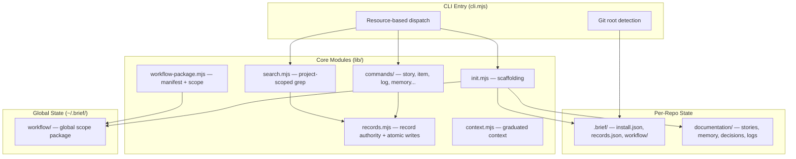
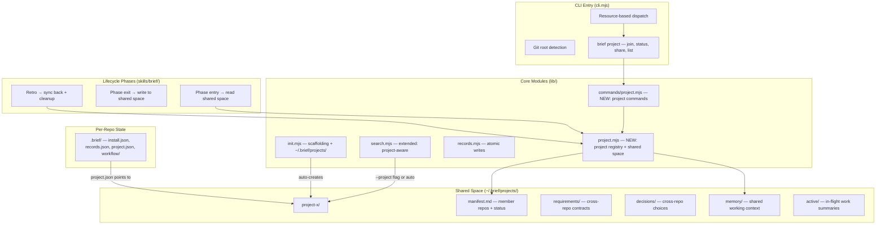
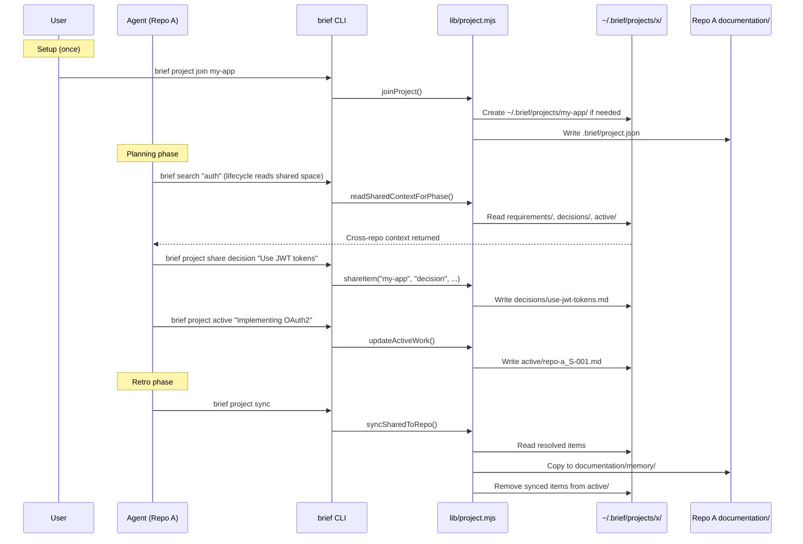
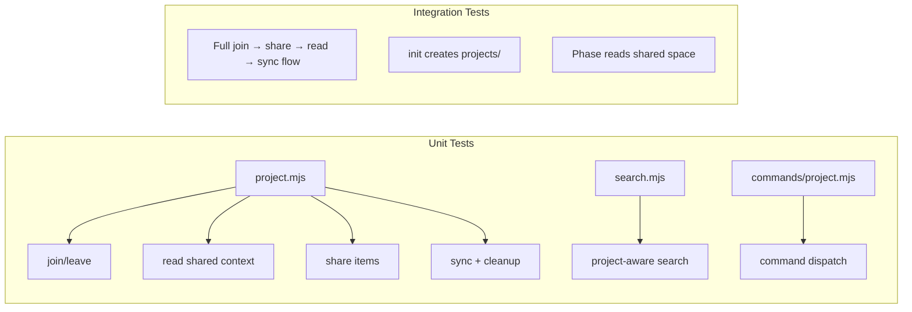

# TRD: Shared Agent Workspace & Portable Install

**Author**: Claude
**Date**: 2026-10-31
**Status**: Draft
**PRD**: [PRD.md](./PRD.md)

## Overview

Add a project-scoped shared workspace at `~/.brief/projects/<name>/` that multiple repos can join, enabling cross-repo agent coordination through Brief's existing lifecycle phases. Extend the CLI with `brief project` commands. Add a portable shell installer for cloud/CI environments.

## Current Architecture



**Key constraints**: Search is project-root-scoped only. No cross-directory lookups. `~/.brief/` currently holds only the global workflow package. All writes use atomic temp+rename pattern.

## Applied Constraints

| Source decision/rule | Scope/status | Effect on design | Verification or unresolved choice |
|----------------------|--------------|------------------|-----------------------------------|
| File-based architecture | Active, core | Shared space is Markdown files, no DB. Uses existing atomic write pattern from records.mjs | None |
| Portable installs memory | Active, approved | `.brief/` already has install.json, records.json, workflow/. New project.json coexists alongside them | None |
| Canonical Markdown records | Active, approved | Shared space files use frontmatter metadata consistent with existing conventions | Shared items use project-scoped IDs (not repo-scoped) |
| Immutable logs | Active, approved | Shared log entries are one-file-per-write, append-only | None |
| Coding style rules | Active | camelCase functions, UPPER_SNAKE constants, kebab-case .mjs files, atomic writes, ESM, node: prefix | None |
| First-principles rule | Active | No org/global level yet. No pub/sub. Project level only | None |

## Proposed Architecture



### What Changes

| Component | Change Type | Description |
|-----------|------------|-------------|
| `lib/project.mjs` | New | Core module: read/write shared space, manage project registry, sync-back |
| `lib/commands/project.mjs` | New | CLI command handler: join, status, share, list, leave |
| `cli.mjs` | Modified | Register `project` resource in command dispatch |
| `lib/init.mjs` | Modified | Auto-create `~/.brief/projects/` directory during init/install |
| `lib/search.mjs` | Modified | Accept project scope; search shared space when project.json exists |
| `skills/brief/references/shared-context.md` | New | Reference doc for phases to read shared space |
| `skills/brief/*/SKILL.md` (discover, plan, implement, retro) | Modified | Add shared space reading at phase entry |
| `scripts/install.sh` | New | Portable curl\|bash installer |
| `package.json` | Modified | Prepare for NPM publish (name: getbrief, files field, etc.) |

## Data Model

No database. All state is filesystem.

### `.brief/project.json` (per-repo)

```json
{
  "projects": ["project-x", "my-saas"],
  "joined_at": {
    "project-x": "2026-10-31T00:00:00.000Z",
    "my-saas": "2026-10-31T00:00:00.000Z"
  }
}
```

A repo can belong to multiple projects. The file is committed with the repo so team members inherit the project association (they still need Brief installed locally with `~/.brief/` on their machine).

### `~/.brief/projects/<name>/` (shared space)

```
~/.brief/projects/project-x/
├── manifest.md          # member repos, roles, status
├── requirements/        # cross-repo contracts, specs
│   └── api-contract-auth.md
├── decisions/           # cross-repo technical decisions
│   └── shared-auth-flow.md
├── memory/              # shared working context
│   └── auth-service-migration-notes.md
└── active/              # in-flight work summaries (one per repo per story)
    ├── repo-a_S-001.md
    └── repo-b_S-003.md
```

### `manifest.md` format

```markdown
---
name: project-x
created: 2026-10-31
repos:
  - path: /Users/db/Work/project-x/api
    name: api
    joined: 2026-10-31
  - path: /Users/db/Work/project-x/web
    name: web
    joined: 2026-10-31
---

# project-x

Multi-service SaaS app with API, web frontend, and worker.
```

### Shared item format (requirements/, decisions/, memory/)

```markdown
---
title: Auth API contract v2
type: requirement
created: 2026-10-31
updated: 2026-10-31
source_repo: api
status: active
---

# Auth API contract v2

POST /api/auth/token returns { access_token, refresh_token, expires_in }.
All services must validate tokens via the shared JWT secret.
```

### Active work summary format (active/)

```markdown
---
repo: api
story: S-001
title: Implement OAuth2 flow
status: in_progress
updated: 2026-10-31
---

# api — S-001: Implement OAuth2 flow

## What's happening
- Adding OAuth2 authorization code flow
- New endpoints: /auth/authorize, /auth/token, /auth/callback

## What other repos need to know
- Token format changing from opaque to JWT
- New shared secret required in env: AUTH_JWT_SECRET

## Blocked on / waiting for
- Nothing currently
```

## API Design

### CLI Commands

| Command | Action | Description |
|---------|--------|-------------|
| `brief project join <name>` | Register | Join current repo to a project; auto-creates project if needed |
| `brief project leave <name>` | Unregister | Remove current repo from a project |
| `brief project list` | Read | List all projects on this machine |
| `brief project status [name]` | Read | Show member repos, active work, shared context for a project |
| `brief project share <type> "title"` | Write | Write a requirement/decision/memory to shared space |
| `brief project active "title"` | Write | Write/update active work summary for current repo+story |
| `brief project sync` | Sync | Retro-driven: sync shared knowledge to repo memory, clean up resolved items |
| `brief project search "<query>"` | Read | Search across shared space (also available via `brief search --project`) |

### `lib/project.mjs` exports

```javascript
// Core operations
export function joinProject(projectRoot, repoRoot, projectName) { ... }
export function leaveProject(projectRoot, repoRoot, projectName) { ... }
export function getRepoProjects(repoRoot) { ... }

// Shared space read
export function readSharedContext(projectName) { ... }
export function readActiveWork(projectName) { ... }
export function searchSharedSpace(projectName, query) { ... }

// Shared space write
export function shareItem(projectName, type, title, content, sourceRepo) { ... }
export function updateActiveWork(projectName, repoName, storyId, summary) { ... }

// Lifecycle integration
export function readSharedContextForPhase(repoRoot) { ... }

// Sync and cleanup
export function syncSharedToRepo(projectName, repoRoot) { ... }
export function cleanupResolved(projectName) { ... }

// Queries
export function listProjects() { ... }
export function projectStatus(projectName) { ... }
```

## System Design

### Component Interaction



### Design Decisions

| Decision | Options Considered | Chosen | Rationale |
|----------|-------------------|--------|-----------|
| Shared space location | A) `~/.brief/projects/` B) Separate git repo C) Per-repo `.brief/shared/` | A) `~/.brief/projects/` | File-based, no git overhead, all repos on same machine can access. B adds git complexity. C doesn't enable cross-repo sharing. |
| Project creation | A) Explicit `brief project create` B) Auto-create on first `brief project join` | B) Auto-create on join | Fewer commands to learn. No empty projects that never get used. User feedback: no explicit create step. |
| Shared item ID scheme | A) Repo-scoped (same as repo stories) B) Project-scoped sequential C) Slugs from title | C) Slugs from title | Shared items are cross-repo — repo-scoped IDs don't make sense. Sequential needs a counter file. Slugs are human-readable and collision-resistant for the expected volume (<50 items). |
| Lifecycle integration | A) Explicit `brief project read` in each phase B) Automatic via `readSharedContextForPhase()` C) Search-only (extend `brief search`) | B) Automatic | Core value prop: agents check shared space without prompting. A requires agent cooperation. C is too passive. |
| Sync mechanism | A) Manual `brief project sync` B) Auto on retro C) Both | C) Both | Retro should auto-sync, but manual sync is useful for mid-story checkpoints. |
| Active work tracking | A) Single file per project B) One file per repo per story C) One file per repo | B) One per repo per story | Granular enough to show what's in-flight, avoids write conflicts when multiple agents active on same repo. |
| Installer approach | A) curl\|bash script B) npx C) Homebrew D) Docker | A) curl\|bash, with B as follow-up | Simplest, works everywhere with Node.js. No registry account needed day 1. B requires NPM publish. |

### Design Patterns

- **Atomic writes**: All shared space writes use existing `atomicText()` from records.mjs (write to `.tmp`, rename to final)
- **One-file-per-write for active/**: Same pattern as `brief log` — prevents write conflicts between concurrent agents
- **Slug-based naming**: Same kebab-case slugging used for memory files — `title-to-slug.mjs` or inline
- **Frontmatter metadata**: Same YAML frontmatter pattern used across all Brief Markdown files

## Error Handling & Failure Modes

### Exception Table

| Error | Handler | User-Visible Result |
|-------|---------|---------------------|
| `~/.brief/` doesn't exist | `joinProject()` creates it | Transparent — user sees "Joined project X" |
| Project folder permissions error | Throw with path + permission details | "Cannot write to ~/.brief/projects/X: permission denied" |
| `.brief/project.json` missing during phase read | Skip shared context, proceed normally | No message — shared context is additive, not required |
| Manifest.md corrupted YAML frontmatter | Warn, skip manifest read, proceed | "Warning: Could not read project manifest for X" |
| Concurrent writes to same active/ file | Atomic writes prevent corruption; last write wins | No user-visible issue — content is latest agent's view |

### Failure Modes

| Failure | Trigger | Impact | Mitigation |
|---------|---------|--------|------------|
| Stale shared context | Repo finishes work but doesn't run retro/sync | Other agents act on outdated info | `brief project status` warns on items >7 days old; timestamps in frontmatter |
| Orphaned project | All repos leave but project folder remains | Disk clutter only — no functional impact | `brief project list` shows member count; user can `rm -rf` |
| Broken repo path in manifest | Repo moved or deleted after joining | `brief project status` shows stale repo | Status command validates paths, marks unreachable repos |
| Install script Node.js version mismatch | Machine has Node <18 | Brief requires Node 24 | Installer checks `node --version`, exits with clear message |

## Performance Considerations

- **Expected load**: 1-10 shared items per project, 1-5 concurrent agents. File I/O is negligible.
- **Bottlenecks**: None at this scale. `readSharedContextForPhase()` reads a handful of small Markdown files.
- **Search overhead**: Adding project scope to search adds one directory scan. Bounded by shared item count (<50).

## Security Considerations

- **No auth/authz**: Any process on the machine can read/write any project's shared space. Acceptable for single-user developer machine. Not suitable for shared servers.
- **No sensitive data**: Shared space holds planning artifacts, not credentials or secrets. Same trust model as `~/.brief/workflow/`.
- **Install script**: curl\|bash pattern has known trust issues. Mitigated by: hosting on GitHub (auditable), pinning to tagged releases, script validates checksums of downloaded artifacts.

## Dependencies

| Dependency | Type | Risk | Mitigation |
|-----------|------|------|------------|
| `~/.brief/` directory exists | Internal | Low | Auto-created by `brief init` or `brief project join` |
| Node.js 24 on target machine | External | Medium | Installer checks version, fails with clear message |
| GitHub raw/releases for install script | External | Low | Script is self-contained; can be vendored |
| Existing Brief CLI infrastructure (records.mjs, search.mjs) | Internal | Low | Extending, not replacing |

## Testing Strategy

| Layer | What to Test | Approach |
|-------|-------------|----------|
| Unit | `lib/project.mjs` — join, leave, read, write, sync, cleanup | Temp dirs simulating `~/.brief/` and repo roots. Mock `os.homedir()`. |
| Unit | `lib/commands/project.mjs` — CLI dispatch and argument parsing | Same as existing command tests |
| Unit | `lib/search.mjs` — project-aware search | Temp project with shared items, verify search returns them |
| Integration | Full flow: join → share → read from other repo → sync | Two temp repos joined to same project, verify end-to-end |
| Integration | `brief init` creates `~/.brief/projects/` | Verify directory exists after init in temp home |
| Integration | Lifecycle phase reads shared context | Verify phase skill output includes shared context reference |

### Coverage Diagram



## Verification (beyond tests)

- **Manual verification**: Join 2+ repos to a project, run `brief project share` from one, verify `brief project status` shows it from the other
- **Smoke test**: `brief project join test && brief project status test && brief project leave test`
- **Lifecycle test**: Run `/brief discover` in a repo that's joined to a project with shared context — verify discovery references it

## Rollback Plan

| Scope | Revert Strategy | Data Implications | User Impact |
|-------|----------------|-------------------|-------------|
| CLI commands | Git revert the commits | No data loss — shared space files persist independently | Commands unavailable but files still readable |
| Shared space structure | `rm -rf ~/.brief/projects/` | Loses shared context; repo `.brief/project.json` files become inert | Repos continue working normally without shared context |
| Init changes | Revert init.mjs changes | New installs won't create `projects/`; existing ones unaffected | No impact on existing installs |
| Install script | Remove from hosting | No impact — already-installed Brief continues working | New cloud installs use npm link fallback |

Reversibility: **5/5** — all changes are additive. Removing them leaves existing Brief functionality intact.

## Open Technical Questions

- [ ] Should `readSharedContextForPhase()` return a formatted Markdown summary or structured data? (Recommendation: Markdown summary that lifecycle phases can inline into their context)
- [ ] Should `.brief/project.json` be committed or gitignored? (Recommendation: committed — team members inherit project association)
- [ ] Should the install script support non-Node environments via a standalone binary? (Recommendation: not now — Node.js 24 is the only supported runtime)

## Implementation Order (High-Level)

1. **`lib/project.mjs`** — core module with join, leave, read, write, sync operations
2. **`lib/commands/project.mjs`** — CLI command handler wiring
3. **`cli.mjs`** — register `project` resource in dispatch
4. **`lib/init.mjs`** — auto-create `~/.brief/projects/` during init
5. **`lib/search.mjs`** — extend with project-aware search
6. **Tests** — unit + integration for project.mjs and search extension
7. **Lifecycle skill updates** — add shared context reading to discover, plan, implement, retro phases
8. **`scripts/install.sh`** — portable installer
9. **`package.json`** — NPM publish preparation (name, files, version)
