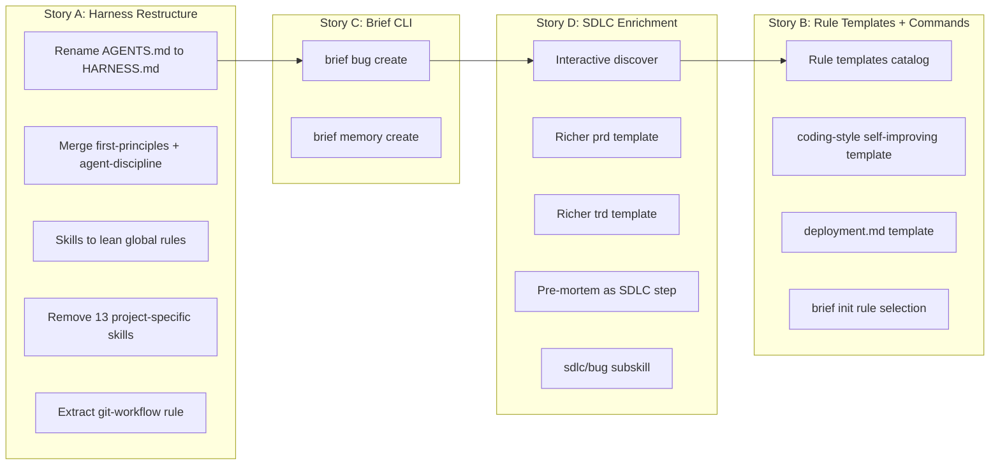
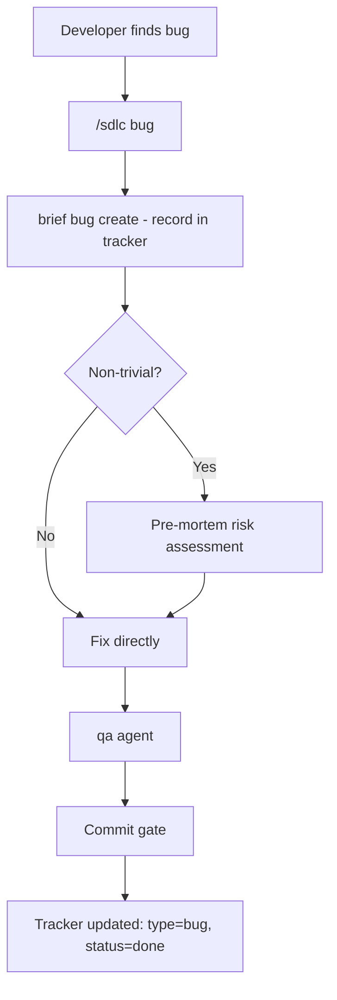
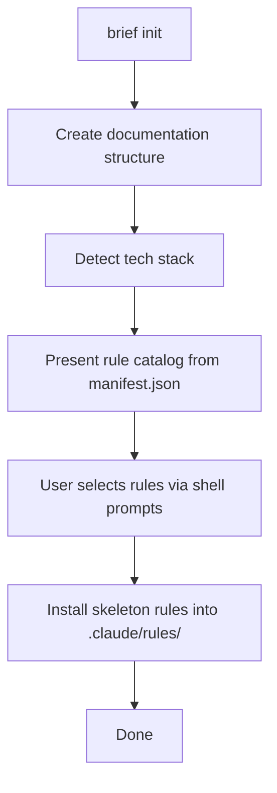

# PRD: Skills Cleanup & Consolidation

**Author**: Deepak / Claude
**Date**: 2026-08-22
**Status**: 🔒 Approved
**Discovery**: [discovery.md](./discovery.md)

## Problem

The global agent harness has grown organically to 28 skills — 13 are project-specific (Cloudflare, sandbox, shadcn), 4 are conventions masquerading as skills, and several are dead or misplaced. Every session loads all 28 descriptions regardless of project. The harness config (`AGENTS.md`) mixes thinking frameworks, git rules, and process in one file with a misleading name. Projects duplicate harness rules in their own AGENTS.md, causing drift. There's no interactive setup for project-specific rules, no bug-tracking workflow for small fixes, and the SDLC's discover/prd/trd phases lack the rigor that gstack's review skills demonstrate.

## Users

| Segment | Pain Level | Current Workaround |
|---------|-----------|-------------------|
| Developer (Deepak) using Claude Code across multiple projects | High | Manually manages rules, repeats style corrections, duplicates config |
| Agent sessions (Claude/Codex) in any project | Medium | Loads 28 irrelevant skill descriptions, misapplies generic standards |
| Future collaborators onboarding to a project | Medium | Must understand the full global setup to work effectively |

## Goals & Success Metrics

| Goal | Metric | Target | Measurement Method |
|------|--------|--------|-------------------|
| Reduce global skill noise | Skill descriptions per session | ≤ 6 (from 28) | Count skills in `~/.claude/skills/` after cleanup |
| Eliminate config duplication | Projects with duplicated harness rules | 0 | Grep project AGENTS.md files for harness-level rules |
| Enable project-specific rules via init | Projects with local `.claude/rules/` | All active projects | `find` across project dirs |
| Bug workflow without story overhead | Time to record + fix a small bug | < 5 min (from ~15 min story creation) | Measure from `brief bug create` to commit |
| HARNESS.md stays lean | File line count | < 100 lines | `wc -l` |
| Self-improving coding style | Retro findings mentioning repeated style issues | Decrease over time | Qualitative review in retros |

## What We Are Building

A four-story restructure of the agent harness, brief CLI, and SDLC skills:

### Requirements

| # | Requirement | Priority | Notes |
|---|------------|----------|-------|
| R1 | Rename AGENTS.md → HARNESS.md, merge first-principles + agent-discipline into it. Task 0: test `@` import paths first. | Must-have | Foundation. Must verify `@` import works before committing rename. Fallback: symlink during transition. |
| R2 | Convert coding-standards, documentation-standards, observability (principles) to lean global rules | Must-have | Correct mechanism: rules with paths |
| R3 | Remove 13 project-specific skills from global listing | Must-have | User-installable, outside brief scope |
| R4 | Extract git branch/push safety into `rules/git-workflow.md` | Must-have | Keeps HARNESS.md < 100 lines |
| R5 | Delete dead skills: update-tracker, first-principles, product-analytics. Deprecate pre-mortem (delete when sdlc/bug ships) | Must-have | Dead or absorbed elsewhere. Pre-mortem stays functional until Story D replaces it. |
| R6 | `brief bug create` command with tracker support (type: bug) | Must-have | Bug workflow foundation |
| R7 | `brief memory create` command | Must-have | First-class memory CRUD |
| R8 | Enrich `discover` skill with interactive forcing questions | Should-have | Inspired by gstack office-hours |
| R9 | Enrich `prd` template (exec summary, success metrics, risk table, scope modes) | Should-have | Inspired by plan-ceo-review |
| R10 | Enrich `trd` template (arch decisions, rollback plan, verification) | Should-have | Inspired by plan-eng-review |
| R11 | Pre-mortem absorbed as SDLC implementation step for high-risk tasks | Should-have | Part of lifecycle, not standalone |
| R12 | `sdlc/bug` subskill — mini workflow: triage → risk → fix → qa → tracker | Should-have | Dedicated SDLC phase for bugs, like discover/prd/trd are for features |
| R13 | Rule templates catalog (`templates/rules/manifest.json`) in brief package | Should-have | Source for init installations |
| R14 | `brief init` shell-interactive rule selection (like wrangler init) | Should-have | Detects tech, presents catalog, installs skeletons |
| R15 | Self-improving `coding-style.md` rule template | Should-have | Refined by retro findings |
| R16 | `deployment.md` project-local rule template | Nice-to-have | Filled during setup or usage |
| R17 | Project AGENTS.md scaffold that inherits harness (no duplication) | Nice-to-have | Eliminates drift |

**Deferred to separate PRD (Epic 1 + Project Setup):**
- `/brief setup` agent skill (interactive project configuration)
- Detection in brief rule (recommend setup if unconfigured)
- `brief init` → agent handoff
- Full project-scoped architecture

### User Flows

**Bug workflow (new — `/sdlc bug` subskill):**

The `sdlc/bug` subskill is a mini-workflow inside SDLC — invoked via `/sdlc bug` — that handles the full lifecycle: create record, assess risk, branch, fix, qa, commit, close. It's the bug equivalent of what discover→prd→trd→implement is for features, but compressed into one phase.

**Enhanced brief init flow (Story B):**

## What We Are NOT Building

- **NOT**: Epic 1 (Project-Scoped Architecture) + `/brief setup` agent skill — deferred to own PRD after this ships
- **NOT**: Full gstack integration — we borrow patterns, not the gstack runtime/telemetry/gbrain
- **NOT**: Multi-provider support (Gemini, Codex config) — Claude-only for now
- **NOT**: Automatic rule generation from code analysis — rules start as templates, evolve via retros
- **NOT**: `brief serve` (Epic 7) — independent, lower priority
- **NOT**: Tracker restructure (Epic 4: retros/context as first-class entities) — separate story

## Triggers & Edge Cases

| Trigger / Edge Case | Expected Behavior |
|--------------------|-------------------|
| Existing project already has AGENTS.md with harness rules duplicated | `/brief setup` detects and offers to slim it down |
| User runs `brief init` in a project that already has brief structure | Skips existing structure, still offers rule installation |
| `brief bug create` on a bug that grows into a full feature | Bug record links to escalated story via `escalated_to: S-NNN` field |
| Global HARNESS.md referenced by `@` in project CLAUDE.md | Claude Code's `@` import resolves correctly from project dir |
| User deletes a global rule that a project depends on | Rule content is self-contained in project `.claude/rules/` — no breakage |

## Dependencies

- Brief CLI (`~/.agents/brief/`) — must support new `bug` and `memory` commands
- Claude Code rule loading behavior (`paths:` frontmatter) — already proven, no changes needed
- Claude Code `@` import in CLAUDE.md — already working (used in S-005)

## Risks

| Risk | Likelihood | Impact | Mitigation |
|------|-----------|--------|------------|
| HARNESS.md rename breaks CLAUDE.md `@` imports in existing projects | Medium | High | Task 0: test `@` import first. Migration: grep all projects for `@AGENTS.md` and update. Fallback: symlink `AGENTS.md → HARNESS.md` during transition |
| Lean coding-standards rule is too thin — agents produce worse code | Low | Medium | Start with current content, trim iteratively; retro captures if quality drops |
| `brief init` interactive shell adds complexity to simple CLI | Low | Low | Progressive disclosure: detect → suggest; don't force choices on simple projects |
| SDLC enrichment makes discover/prd too heavy for small features | Medium | Medium | Keep "scope entry points" — bugs skip discover; small features skip enriched sections |

## Open Questions

- [x] Rule catalog format → `templates/rules/manifest.json` (decided)
- [ ] HARNESS.md `@` import syntax from project CLAUDE.md — needs testing, not confirmed yet

## Timeline

| Milestone | Target Date | Notes |
|-----------|------------|-------|
| PRD Approved | 2026-08-22 | This document |
| TRD Complete | 2026-08-22 | Architecture for file moves + template design |
| Story A: Harness Restructure | 2026-08-23 | Foundation — rename, merge, delete |
| Story C: Brief CLI | 2026-08-23 | bug + memory commands |
| Story D: SDLC Enrichment | 2026-08-24 | Enriched discover/prd/trd + bug workflow |
| Story B: Rule Templates + Init | 2026-08-25 | Rule catalog + brief init rule selection (no agent setup — deferred) |
