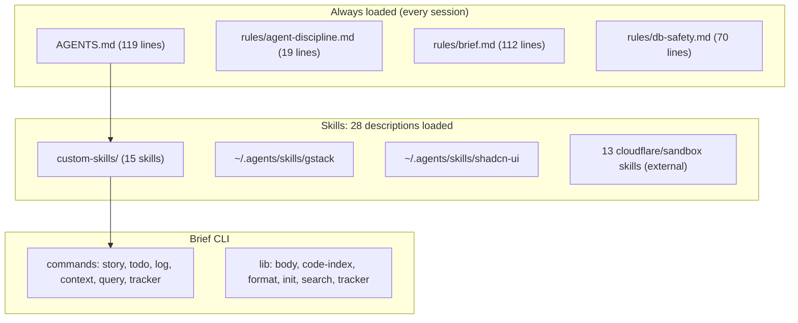
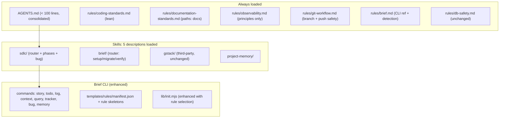
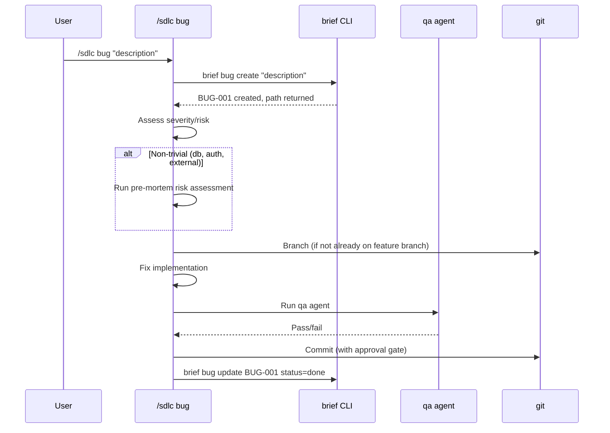
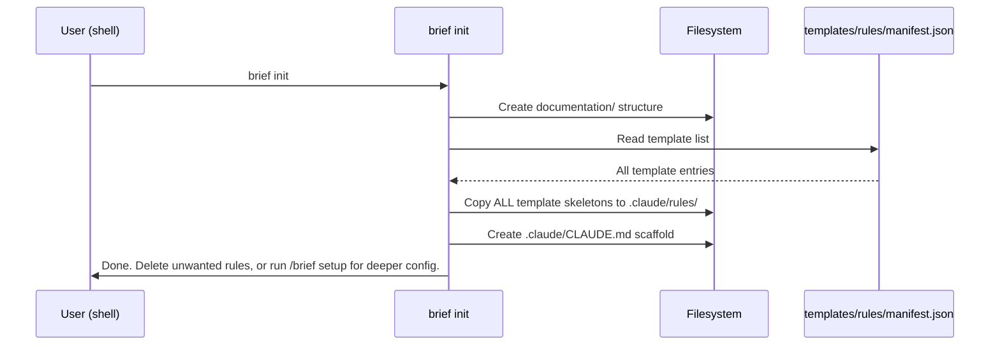

# TRD: Skills Cleanup & Consolidation

**Author**: Deepak / Claude
**Date**: 2026-08-22
**Status**: Draft
**PRD**: [PRD.md](./PRD.md)

## Overview

Restructure the agent harness from 28 global skills + 3 rules + AGENTS.md into a lean system: AGENTS.md (<100 lines, consolidated) + 6 focused rules + 5 skills. Add `brief bug` and `brief memory` CLI commands, a `sdlc/bug` subskill, and rule templates for `brief init`.

## Current Architecture



## Proposed Architecture



### What Changes

| Component | Change Type | Description |
|-----------|------------|-------------|
| `AGENTS.md` | Merged + Trimmed | Stays as `AGENTS.md`. Absorbs first-principles + agent-discipline content. Git rules extracted out. Target: <100 lines. |
| `rules/agent-discipline.md` | Removed | Content merged into AGENTS.md |
| `rules/coding-standards.md` | New | Lean governing principles (from 174-line skill → ~60-line rule) |
| `rules/documentation-standards.md` | New | With `paths:` frontmatter for doc files |
| `rules/observability.md` | New | Signal types + abstraction only (from 121-line skill → ~40-line rule) |
| `rules/git-workflow.md` | New | Extracted from AGENTS.md (branch naming, push safety, commit gates) |
| `custom-skills/first-principles/` | Removed | Content merged into AGENTS.md |
| `custom-skills/update-tracker/` | Removed | Dead (brief handles natively) |
| `custom-skills/product-analytics/` | Removed | Project-specific only |
| `custom-skills/coding-standards/` | Removed | Converted to rule |
| `custom-skills/documentation-standards/` | Removed | Converted to rule |
| `custom-skills/observability/` | Removed | Split: principles → rule, wiring → template |
| `custom-skills/frontend-standards/` | Removed | Becomes project-local template |
| `custom-skills/backend-standards/` | Removed | Becomes project-local template |
| `custom-skills/pre-mortem/` | Unchanged → Deleted | Stays fully functional (no deprecation signal) until sdlc/bug ships in Story D, then hard-deleted |
| `custom-skills/db-safety/` | Removed | Rule already covers it (thin pointer was redundant) |
| `custom-skills/sdlc/bug/SKILL.md` | New | Bug mini-workflow subskill |
| `~/.claude/skills/` symlinks | Updated | Remove 13 project-specific + 8 converted skills |
| `brief/lib/commands/bug.mjs` | New | Thin command layer delegating to `item.mjs` with type='bug' |
| `brief/lib/commands/memory.mjs` | New | Thin command layer delegating to `item.mjs` with type='memory' |
| `brief/templates/rules/` | New | Rule templates + manifest.json |
| `brief/lib/init.mjs` | Modified | Add rule selection step |

## Data Model

### Tracker Schema Change

```yaml
# New item type in tracker.yaml
- id: BUG-001
  type: bug
  title: "Description of the bug"
  status: open | in_progress | done
  priority: P1 | P2 | P3
  severity: critical | major | minor
  created: 2026-08-22
  story: null  # or S-NNN if escalated
  escalated_to: null  # S-NNN if bug grew into story
```

### Memory File Format

```yaml
# documentation/memory/<name>.md (unchanged format, just created via CLI now)
---
name: <slug>
description: <one-line>
type: <project|reference|feedback|user>
created: <date>
updated: <date>
valid_until: <date|permanent>
importance: <1-5>
---

<body content>
```

### Rule Template Manifest

```json
{
  "version": "1.0",
  "templates": [
    {
      "id": "backend-standards",
      "name": "Backend Standards",
      "description": "Framework-specific backend architecture rules (layers, modules, API design)",
      "detect": ["package.json:express|fastify|hono|koa", "Cargo.toml", "go.mod"],
      "paths": ["**/server/**", "**/api/**", "**/routes/**"],
      "file": "backend-standards.md"
    },
    {
      "id": "frontend-standards",
      "name": "Frontend Standards",
      "description": "Component architecture, ownership ladder, data-fetching boundaries",
      "detect": ["package.json:react|vue|svelte|solid"],
      "paths": ["**/components/**", "**/pages/**", "**/hooks/**"],
      "file": "frontend-standards.md"
    },
    {
      "id": "coding-style",
      "name": "Coding Style (self-improving)",
      "description": "Project-specific conventions — refined by retro findings over time",
      "detect": ["*"],
      "paths": [],
      "file": "coding-style.md"
    },
    {
      "id": "deployment",
      "name": "Deployment",
      "description": "Deploy commands, env vars, CI/CD, infrastructure specifics",
      "detect": [".github/workflows", "Dockerfile", "fly.toml", "wrangler.jsonc"],
      "paths": [],
      "file": "deployment.md"
    },
    {
      "id": "observability-wiring",
      "name": "Observability Wiring",
      "description": "Provider-specific instrumentation (Sentry, PostHog, OTel config)",
      "detect": ["package.json:@sentry|posthog|@opentelemetry"],
      "paths": [],
      "file": "observability-wiring.md"
    },
    {
      "id": "git-workflow",
      "name": "Git Workflow",
      "description": "Branch naming, push safety, PR conventions",
      "detect": [".git", ".github"],
      "paths": [],
      "file": "git-workflow.md"
    }
  ]
}
```

## System Design

### Component Interaction — Bug Workflow



### Component Interaction — brief init (enhanced)



### Design Decisions

| Decision | Options Considered | Chosen | Rationale |
|----------|-------------------|--------|-----------|
| AGENTS.md consolidation | A) Minimal (just imports), B) Self-contained (<100 lines), C) Comprehensive (keep everything) | B | Must be self-contained (imports add indirection). <100 lines keeps it focused. No rename — risk exceeds value. |
| Rule for coding-standards | A) No glob (always loads), B) Universal code glob (`**/*.{ts,js,py}`) | A (no glob) | It's universal — applies to every file. A glob would miss config files, scripts, etc. |
| Bug IDs | A) BUG-NNN, B) Reuse TODO-NNN with type field, C) S-NNN (same as stories) | A | Distinct namespace. Clear in tracker. Easy to count bugs vs stories. |
| Rule template location | A) In brief package (`brief/templates/rules/`), B) In custom-skills dir, C) In a separate repo | A | Co-located with the CLI that installs them. Single package to version. |
| sdlc/bug skill scope | A) Full SDLC (branch, fix, commit, close), B) Just triage + record, C) Triage + fix + qa only | A | The value is end-to-end. User invokes once, gets a complete workflow. |
| Symlink cleanup | A) Delete symlinks only, B) Delete symlinks + source skills, C) Move source to archive | B | Source files in custom-skills/ serve no purpose after conversion. Clean delete. |
| pre-mortem lifecycle | A) Delete immediately, B) Mark deprecated + delete later, C) Keep unchanged until replacement | C | Simplest. No deprecation signal needed. Hard-delete in Story D when sdlc/bug ships. |
| bug/memory implementation | A) Delegate to item.mjs, B) Standalone modules, C) Extend item.mjs | A | DRY. item.mjs is proven CRUD engine. Bug/memory are thin type-specific layers. |
| Rule template content | A) Skeleton + examples, B) Opinionated defaults, C) Empty body | A | Guides without imposing. Setup or retros fill real content. |

### Design Patterns

- **Command pattern (brief CLI)**: `bug.mjs` and `memory.mjs` follow the same structure as `story.mjs` — CRUD operations with `--body` support and `path:` output.
- **Skill router pattern (SDLC)**: `bug/SKILL.md` follows the same pattern as `discover/SKILL.md` — independent subskill routed by the SDLC router.
- **Rule conversion pattern**: Skill SKILL.md → extract core principles → write as `rules/name.md` with `paths:` frontmatter → delete skill dir + symlink.

## Performance Considerations

- **Expected load**: N/A — these are local config files, not a service
- **Context window impact**: Reduction from ~28 skill descriptions (~700 tokens) to ~5 descriptions (~125 tokens) per session. Rules with `paths:` load only when relevant files are touched.
- **Brief CLI**: New commands add <500 lines of code to the package. No performance concern.

## Security Considerations

- **No auth changes**: This is local config restructuring
- **File permissions**: Rule templates contain no secrets. Same permissions as existing skills.
- **Input validation**: `brief bug create` and `brief memory create` sanitize titles (same as existing story/todo commands — slug generation, YAML frontmatter escaping)

## Dependencies

| Dependency | Type | Risk | Mitigation |
|-----------|------|------|------------|
| Claude Code `paths:` in rules | Internal | Low | Already proven in production (db-safety, taiboli-app) |
| Brief CLI (`node:test`, Node.js) | Internal | Low | Established test infrastructure (4 existing test files) |
| Existing skill symlinks in projects | Internal | Low | Grep before deletion; skills being removed are global-only, not project-referenced |

## Testing Strategy

| Layer | What to Test | Approach |
|-------|-------------|----------|
| Unit | `item.mjs` CRUD (prerequisite) | Node.js test — create/list/show/update with temp dir |
| Unit | `brief bug create/list/show/update` | Node.js test — validates type='bug' routing + field validation |
| Unit | `brief memory create/list/show/update` | Node.js test — validates type='memory' routing + field validation |
| Unit | `brief init` rule selection | Mock filesystem + manifest — detection, filtering, template copy |
| Unit | Manifest detection logic | Test each `detect` pattern against mock project files |
| Integration | Rule loading with `paths:` frontmatter | Manual: touch a file, verify rule loads in session |
| Integration | AGENTS.md loads correctly in session | Manual: verify AGENTS.md content appears in system prompt |
| Integration | SDLC router dispatches to `bug` subskill | Manual: invoke `/sdlc bug` |
| Preflight | Grep all references to deleted skills before removal | `grep -r "skill-name" ~/.claude/ ~/.agents/` |
| Smoke | Full system after migration | `brief status`, all skills load, rules load correctly |

### Rule Template Content Structure

Each template file follows this structure (~20-30 lines):
```markdown
---
description: <one-line purpose>
paths: [<glob patterns if conditional>]
---

## <Section 1 Name>
<!-- Example: Prefer composition over inheritance for shared behavior -->

## <Section 2 Name>
<!-- Example: All API responses use { data, error, meta } envelope -->

## <Section 3 Name>
<!-- Example: Feature flags gate all new user-facing changes -->
```

Templates are skeletons: section headers + one commented example per section. NOT opinionated defaults. User or `/brief setup` fills them.

## Decision: No Rename (D8 — eng review)

The AGENTS.md → HARNESS.md rename was dropped during engineering review. Rationale: zero functional value (naming preference only), carries the highest risk (@ import resolution), gates all other work, requires migrating every project's CLAUDE.md. The file stays as `AGENTS.md` with content consolidated (merge first-principles + agent-discipline, extract git-workflow). This eliminates Task 0, the test protocol, and all migration risk.

## SDLC Enrichment Specification

### Discover: Interactive Forcing Questions

Add to `discover/SKILL.md` after context gathering:

**Mode detection** (auto): Detect work type from user input:
- `greenfield` — new feature, no prior art
- `bug` — something broken, needs diagnosis
- `optimization` — working but slow/expensive
- `refactor` — working but structurally wrong

**Forcing questions** (ask one at a time, push until specific):
1. "Who specifically is affected? Name the user type and their workflow."
2. "What do they do today without this? What breaks or is painful?"
3. "How will you know this worked? What measurable outcome changes?"
4. "What's the smallest version that delivers value? What can wait?"
5. "What have you already tried or ruled out? Why didn't it work?"

**Push rule**: If answer is vague (contains "users", "better", "improve" without specifics), push once: "Can you be more specific? Which users, what specifically is better, how do you measure improvement?"

### PRD: Structured Sections (added to template)

Aligned with what `/gstack plan-ceo-review` checks (11 sections). The PRD owns requirements-level concerns; implementation-level detail lives in TRD.

| Section | Content | Review Section It Satisfies | When to include |
|---------|---------|---------------------------|-----------------|
| Exec Summary | 2-3 sentences, stakeholder-readable | — (orientation) | Always |
| Problem | Who has it, what they do today, what breaks | — (framing) | Always |
| Success Metrics | Measurable outcomes with targets + how measured | Observability (§8) | Always |
| Risk Table | Likelihood × Impact × Mitigation | Security & Threat (§3), Long-Term (§10) | Always |
| Scope Modes | In-scope (must/should/nice), out-of-scope with rationale | — (scope clarity) | Always |
| User Experience | User flows, interaction states, accessibility requirements | Design & UX (§11) | When UI/UX exists |
| Performance Requirements | Latency targets, resource limits, degradation thresholds | Performance (§7) | When measurable perf matters |
| Deployment & Rollout | Phasing, feature flags, rollback criteria, migration path | Deployment & Rollout (§9) | When rollout has risk |
| Stakeholder Impact | Who's affected, how, when | — (communication) | When >1 team or user type |

**Omitted from PRD (TRD owns these):** Architecture (§1), Error/Rescue (§2), Data Flow (§4), Code Quality (§5), Test Strategy (§6). PRD states *what* must work; TRD states *how*.

### TRD: Rigorous Sections (added to template)

Aligned with what `/gstack plan-eng-review` checks (Architecture, Code Quality, Tests, Performance + required outputs: Error Registry, Failure Modes, Coverage Diagram).

| Section | Content | Review Section It Satisfies | When to include |
|---------|---------|---------------------------|-----------------|
| Architecture Decisions | Each with alternatives + why rejected | Architecture (§1) | Always |
| Error Handling & Failure Modes | Exception table, rescue strategies, what happens when X fails | Architecture (§1), Error & Rescue (§2) | Always |
| Security & Threat Model | Attack surface, auth boundaries, injection points, PII handling | Security (§3) | When auth/data/external APIs involved |
| Testing Strategy | Coverage goals, test pyramid, coverage diagram, flakiness mitigation | Test Review (§6) | Always |
| Observability Plan | What to log, metrics to emit, alerts to set, runbook pointers | Observability (§8) | When system has runtime behavior |
| Rollback Plan | How to undo if it goes wrong, at each story level | Deployment (§9) | Always |
| Dependencies | What we couple to, what breaks if it changes | Architecture (§1) | Always |
| Verification | How we know it's correct beyond "tests pass" — integration checks, smoke tests | Test Review (§6) | Always |
| Performance | N+1 risks, caching strategy, connection pools, expected load | Performance (§4) | When data/traffic/latency matters |
| Long-Term Trajectory | Tech debt introduced, reversibility score (1-5), path dependency risks | Long-Term (§10) | When architecture is hard to undo |

**Required outputs the review expects to find** (produce during implementation, not in TRD draft):
- Error/Rescue Registry (maps error → handler → user-visible result)
- Failure Modes list (each with trigger, impact, mitigation)
- Coverage Diagram (visual test coverage map)
- Implementation Task list (structured, with dependencies)

## Pre-Mortem Extraction: What sdlc/bug Absorbs

From the 96-line `pre-mortem/SKILL.md`, sdlc/bug absorbs:

**Auto-trigger criteria** (when risk assessment runs in the bug workflow):
- Bug fix touches database migrations or schema
- Bug fix touches authentication or authorization
- Bug fix has external dependencies (third-party APIs)
- Bug fix affects payment or billing flows

**Risk assessment prompt** (adapted for bugs):
> "This fix has been deployed. It made things worse. What went wrong?"

**The 4 risk angles** (ask for each non-trivial bug):
- Technical: What could this fix break?
- Product: Could the fix have unintended UX consequences?
- Process: Is there a simpler/safer approach we're not considering?
- External: Is anything outside our control (race conditions, third-party behavior)?

**Simplified categorization** (Tigers only, no Paper Tigers/Elephants for bugs):
- `blocks-fix`: Risk must be mitigated before committing. Has specific mitigation.
- `acceptable`: Acknowledged but acceptable for this fix. No action needed.

**What's NOT absorbed** (dropped for bug workflow):
- Paper Tigers / Elephants (overkill for bug fixes)
- Classification tiers (Launch-blocking / Fast-follow / Track) -- bugs are smaller scope
- Owner assignment (single developer workflow)
- Output format template (sdlc/bug has its own output)

## Open Technical Questions

- [x] ~~Should `brief init` use `inquirer` for interactive prompts?~~ → Yes, `inquirer` for any future interactive flows (e.g. `/brief setup`). Init itself copies all templates without prompts (D9), so moot for this epic.

## Implementation Order (High-Level)

### Story A: Harness & Core Rules Restructure
1. Create new rule files (coding-standards, documentation-standards, observability, git-workflow)
2. Merge first-principles + agent-discipline INTO AGENTS.md (no rename — stays AGENTS.md)
3. Extract git-workflow content from AGENTS.md into the new rule (AGENTS.md loses those lines)
4. Grep ALL references to deleted skills (`grep -r "skill-name" ~/.claude/ ~/.agents/`) before removal
5. Remove symlinks for converted/deleted skills
6. Delete source skill directories (custom-skills/first-principles, update-tracker, product-analytics, coding-standards, documentation-standards, observability, frontend-standards, backend-standards, db-safety)
7. Remove 13 project-specific skill symlinks (pre-mortem stays unchanged — deleted in Story D)
8. Verify AGENTS.md is <100 lines after consolidation

### Story C: Brief CLI Enhancements
1. Add `item.test.mjs` — test existing CRUD engine (prerequisite for delegation)
2. Add `bug.mjs` command (thin layer delegating to item.mjs with type='bug')
3. Add `memory.mjs` command (thin layer delegating to item.mjs with type='memory')
4. Register in CLI router, add bug.test.mjs + memory.test.mjs
5. Update `brief` rule with new commands documentation

### Story D: SDLC Enrichment
1. Create `custom-skills/sdlc/bug/SKILL.md` (mini-workflow: triage → risk → fix → qa → tracker)
2. Update SDLC router to include `bug` phase
3. Enrich `discover/SKILL.md` — add mode detection + 5 forcing questions (see spec above)
4. Enrich `prd/SKILL.md` — add exec summary, metrics, risk table, scope modes sections
5. Enrich `trd/SKILL.md` — add arch decisions, rollback, dependencies, verification sections
6. Delete `pre-mortem` skill (absorbed into sdlc/bug risk assessment step)

### Story B: Rule Templates + Init
1. Create `brief/templates/rules/` directory with manifest.json (catalog metadata only — init doesn't parse `detect`)
2. Write rule template skeleton files (backend-standards, frontend-standards, coding-style, deployment, observability-wiring, git-workflow)
3. Enhance `init.mjs` to copy ALL template skeletons to `.claude/rules/` (no detection, no interactive selection — user deletes unwanted ones)
4. Add tests for init template copying
5. Smart detection/selection deferred to `/brief setup` (Epic 1)

## Rollback Plan

Each story is independently revertable:
- **Story A**: `git revert` restores AGENTS.md to pre-merge state. Symlinks can be recreated from the skill dirs (which exist in git history). No rename = no @ import breakage risk.
- **Story C**: New brief commands are additive — revert doesn't break existing functionality.
- **Story D**: SDLC changes are file additions/edits — revert restores previous skill versions.
- **Story B**: Template additions are new files — revert removes them, init falls back to current behavior (no templates copied).
