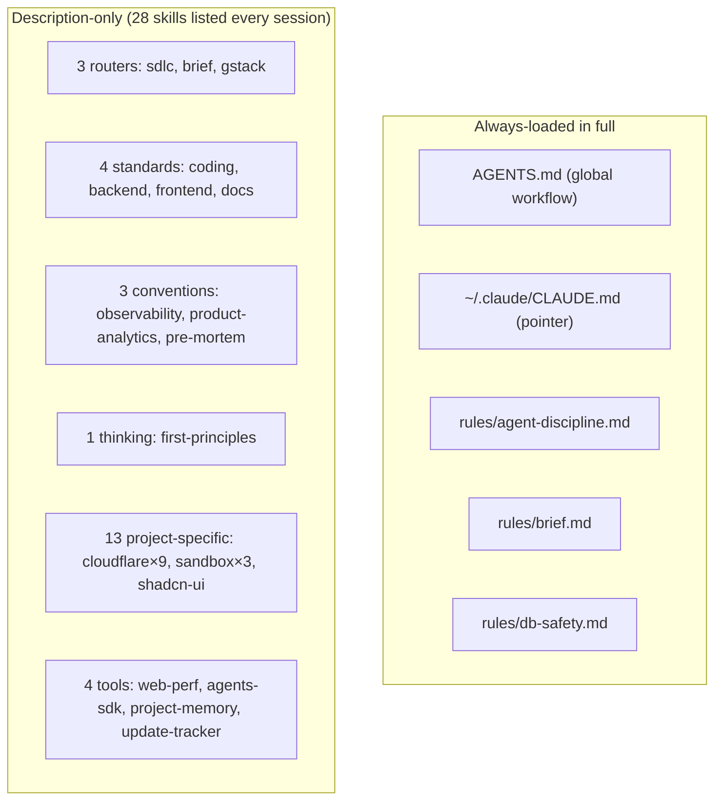
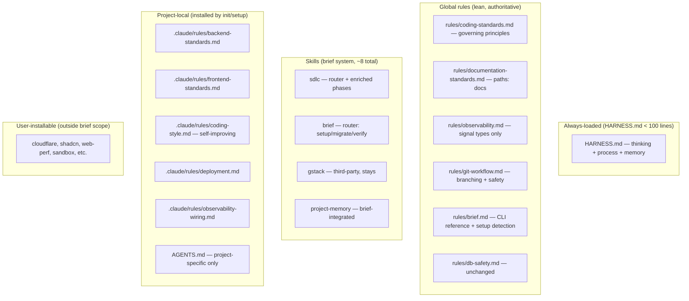

# Discovery: Skills Cleanup & Consolidation

**Date**: 2026-08-22
**Epic**: TODO-010 Epic 5 (Skills Cleanup & Consolidation)
**Related Epics**: Epic 1 (Project-Scoped Architecture), Epic 4 (Tracker/Story), Epic 6 (SDLC Enhancement)
**Scope**: This discovery covers the full restructure — harness rename, skills→rules, SDLC
enrichment, brief enhancements, and project-local setup. Multiple stories will reference this.

---

## Current Reality

### What Loads Per Session



### Key Constraints (from memory)

1. **Skills load description only** — bodies load when invoked. Rules + CLAUDE.md load in full every session.
2. **`paths:` frontmatter on rules** — loads rule conditionally when matching files are touched (proven with db-safety, frontend-components.md in taiboli-app).
3. **Personal skills shadow project skills with same name** — distinct names required to avoid silent collision.
4. **Stack-specific content belongs in repos, not globally** — global skill that's wrong for the repo reading it is worse than no skill.

### Pain Points

| # | Problem | Impact |
|---|---------|--------|
| 1 | 28 skill descriptions load every session — 13 are irrelevant to most projects | Wastes listing space, confuses agent selection |
| 2 | Standards skills are conventions, never invoked — they auto-apply via description matching | Wrong mechanism; rules with `paths:` globs are the proven pattern |
| 3 | `update-tracker` is dead — brief handles tracker natively | Dead code in listing |
| 4 | `first-principles` is a thinking pattern, not a procedure — should always be available, not on-demand | Currently only fires when description match triggers |
| 5 | `pre-mortem` is a risk assessment step — belongs in SDLC graph, not standalone | Disconnected from workflow |
| 6 | No self-improving coding-style per project — harness repeats mistakes per project's conventions | Same errors recur across sessions |
| 7 | No bug-type workflow — everything is a story, even 10-minute fixes | Overhead kills velocity on small fixes |
| 8 | Skills are generic/open-ended — don't compose with brief as a system | Each skill assumes standalone invocation |
| 9 | `AGENTS.md` name doesn't reflect its role — it's the harness config, not an agent definition | Naming confusion |
| 10 | `brief init` doesn't install skills/rules per project | Manual setup, inconsistent environments |
| 11 | No `brief memory` command — memory creation requires manual file writing | Friction for the most important persistence operation |
| 12 | Project AGENTS.md duplicates harness rules | taiboli-app hard rules repeat commit/push gates, branch naming that harness already enforces — drift risk |
| 13 | `discover` skill is fully self-running, no user engagement | Misses key insights; gstack office-hours proves interactive questioning produces sharper problem definitions |
| 14 | PRD/TRD templates lack rigor that slows review | gstack plan-ceo-review and plan-eng-review have structured sections we lack |

### Observation: Project AGENTS.md Pattern (taiboli-app)

taiboli-app's `AGENTS.md` has two kinds of content:
1. **Duplicated harness rules** — commit gates, branch naming, no force-push (same as global HARNESS.md)
2. **Genuinely project-specific** — schema→migrate not push, VITE_ rules, Clerk userId mapping, import boundaries, doc map

The harness should provide #1 automatically. Projects should only need to declare #2. This means:
- `brief init` scaffolds a project AGENTS.md that `@imports` the global harness
- Project file contains ONLY project-specific hard rules, commands, doc map
- No duplication, no drift between global rules and project copies

---

## Decisions (from user input)

### D1: Rename AGENTS.md → HARNESS.md

The file configures the harness (Claude Code runtime), not agents. `HARNESS.md` reflects its true role — the operating system for how work gets done.

### D2: Elevate first-principles to HARNESS.md

First-principles thinking is core to everything — architecture, debugging, refactoring, prioritization. It belongs in the always-loaded harness config, not behind an invocation gate. Merge into the "Critical Thinking" section (which already has `Why → What → How`).

### D3: Agent-discipline → merge into HARNESS.md

`rules/agent-discipline.md` is always loaded and always relevant. Since it's universal and never conditional, merge it into HARNESS.md. This consolidates all always-loaded governance into one file. Delete the separate rule file after merge.

### D4: Self-improving coding-style rule per project

A `coding-style.md` rule in each project's `.claude/rules/` that:
- Starts from a template during `brief init`
- Gets refined by the `self-improving` agent after retros
- Captures project-specific conventions (naming, patterns, preferences)
- Prevents the harness from repeating style mistakes across sessions

### D5: Standards skills → rules (lean global + detailed project-local)

| Current Skill | Becomes | Location | Notes |
|---------------|---------|----------|-------|
| `coding-standards` | Lean global rule | `~/.claude/rules/coding-standards.md` | Governing principles only — authoritative but short. No glob (universal). |
| `backend-standards` | Detailed project-local rule | `.claude/rules/backend-standards.md` | Framework-specific. Installed by `brief init`/`brief setup`. |
| `frontend-standards` | Detailed project-local rule | `.claude/rules/frontend-standards.md` | Framework-specific. Merged with frontend-components into one rule. |
| `documentation-standards` | Rule with paths | `~/.claude/rules/documentation-standards.md` | `paths: ["**/documentation/**"]` |
| `frontend-components.md` + `frontend-standards` | Single project rule | `.claude/rules/frontend-standards.md` | One file covering both architecture + component patterns |

**Key insight**: coding-standards must be lean and authoritative (governing rules). Backend & frontend rules carry more detail because they're framework-specific and installed per-project where relevant.

### D6: Observability splits into two

- **Code standards part** (always have observability): stays as a lighter global rule about signal types, abstraction pattern, never-log-secrets
- **Stack-specific wiring** (PostHog, Sentry, OTel config): project-local, installed by `brief init`

### D7: product-analytics is project-specific only

Generic naming conventions are too thin for a global skill. The useful content is provider wiring (PostHog, Amplitude) which varies per project. Remove globally; `brief init` installs project-local version when analytics detected.

### D8: pre-mortem → SDLC phase

Pre-mortem is a risk assessment step in the lifecycle. It belongs in the SDLC graph:
- Auto-triggers before high-risk implementation (db migrations, auth, external deps)
- Also useful for bug triage — assess blast radius before fixing
- Becomes a step in `/sdlc implement` for qualifying tasks, not a standalone skill

### D9: Bug type in brief

Not everything is a story. Bugs need:
- `brief bug create "description"` — lightweight record
- Runs pre-mortem/risk assessment automatically for non-trivial bugs
- Tracked in PROJECT-TRACKER.md as type `bug`
- Minimal overhead: no PRD/TRD required, optional story escalation if scope grows
- Helps track bug frequency and patterns over time

### D10: brief memory as first-class command

`brief memory create "title" --body="content"` — creates memory in the correct format in `documentation/memory/`. No more manual file creation. Follows the same CRUD pattern as stories/todos.

### D11: brief init installs project skills and rules

During `brief init`:
- Detects tech stack (package.json, Cargo.toml, pyproject.toml, etc.)
- Detects frameworks (React, Next.js, Cloudflare Workers, etc.)
- Installs relevant skills + rules into project `.claude/skills/` and `.claude/rules/`
- Currently supports Claude only (other providers later)
- Sources from a template/catalog in the brief package

### D12: All skills are brief-specific — structured system, not open-ended

Skills are part of the brief system. They assume:
- brief CLI is available
- Project structure follows brief conventions
- SDLC workflow is the operating model
- Memory, tracker, stories exist

This isn't a collection of independent tips — it's an integrated system. Skills that don't compose with brief should be absorbed into rules or removed.

### D13: Project-specific skills removed from global — user-installable

13 Cloudflare/sandbox/shadcn/web-perf/agents-sdk skills don't belong in the brief harness. They are:
- **Not restricted** — users can install any skill they want per project
- **Outside brief's scope** — brief delivers a structured system; these are general-purpose skills
- **User-installable** — via `npx mdskills install cloudflare/web-perf` or community sources
- **Configurable** — `brief setup` can recommend and install during first-time project configuration

Some projects need shadcn, some don't. The harness doesn't decide — the user does during setup.

### D14: Two-layer setup — `brief init` (shell) + `/brief setup` (agent)

Two distinct commands with different execution contexts:

**`brief init`** (shell CLI, interactive shell prompts — no agent):
- Creates documentation structure (tracker, docs folders, MEMORY.md)
- Detects tech stack (package.json, Cargo.toml, etc.)
- Presents interactive menu of available rules with descriptions (like `wrangler init`, `npm init`)
- User picks which rules to install (checkboxes, multi-select)
- Installs selected rule skeletons into `.claude/rules/`
- Creates `.claude/CLAUDE.md` scaffold
- Purely shell-based — works without any agent session
- **Final prompt**: detects if Claude/Codex/Gemini CLI is available → offers to launch `/brief setup` for deeper configuration. User can skip — `/brief setup` can run any time later via agent.

**`/brief setup`** (agent skill, interactive):
- Runs inside Claude/Codex session via the `brief` skill router
- Detects tech stack, engages user conversationally (like gstack office-hours)
- Asks: frontend framework? backend framework? UI library? analytics? deployment?
- Installs + configures rules based on answers (not just skeletons — fills project-specific content)
- Creates `coding-style.md` with initial project conventions
- Fills `deployment.md` with actual deploy commands, env vars, CI references
- Only supports Claude for now (other providers later)

**`brief` skill adopts nested folder pattern** (like sdlc):
```
custom-skills/brief/
  SKILL.md          ← router (setup, migrate, verify)
  setup/SKILL.md    ← interactive project configuration
  migrate/SKILL.md  ← data migration
  verify/SKILL.md   ← health check
```

### D14b: Detection mechanism — recommend setup if not configured

The `brief` rule (`~/.claude/rules/brief.md`) can include a lightweight detection:
- Check if `.claude/rules/` has project rules (beyond what init creates)
- If empty/minimal, first time in session: "Run `/brief setup` to configure project rules"
- Non-intimidating — one line, once per session, only if unconfigured
- Decision locked in a file (e.g. `.claude/.brief-configured`) so it doesn't nag after setup is done

### D15: SDLC skills enriched from gstack patterns

Take inspiration from gstack's three review skills to improve our SDLC:

| gstack skill | What to borrow | Improves our |
|---|---|---|
| `office-hours` | Interactive user engagement, forcing questions, pushing for specificity, "don't accept vague answers" | `discover` — currently self-running, should be interactive |
| `plan-ceo-review` | Structured sections (exec summary, stakeholder impact, success metrics, risk table, scope modes) | `prd` — needs richer template and review checklist |
| `plan-eng-review` | Architecture decisions, scalability, dependencies, rollback, structured verification | `trd` — needs more rigorous sections |

**Key principle from office-hours**: The first answer is usually the polished version. The real answer comes after pushing. Our discover skill should engage the user with forcing questions, not just self-generate opportunities.

### D16: Project AGENTS.md scaffolding — no duplication

Projects like taiboli-app currently duplicate harness rules in their AGENTS.md. The fix:
- `brief init` creates a project AGENTS.md that references the global harness (via `@HARNESS.md` or equivalent)
- Project AGENTS.md contains ONLY: project-specific commands, hard rules unique to this project, doc map
- Harness provides: commit gates, branch naming, push safety, lifecycle workflow — projects inherit these
- No more drift between global rules and per-project copies

### D17: Git branching → separate rule, conditionally installed

Git branch/push safety rules move OUT of HARNESS.md into a dedicated rule:
- `~/.claude/rules/git-workflow.md` (or project-local `.claude/rules/git-workflow.md`)
- Always loaded globally (no `paths:` needed — applies to all git operations)
- During `brief init`, if project is GitHub-based (`.github/` exists, `gh` available), install project-local variant
- Interactive shell asks: "This is a GitHub project — install git workflow rules?" (tick option)
- Keeps HARNESS.md focused on thinking/process, not git mechanics

### D18: Deployment rule — project-specific, built during init

Deployment config (env vars, commands, CI/CD, deploy targets) isn't captured anywhere today. New pattern:
- `.claude/rules/deployment.md` — project-local rule installed as skeleton by `brief init`
- Skeleton contains sections: commands table, env vars, deploy process, CI reference
- Gets filled in during usage (agent learns) or user fills manually
- Self-improving: retro findings about deployment issues refine this rule

Example content (taiboli-app would have):
```
Deploy: push branch → GitHub Actions → Docker → ECS
VITE_* vars: inlined at build time, not runtime
DATABASE_URL: needs dotenv -o (shell exports override otherwise)
```

---

## Opportunity Map

### Story A: Harness & Core Rules Restructure

| Item | What | Why |
|------|------|-----|
| A1 | Rename AGENTS.md → HARNESS.md | Correct naming — it's the harness config |
| A2 | Merge first-principles into HARNESS.md "Critical Thinking" | Always-loaded, core to every task |
| A3 | Merge agent-discipline into HARNESS.md | Always loaded, always relevant — one file |
| A4 | coding-standards → lean global rule | Governing principles, authoritative but short |
| A5 | documentation-standards → rule with `paths:` globs | Loads when writing docs only |
| A6 | observability (code principles) → lean global rule | Signal types + abstraction, never vendor wiring |
| A7 | Delete `update-tracker` skill | Dead — brief owns this |
| A8 | Delete `first-principles` skill | Merged into HARNESS.md |
| A9 | Delete `pre-mortem` skill | Absorbed into SDLC (Story D) |
| A10 | Delete `product-analytics` skill globally | Project-specific only |
| A11 | Remove 13 project-specific skills from global | User-installable, outside brief scope |
| A12 | Extract git branching from HARNESS.md → `rules/git-workflow.md` | Separate concern, conditionally installable per-project |
| A13 | Update all cross-references (CLAUDE.md, rules, skills) | Nothing points to deleted/renamed files |

### Story B: Project Setup & Local Rules

| Item | What | Why |
|------|------|-----|
| B1 | `/brief setup` agent skill (nested in brief router) | Interactive project config inside agent session |
| B2 | Rule templates catalog in brief package (`templates/rules/`) | Source for setup installations |
| B3 | backend-standards → project-local rule template | Framework-specific, detailed |
| B4 | frontend-standards + frontend-components → single project rule template | Framework-specific, merged |
| B5 | observability-wiring → project-local template | PostHog/Sentry/OTel per-project |
| B6 | product-analytics → project-local template | Provider-specific |
| B7 | Self-improving `coding-style.md` rule template | Refined by retros, captures project conventions |
| B8 | Project AGENTS.md scaffold (no duplication) | Inherits harness, declares only project-specific |
| B9 | `deployment.md` rule skeleton — filled by setup | Env vars, commands, CI |
| B10 | `git-workflow.md` rule (conditionally installed) | GitHub detection → ask in setup |
| B11 | Detection in `brief` rule — recommend setup if unconfigured | Non-intimidating, once per session, lockable |
| B12 | Enhanced `brief init` — install base rule skeletons from catalog | Shell-level, no agent needed |

### Story C: Brief CLI Enhancements

| Item | What | Why |
|------|------|-----|
| C1 | `brief bug create` — bug type | Lightweight tracking without full story overhead |
| C2 | `brief memory create` — memory CRUD | First-class memory command |
| C3 | Bug record in tracker (type: bug) | Track bug frequency and patterns |

### Story D: SDLC Enrichment

| Item | What | Why |
|------|------|-----|
| D1 | Enrich `discover` — interactive user engagement | Borrow forcing questions from gstack office-hours |
| D2 | Enrich `prd` template — structured sections | Borrow from plan-ceo-review: exec summary, metrics, risk |
| D3 | Enrich `trd` template — rigorous sections | Borrow from plan-eng-review: arch decisions, rollback |
| D4 | `pre-mortem` absorbed as SDLC step | Auto-triggers for high-risk tasks and bugs |
| D5 | Bug workflow in SDLC | Entry point → risk assessment → fix → tracker record |

---

## Priority & Sequencing

| # | Story | Effort | Dependencies | Why this order |
|---|-------|--------|--------------|----------------|
| 1 | A: Harness & Core Rules | M | None | Foundation — rename, merge, delete. Everything else builds on this. |
| 2 | C: Brief CLI Enhancements | S | Brief CLI | `bug` and `memory` commands needed before D |
| 3 | D: SDLC Enrichment | M | Story A (harness settled), Story C (bug command) | Enriched discover/prd/trd + bug workflow |
| 4 | B: Project Setup & Local Rules | M-L | Story A + C done | Largest scope, needs stable harness + brief commands |

---

## Resolved Questions

1. **Agent-discipline** → Merge into HARNESS.md. Always loaded, always relevant. One file.
2. **coding-standards size** → Lean and authoritative (governing rules only). Detailed standards go project-local in backend/frontend rules.
3. **shadcn-ui** → Drop from global. User installs per-project during `brief init` interactive selection.
4. **gstack** → Stays global (20 tokens, router only). Take inspiration from its three review skills to enrich our SDLC.
5. **web-perf** → Project-specific. User installs via community (`npx mdskills install`) or during `brief init`.
6. **`brief setup` vs `brief init`** → Two layers. `brief init` = shell CLI (structure + base skeletons). `/brief setup` = agent skill (interactive config, fills rules with project-specific content).
7. **Timing of gstack patterns** → Capture key patterns now (below). Full details in PRD/TRD.
8. **Git branching** → Separate rule file, not in HARNESS.md. Installed conditionally (GitHub detection).
9. **Deployment** → New project-local rule skeleton, built during init, filled during usage.

## Key Patterns from gstack (captured for SDLC enrichment)

### From office-hours → improve `discover`

**Core principle**: Interactive engagement, not self-running analysis.

Patterns to adopt:
- **Forcing questions** — ask one at a time, push until answer is specific and evidence-based
- **Don't accept vague** — "users need better X" is not a problem definition. Push: "which users? what do they do today? what breaks?"
- **The first answer is polished** — the real answer comes after second/third push
- **Mode detection** — detect what kind of work (greenfield, bug, optimization, refactor) and adapt questions accordingly
- **Context gathering before questions** — read project history, existing decisions, prior learnings

### From plan-ceo-review → improve `prd`

Structured sections to add:
- **Exec summary** (2-3 sentences, stakeholder-readable)
- **Scope modes** — what's in vs out, with explicit justification for exclusions
- **Success metrics** — measurable outcomes, not just "it works"
- **Risk table** — pre-mortem style (Tigers/Paper Tigers/Elephants absorbed here)
- **Stakeholder impact** — who's affected, how
- **Completeness score** — 10=all edge cases, 7=happy path, 3=shortcut

### From plan-eng-review → improve `trd`

Structured sections to add:
- **Architecture decisions** — each with alternatives considered and why rejected
- **Scalability** — what happens at 10x, 100x
- **Dependencies** — what we're coupling to, what breaks if it changes
- **Rollback plan** — how to undo if it goes wrong
- **Verification** — how we know it's correct (not just "tests pass")

## Remaining Open Questions

1. **Rule catalog format** — How does `brief init` / `/brief setup` discover available rule templates? Options:
   - A `templates/rules/` directory in the brief package with a `manifest.json` listing each template + description + detection criteria
   - Follow gstack pattern: templates embedded in skill subdirectory

---

## Target State Summary

After all stories ship:



**Global skill count**: 28 → ~4-5 (sdlc, brief, gstack, project-memory)
**HARNESS.md**: ~100 lines (down from 120 AGENTS.md + separate agent-discipline + first-principles)
**Session context**: dramatically reduced — only relevant rules load per project

---

## Next Step

Ready for `/sdlc prd` — covering all four stories in one PRD since they're one cohesive restructure. The PRD defines what each story delivers; TRD defines how (file changes, migrations, templates).
