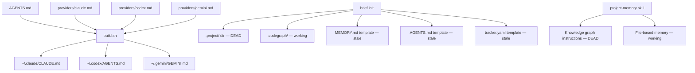

# Discovery: Templates & Agent Config (Epic 3)

**Date**: 2026-08-22
**Story**: S-005
**Epic**: TODO-010, Epic 3

## Problem Space

Templates and skills reference a knowledge graph system (`.project/knowledge.db`, `knowledge_search`
MCP tools) that was never operational and has been superseded by `brief`. Agents following these
instructions waste tokens on tools that don't exist, or create dead `.project/` directories.

## Current Reality

### Pain Points

| Location | Issue |
|----------|-------|
| `templates/project-structure/MEMORY.md` | Says "knowledge graph is primary read path" — it isn't |
| `templates/project-structure/AGENTS.md` | References `.project/knowledge.db` and knowledge-graph CLI |
| `templates/project-structure/tracker.yaml` | Comments reference `knowledge-graph create/update/generate` |
| `custom-skills/project-memory/SKILL.md` | ~50 lines of knowledge-graph MCP instructions that never fire |
| `brief/lib/init.mjs` | Creates `.project/` dir with gitignore for nonexistent knowledge.db |
| `providers/claude.md` | Tells Claude to use `knowledge_context`, `knowledge_search` MCP tools |
| `AGENTS.md` (global) | Memory Checkpoints mentions knowledge graph |

### What Already Works

- `build.sh` generates per-provider configs from shared `AGENTS.md` + appendixes (Epic 3 items 3.2, 3.3 — already solved)
- codegraph (`.codegraph/`) is working and separate from knowledge.db — stays untouched
- `brief` CLI is fully operational (stories S-002, S-003, S-004 shipped)
- Provider appendix pattern is established and clean

## Opportunities

| # | Opportunity | Score |
|---|-------------|-------|
| O1 | Purge all knowledge graph references | H |
| O2 | Make `brief` the documented primary interface in templates | H |
| O3 | Remove `.project/` from `brief init`, add `.claude/CLAUDE.md` scaffold | M |

## Assumptions Validated

| # | Assumption | Status |
|---|-----------|--------|
| A1 | No project uses `.project/knowledge.db` | Confirmed — S-003 retro: "binary not found", serve.mjs was dead code |
| A2 | Provider appendix pattern (3.2/3.3) already working | Confirmed — `build.sh` does this |
| A3 | `brief` is the replacement | Confirmed — 3 stories shipped it |

## Scope Decisions

- **IN**: items 3.1 (MEMORY template) + 3.4 (remove knowledge graph) combined as one cleanup
- **OUT**: items 3.2 (AGENTS.md single file) + 3.3 (provider appendix) — already done by `build.sh`
- **ADDED**: scaffold `.claude/CLAUDE.md` with `@AGENTS.md` pointer in `brief init`

## Open Questions (Resolved)

1. **Should `brief init` create `.claude/CLAUDE.md`?** → YES. Same pattern as AGENTS.md: skip if exists, create if not.
2. **Should project-memory skill use brief or files?** → BOTH. `brief search` as primary, file read as fallback. Don't restrict.

## Recommended Path

Single story: "Remove knowledge graph, make brief canonical in templates and skills."
Effort: Small (S). All mechanical replacements with clear before/after.
