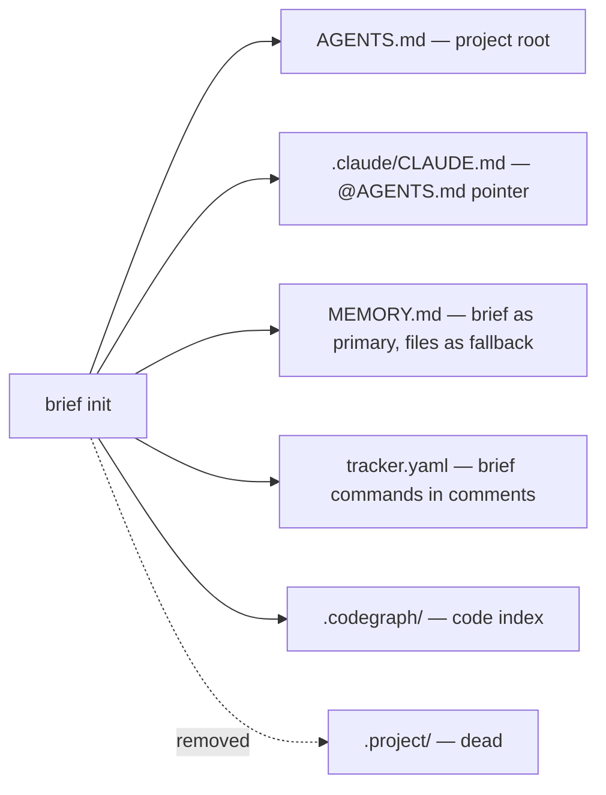
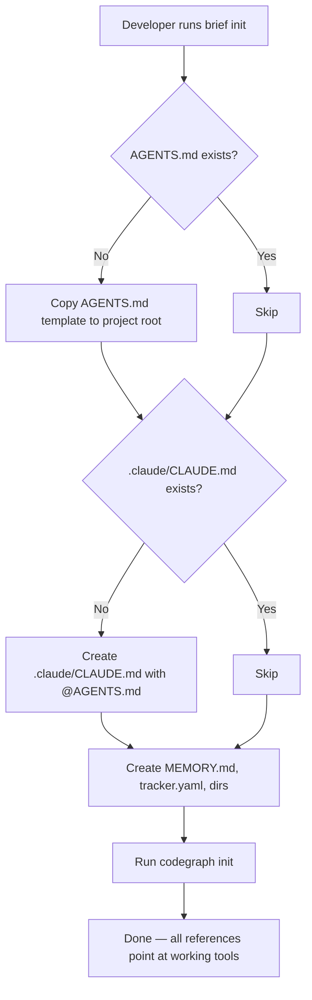

# PRD: Templates & Agent Config — Remove Knowledge Graph, Make Brief Canonical

**Author**: claude + db
**Date**: 2026-08-22
**Status**: 🔒 Approved
**Discovery**: [discovery.md](./discovery.md)

## Problem

Templates, skills, and provider configs still instruct agents to use a knowledge graph system
(`.project/knowledge.db`, `knowledge_context`/`knowledge_search` MCP tools) that was never
operational. Agents waste tokens processing dead instructions, `brief init` scaffolds a dead
`.project/` directory, and new projects get stale setup instructions pointing at tooling that
doesn't exist.

## Users

| Segment | Pain Level | Current Workaround |
|---------|-----------|-------------------|
| AI agents (Claude, Codex, Gemini) following templates | Med | Silently ignore dead MCP tool refs — wastes context tokens |
| Developer (DB) running `brief init` on new projects | Low | Manually ignores `.project/` dir; knows to use `brief` |
| Future users of this setup repo | High | No workaround — they'd follow templates literally and hit walls |

## Goals & Success Metrics

| Goal | Metric | Target | Measurement Method |
|------|--------|--------|-------------------|
| Zero knowledge-graph references in active files | `grep -r "knowledge" templates/ custom-skills/ providers/ AGENTS.md` hits | 0 | grep count |
| `brief init` scaffolds working project | Files created by init all reference working tools | 100% | Manual test on fresh dir |
| Reduced token waste in provider configs | Lines of dead instructions removed | > 50 lines | diff --stat |

## What We Are Building

A cleanup pass that replaces all knowledge graph references with `brief` commands and removes
dead `.project/` scaffolding. No new features — just making the existing templates and skills
tell the truth about how things work today.

### Requirements

| # | Requirement | Priority | Notes |
|---|------------|----------|-------|
| R1 | Remove all `knowledge_graph`, `knowledge_search`, `knowledge_context`, `knowledge_status`, `.project/knowledge.db` references from templates | Must-have | 3 template files |
| R2 | Update `MEMORY.md` template: brief as primary read, file read as fallback | Must-have | |
| R3 | Update `AGENTS.md` template: remove `.project/` from structure, remove knowledge refs | Must-have | |
| R4 | Update `tracker.yaml` template: replace `knowledge-graph` CLI with `brief` commands | Must-have | |
| R5 | Update `brief init`: remove `.project/` creation, add `.claude/CLAUDE.md` scaffold | Must-have | Skip if file exists |
| R6 | Update `project-memory` skill: brief primary + file fallback, remove knowledge graph sections | Must-have | Keep both paths |
| R7 | Update `providers/claude.md`: remove knowledge graph reading instructions | Must-have | |
| R8 | Update global `AGENTS.md`: remove knowledge graph from Memory Checkpoints | Must-have | |
| R9 | `brief init` creates `.claude/CLAUDE.md` with `@AGENTS.md` — skip if exists | Should-have | Completes provider pattern |

### User Flow

## What We Are NOT Building

- **NOT**: A new memory system — brief + files already work, we're just documenting them correctly
- **NOT**: Changes to `build.sh` or provider generation — that system is already correct
- **NOT**: Migration script for existing projects — they already use brief; templates only affect new inits
- **NOT**: Changes to codegraph integration — `.codegraph/` stays exactly as-is
- **NOT**: Any new brief CLI commands — just template/doc updates

## Triggers & Edge Cases

| Trigger / Edge Case | Expected Behavior |
|--------------------|-------------------|
| `brief init` on project with existing `.claude/CLAUDE.md` | Skip file creation, report "skipped" |
| `brief init` on project with existing `.project/` dir | Leave it alone (don't delete), just don't create new ones |
| Agent reads updated `project-memory` skill without brief installed | Falls back to "read files directly" path |

## Dependencies

- None — all changes are internal to this repo

## Risks

| Risk | Likelihood | Impact | Mitigation |
|------|-----------|--------|------------|
| Removing knowledge graph refs from global AGENTS.md affects other projects | L | L | Those projects never had a working knowledge.db either |
| `project-memory` skill used by other agents mid-session | L | L | Both paths (brief + files) remain valid |

## Open Questions

- [x] Should `.claude/CLAUDE.md` content be just `@AGENTS.md` or include anything else? → Just the pointer + a comment explaining it

## Timeline

| Milestone | Target Date | Notes |
|-----------|------------|-------|
| PRD Approved | 2026-08-22 | This session |
| Implementation Start | 2026-08-22 | Small scope, no TRD needed |
| Complete | 2026-08-22 | All mechanical replacements |
